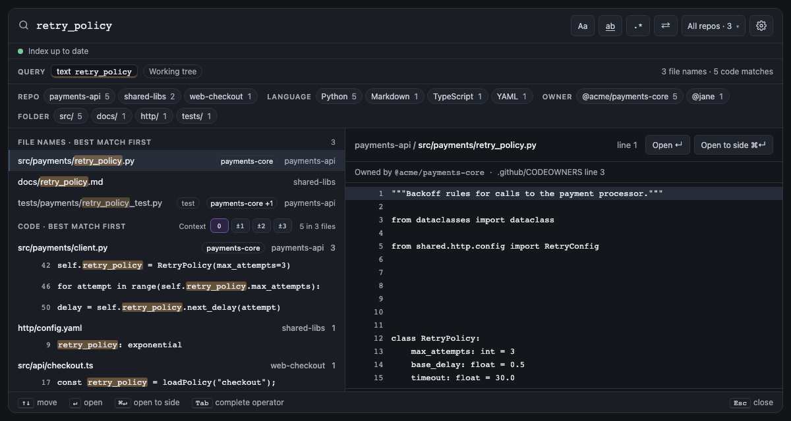

# Spelunk

**One search box for file names, code and Git history, across every repo in your VS Code workspace.**

```text
author:jane f:.*test\.py$ (timeout OR retry) -f:vendor/ since:6m
```

That query finds Jane's commits from the last six months that changed a Python test outside `vendor/` and added or
removed `timeout` or `retry`. Drop `author:` and the same box searches current files instead.



> **Status: released on GitHub, not yet on the Marketplace.** Download the `.vsix` for your platform from the
> [latest release](https://github.com/cruisinme30/spelunk/releases/latest) and run **Extensions: Install from VSIX…**
> in VS Code.

## What it does

- **One query language.** Combine words, `"phrases"`, `/regex/`, `AND`, `OR`, `( )` and `-exclusions` (or `NOT`) with
  operators: `file:` / `f:`, `author:` / `a:`, `symbol:` / `sym:`, `language:` / `lang:`, `message:` / `msg:`,
  `repo:`, `type:`, `kind:`, `ref:`, `is:`, `since:`, `until:`, `case:`, `word:`, `count:`, `order:`, `content:`,
  `owner:`, `struct:`, `excludes:` and `at:`. `is:open`, `is:changed`, `is:test`, `is:generated`
  and `is:vendored` keep the files open in the editor, the uncommitted ones, the tests, the ones a tool wrote or the
  ones copied in, so
  `-is:generated -is:vendored` keeps a replace to code you wrote, `word:yes` matches whole words only, `case:smart`
  matches case only when the query has a capital letter, `kind:class` keeps one kind of definition, `ref:RetryPolicy`
  finds a name's uses without its definitions, `owner:payments-core` keeps the files a team owns in CODEOWNERS,
  `content:retry` matches text inside files but never file names, and `since:` and `until:` take dates too:
  `since:2026-09 until:2026-09` is September. A `/regex/` with `\n` in it matches across lines of current files, and
  `struct:"backoff(:[call], tries=:[n])"` finds code by its shape, its holes taking whole arguments over lines.
- **Exact words, and file names the way Quick Open finds them when you ask.** A word matches its exact text;
  `match:fuzzy usrsvc` also finds file names that have its letters in order, like `UserService.ts`, and a note offers
  them when exact matching left them out. Code lines always match exactly.
- **Best match first.** Files that define what you searched for, are open in the editor, or are named after it come
  first; tests, vendored and generated files come last. `order:file` sorts by path instead, and `order:recent` by
  when files last changed; the order name above the results picks one too.
- **Facets** count the results by repo, language, CODEOWNERS owner and top folder (repo, author and month for
  commits). Click one to
  keep only it, Alt-click to leave it out.
- **Files or commits from the same box.** A query searches current files, unless it has `author:`, `message:` or
  `type:commit`; then each result is a commit, and words match the lines it added or removed or its message.
  `type:added` and `type:removed` match only the lines commits added, or removed: who introduced a call, and when it
  went away. `at:v1.0.0` searches the files as they were at a tag, branch, commit or time instead of today's.
- **Results as you type,** from local indexes that keep up with saves within a second and new commits within seconds.
- **Helpful when you're wrong:** errors with one-key fixes, warnings for likely slips such as `daemon|search`,
  completions for operators and their values, and notes like "3 commits hidden by `-file:vendor/`".
- **Watch a query.** The bell on a pinned commit query, such as `msg:revert f:payments/`, tells you when new
  commits by others match it, and tags them New when you run it.
- **Replace in current files.** ⇄ shows every code match struck out and replaced, then **Replace all** changes
  them in one edit that ⌘Z undoes, skipping any file edited since it was indexed.
- **Keyboard first:** ⌘P or ⇧⌘F to open, ↵ to open at the match, ⌘↵ to open to the side, F4 to step through results.
- Works the same in desktop VS Code and code-server. Nothing leaves your machine.

## Documentation

The [wiki](https://github.com/cruisinme30/spelunk/wiki) has the user guide:
[Getting Started](https://github.com/cruisinme30/spelunk/wiki/Getting-Started),
[Recipes](https://github.com/cruisinme30/spelunk/wiki/Recipes),
[Query Language](https://github.com/cruisinme30/spelunk/wiki/Query-Language) (every operator, each linked to its card),
[Using the Panel](https://github.com/cruisinme30/spelunk/wiki/Using-the-Panel),
[Troubleshooting](https://github.com/cruisinme30/spelunk/wiki/Troubleshooting) and
[Settings and Commands](https://github.com/cruisinme30/spelunk/wiki/Settings-and-Commands). It also explains
how the pieces fit together, with diagrams and every design mock.

## Repository layout

| Path | What lives there |
| --- | --- |
| [`daemon/`](daemon/) | Go search daemon: parser, planner, indexes, engines |
| [`extension/`](extension/) | VS Code extension host (TypeScript) |
| [`webview/`](webview/) | The search panel (TypeScript, no framework) |
| [`protocol/`](protocol/) | JSON Schema for every cross-process message, plus the type generator |
| [`docs/`](docs/) | User docs, decision records, and planning docs |
| [`scripts/`](scripts/) | `test-all.sh`, the spec-coverage check and the panel screenshot tool |
| [`testdata/`](testdata/) | A fixture workspace whose files match the design mockups |

## Development

```sh
npm install && npx playwright install chromium
npm test        # every test layer, including the Go daemon
```

Then open the repo in VS Code and press F5 to run the extension on the sample repos, or install it in your own VS Code:

```sh
npm run package && code --install-extension out/spelunk-*.vsix
```

See [CONTRIBUTING.md](CONTRIBUTING.md) for conventions, and [docs/](docs/README.md) for everything else.

## License

[MIT](LICENSE)
