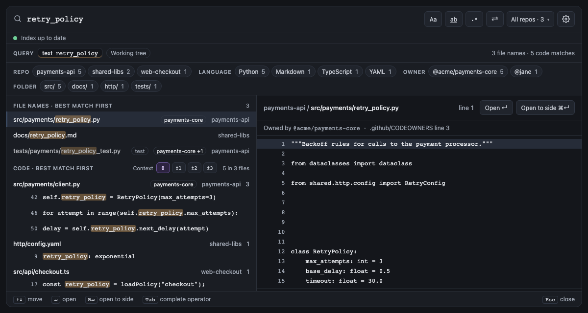

# Spelunk

**Search your code and Git history from one box in VS Code.**

Find a file, jump to a definition, or discover who changed a line—across every repository in your workspace.
Indexing and search run on your machine.

[Get started](#get-started) · [Search examples](#try-a-search) · [Documentation](docs/README.md) ·
[Contribute](CONTRIBUTING.md)



## Get started

You need **VS Code** and a folder to search. Use a Git repository to search commit history too.
The extension includes its search engine; you don't need Go or Node.js to use it.

1. Download the `.vsix` for your system from the [latest release](https://github.com/cruisinme30/spelunk/releases/latest).
   Choose macOS (`darwin`), Linux or Windows (`win32`), and ARM64 or x64. Apple silicon Macs use `darwin-arm64`.
2. In VS Code, open the Command Palette and run **Extensions: Install from VSIX…**. Select the downloaded file.
3. Open your project folder and run **Spelunk: Open** from the Command Palette. Follow the welcome page to pick
   a shortcut and indexing options, then type a word from your code.

You can search while indexing runs; results become complete when it finishes.
Spelunk is distributed through GitHub releases and isn't on the Marketplace yet.

## Try a search

Replace these names with ones from your project. Start with plain text; add a filter when you need one.

| I want to… | Type |
| --- | --- |
| Find a name in files or code | `retry` |
| Search only Python files | `lang:python retry` |
| Find a definition | `symbol:RetryPolicy` |
| Find commits mentioning a fix | `message:"fix flaky"` |
| See who introduced a call | `type:added retry` |

Click a result to preview it. Press **Enter** to open it, or **F4** to step through results.

[More examples](docs/wiki/Recipes.md) · [All search operators](docs/wiki/Query-Language.md)

## A few things you can do

- **Explore a codebase:** search across repositories, filter by language or folder, and jump to definitions.
- **Understand a change:** search commits, added or removed lines, and files at a past revision.
- **Work with results:** preview replacements, pin searches, and copy links to matching code.
- **Search from other tools:** use the same index from the [terminal or an MCP client](docs/wiki/Agents-and-the-Terminal.md).

**Privacy:** indexing and search are local. Optional **Ask** query generation sends your question and, if enabled,
repository and CODEOWNERS names to Anthropic. It does not send source code.

## Build or contribute

For development, install **Node.js 22+**, **Go 1.25+**, **Git**, and **golangci-lint**.
From a checkout:

```sh
npm install
npx playwright install chromium
npm test
```

Open the checkout in VS Code and press **F5** to try the extension in a development window.
See [Contributing](CONTRIBUTING.md) for the full setup and checks, or
[Architecture Overview](docs/wiki/Architecture-Overview.md) for where the code lives.

## Help and license

[Getting Started](docs/wiki/Getting-Started.md) · [Troubleshooting](docs/wiki/Troubleshooting.md) ·
[Report an issue](https://github.com/cruisinme30/spelunk/issues) · [MIT license](LICENSE)
