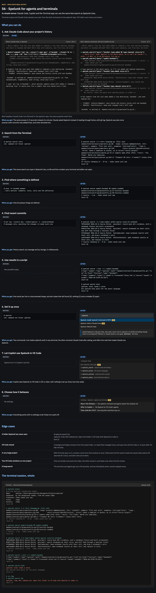
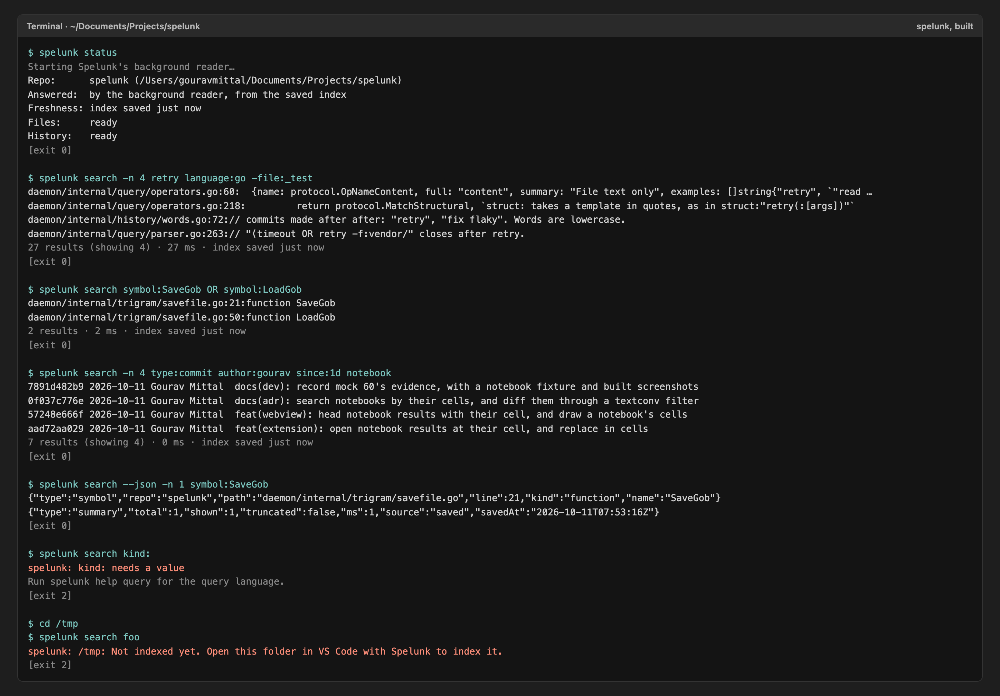
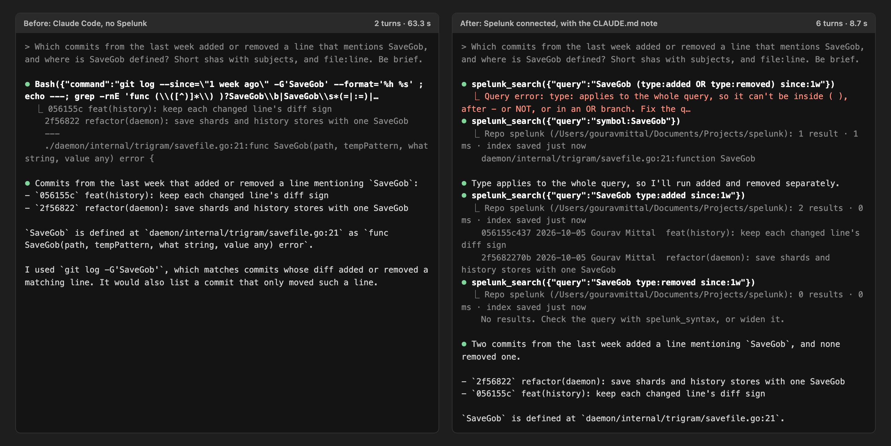

# Agents and the Terminal

<!-- Linked screenshots and expandable previews require these HTML elements. -->
<!-- markdownlint-configure-file {"MD033": {"allowed_elements": ["a", "details", "img", "summary"]}} -->

Claude Code, Copilot and the Terminal app can use the same search as Spelunk's box: the same query language, the same
index, the same history. Search and MCP only read. The explicit `spelunk index` command can build or refresh the
same index without opening VS Code, under the same exclusive writer lock.

## Setting it up

| Run | What happens |
| --- | --- |
| **Spelunk: Install 'spelunk' Command in PATH** | Copies the `spelunk` command to `~/.local/bin` (Windows: `%LOCALAPPDATA%\Programs\Spelunk`), and keeps it current after Spelunk updates. If that folder isn't on your `PATH`, the message says to add it |
| **Spelunk: Add to Claude Code** | Asks first, installs the command, runs Claude Code's own `claude mcp add --scope user spelunk -- ~/.local/bin/spelunk mcp`, then offers to add a short note to the folder's `CLAUDE.md` |
| Nothing, for Copilot | VS Code 1.101 or later lists Spelunk's tools for Copilot and other agents in VS Code by itself (`spelunk.agent.offerToCopilot`) |

For another MCP client, run `spelunk mcp config --in /path/to/repo` and copy its `mcpServers` entry into the client's
configuration. The command emits an absolute executable path and separate arguments, so paths with spaces need
no extra shell quoting. Clients with another configuration format can reuse the same `command` and `args`.
Without `--in`, the server uses the client's working directory. `spelunk mcp --help` and configuration generation
work without an index; run `spelunk index --in /path/to/repo` before searching a new repository.

Say yes to the `CLAUDE.md` note. Without it, agents reach for grep and `git log` even when Spelunk is connected: in our
tests Claude chose Spelunk on its own in none of three tries, and used it at once when the note was there.

## Searching from the Terminal

```text
$ spelunk search 'symbol:SaveGob OR symbol:LoadGob'
daemon/internal/trigram/savefile.go:21:function SaveGob
daemon/internal/trigram/savefile.go:50:function LoadGob
2 results · 2 ms · index saved just now
```

| Command | Does |
| --- | --- |
| `spelunk search [options] QUERY` | Search the repo that holds the current folder. Lines read `path:line:text`, paths relative to where you are, as ripgrep prints them; commits read `sha date author subject`. A summary goes to standard error |
| `spelunk index [--in DIR] [--rebuild]` | Build an initial index or refresh it with saved settings; `--rebuild` rereads configured history. Waits for successful saves, rejects a competing writer, and exits 2 on an error |
| `spelunk status` | Which repo answers here, whether VS Code answers live or the saved index does, and how fresh it is |
| `spelunk help query` | The query language, with examples, as the parser knows it |
| `spelunk mcp [--in DIR]` | Serve AI agents over standard input and output, optionally choosing their default search folder |
| `spelunk mcp config [--in DIR]` | Print client JSON configuration without connecting to a daemon or requiring an index |
| `spelunk mcp --help` | Show setup instructions and exit |
| `spelunk mcp add claude` | Run Claude Code's `claude mcp add` for you |

| Option | Does |
| --- | --- |
| `-n N`, `--count N` | Show up to N results (default 50) |
| `--json` | One JSON object per result (`type`, `repo`, `path`, `line`, `column`, `text`; `kind` and `name` for a definition; `within` (the `kind`, `name` and first `line` of the definition it is in) for a line found inside the definitions `kind:` or `symbol:` asked for; `sha`, `date`, `author` and `subject` for a commit), then one `summary` object |
| `--vimgrep` | `path:line:column:text`, for editors' quickfix lists |
| `--in DIR` | Search the repo that holds `DIR` instead |
| `--timeout SECS` | Stop after `SECS` seconds and print what was found |
| `--` | Everything after it is the query, even words that start with `-` |

A query word that starts with `-`, like `-test` or `-file:vendor/`, is part of the query, not an option. The command
ends with 0 when something matched, 1 when nothing did and 2 for a mistake in the query, a folder with no index, or any
other error, as `grep` and ripgrep do.

## Asking an agent

Agents get four tools, all of which only read:

| Tool | Gives |
| --- | --- |
| `spelunk_search` | Results for a query, each with a `ref` for `spelunk_preview`, and a line that says how many there were, whether the search stopped at the time limit, and how fresh the index is |
| `spelunk_syntax` | The query language |
| `spelunk_preview` | The code around a result, or a commit's message and files |
| `spelunk_status` | Which repo answers, and how fresh its index is |

A query with a mistake comes back as an error with the parser's message, which agents use to fix the query and try
again. A search from the Terminal or an agent may run for 30 seconds (`spelunk.agent.timeLimitMs`), where the panel's
searches stop after 2, since an agent can't tell an answer that stopped early to try again.

`spelunk_search` shows at most 50 results by default. Its `limit` can request 1 through 50,000; zero uses the default.
That is a hard output ceiling even with `count:all` in the query. A lower query count still applies, and the summary
distinguishes the matched count from the number shown and reports incomplete searches. Tools only read; they never
create an index or apply edits.

An incomplete search says **at least N results** and **search incomplete; there may be more results**. That notice
does not identify a cause: a result ceiling can stop a search too. With no matches before the stop, narrow the query
and retry. A completed search with a smaller output page still reports an exact total, such as
**3 results (showing 1)**.

Each MCP server process allows eight active search, preview or status calls. If all slots are busy, another call
gets a retry error immediately instead of waiting in a queue. `spelunk_syntax` remains available. Separate server
processes have separate limits. A window or reader that accepts a connection but fails to complete its handshake
within two seconds is disconnected; this deadline does not limit the later search to two seconds.

## Where answers come from

| Situation | Who answers |
| --- | --- |
| A VS Code window has the folder open (`spelunk.agent.shareWindow` on) | That window, at once, with what you saved a moment ago |
| No window has it | A background reader loads the saved index the first time (about 30 seconds for a repo the size of Linux), then answers at once. Before each search it re-reads files changed since the index was saved, and every answer says how old the index is. It quits after 10 minutes with no questions |
| The folder has no saved index | Run `spelunk index --in DIR`, or open it in VS Code with Spelunk |
| The saved index is from another version of Spelunk | Run `spelunk index --rebuild --in DIR`, or open it in VS Code to rebuild |

Windows talk to the command through a socket in `~/.spelunk/run`, which only your user account can open, and only to
search, preview and read status: nothing that arrives there can rebuild an index, replace text, change settings or
stop VS Code's search.

Two VS Code windows on the same repo build its index once: the first writes it, and the second uses what the first
saves, and takes over when the first closes ([[Indexing]]).

<!-- screen:agent-access -->
**Screen 56: Agents and the terminal: the `spelunk` command and Claude Code or Copilot search the same index, live from
VS Code or from the saved index** · Screen id `agent-access` · milestone 2.1

<a href="images/mocks/AgentAccess.png">

</a>

<details>
<summary>Built: the command and Claude Code</summary>





</details>

<!-- /screen -->

---

**Next:** [[Settings and Commands]]: every command and setting.
