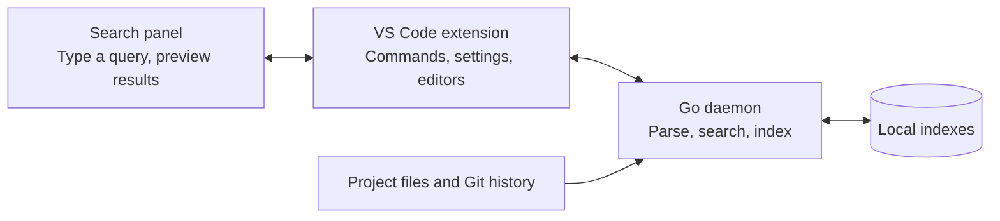

# Architecture Overview

Spelunk has three main parts: a search panel, a VS Code integration, and a local search engine written in Go.
The panel shows results; the extension connects them to your editor; the engine indexes and searches your projects.

The panel and extension communicate through VS Code messages. The extension starts a daemon for its window and
communicates with it over standard input/output. Search doesn't require a remote service.

## Who owns what

| Part | Responsibility | Start here |
| --- | --- | --- |
| Search panel | Query input, suggestions, results and previews | `webview/` · [[Webview]] |
| VS Code extension | Commands, settings, daemon lifecycle, opening files and applying editor edits | `extension/` · [[Extension Host]] |
| Go daemon | Query parsing, indexing, search and preview data | `daemon/` · [[Daemon]] |
| Shared protocol | Message definitions and generated types | `protocol/` · [[Protocol]] |

The daemon builds search indexes and reads them to answer queries. The extension applies replacements through
VS Code after validating the plan and current files. The panel never accesses files or Git directly.

## Follow a search

1. You type `lang:python retry` in the panel.
2. The extension sends the query to the daemon, which checks it and chooses a search engine.
3. The engine reads an index snapshot and sends matching results back in batches.
4. The panel displays them. Selecting a result requests a preview; opening it asks VS Code to show the file.

New searches cancel older ones, and outdated responses are ignored. The indexer publishes complete snapshots,
so searches never read a half-written index. See [[Search Flow]] for the message sequence.

## One query, one engine

| Search | Engine | Example |
| --- | --- | --- |
| Current files, code and definitions | Working-tree engine (`trigram`) | `lang:python retry` |
| Git commits and their changes | History engine (`history`) | `author:jane retry` |
| Added or removed lines | History engine (`history`) | `type:added retry` |

Plain text searches current files. Filters such as `author:`, `message:` and `type:commit` switch to history.
`since:` alone filters current files by when they changed; it doesn't switch engines.

## Next

- [[Search Flow]]: follow the messages for searching, previewing and opening.
- [[Indexing]]: understand index creation and updates.
- [[Protocol]]: look up request and response contracts.
- [[Contributing]]: set up a development environment and run checks.
