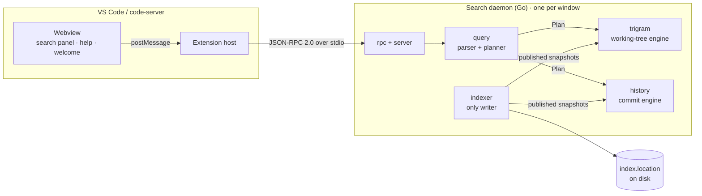

# Architecture Overview

Three processes split the work. Only the daemon touches files, Git or indexes.

## Who owns what

| Part | Owns | Never |
| --- | --- | --- |
| [[Webview]] | Rendering, debouncing, fix-its and completions as text edits | Reads files, calls Git, reaches the daemon, parses queries |
| [[Extension Host]] | Commands, keybindings, settings, spawning the daemon, opening editors | Searches, parses, or keeps results past the current list |
| [[Daemon]]: `rpc`, `server` | Request lifecycle, cancellation, search IDs, batching | Reads or writes an index |
| [[Daemon]]: `query` | Grammar, diagnostics, fix-its, completions, planning | I/O beyond author and repo lookups |
| [[Daemon]]: `trigram`, `history` | Results and previews for files and commits | Writes an index |
| [[Daemon]]: `indexer` | Building, refreshing and publishing both indexes | Answers searches |

## One query, one engine

The planner sends each query to **exactly one** engine:

| Query has… | Engine | Results |
| --- | --- | --- |
| Text, `file:`, `language:`, `symbol:`, `type:file`, `since:`, `until:` | Working tree (`trigram`) | File names, code lines, symbol definitions |
| `author:`, `message:`, `type:commit` | History (`history`) | Commits whose changed lines or message match |
| `type:added`, `type:removed` | History (`history`) | Commits whose added (or removed) lines match |

## Next

- [[Search Flow]]: what happens on each keystroke
- [[Protocol]]: the messages between processes
- [[Indexing]]: how the indexes are built and kept fresh
