# Commits and Time

<!-- Linked screenshots and expandable previews require these HTML elements. -->
<!-- markdownlint-configure-file {"MD033": {"allowed_elements": ["a", "details", "img", "summary"]}} -->

Search Git history instead of today's files, narrow any search to a window of time, or search the code as it was
at a release.

## Files or commits

Every query searches **one** of two things:

| The query has… | It searches | Each result is | Text matches |
| --- | --- | --- | --- |
| No history operator | Current files | A file name, a code line, or a definition | File names and contents |
| `author:`, `message:` or `type:commit` | Git history, newest first | A commit, opened as a diff | The lines each commit added or removed, **or** its message |
| `type:added` or `type:removed` | Git history, newest first | A commit, opened as a diff | Only the lines each commit added (or removed), never its message |

So `author:jane timeout` finds Jane's commits that mention `timeout` in a changed line or in the message, not files
that mention it today. Each commit says where it matched ("in message · 3 hits in diff", "in message only"), and
`message:timeout` searches the message alone. `type:added retry_policy` answers "who introduced this?": only `+`
lines count, each commit says "3 hits in added lines", and its preview marks only those lines. `type:removed` asks
when something went away. A note counts the commits that matched only elsewhere ("1 commit for retry_policy hidden
by `type:added` · Search every changed line", which switches to `type:commit`). Operators
marked "Both" adapt: `file:` keeps commits that changed a matching path, and `since:` keeps commits made in the
window. On current files, `since:` uses each file's last commit, and a file with uncommitted edits counts as
changed now.

A Jupyter notebook's changes are its cells' source: a commit that only re-ran a notebook (new outputs and run
numbers) changed nothing a search sees, and a one-line edit counts as one line, shown in the preview under its cell
(**Cell 2 · Python**), numbered within it.

`symbol:`, `kind:`, `ref:`, `owner:`, `at:`, `is:open` and `is:changed` only work on current files, and `author:` and
`message:` only
on history, so the panel flags `author:jane symbol:Foo` and offers to remove `symbol:Foo`. For the same reason both
sides of an `OR` must search the
same thing: `author:jane OR file:x` is an error.

## Renames and merged branches

History follows a file through its renames. `file:retry_policy.py` finds every commit that changed the file,
including the ones made while it was called `backoff.py` or `policy.py`: each of those says what the file is called
now (**now src/payments/retry_policy.py**), and the commit that renamed it lists it as
**src/payments/policy.py → src/payments/retry_policy.py**, marked **renamed**. A rename is one change: a commit that
only moved a file adds and removes no lines, so `type:added "def next_delay"` finds the commit that wrote the line,
not every commit that moved it, and previewing a pure rename says "Renamed from src/payments/policy.py; no lines
changed." With `file:` the mode chip says **Commit history · follows renames**.

`file:` matches a commit's file by its path then, its old path in the commit that renamed it, or its name now. So an
old name finds the file while it had that name, and the commit that renamed it away, not what came after;
`-file:retry_policy.py` leaves the file out under every one of its names. Git decides what a rename is: a file moved
with at most half its lines changed. A file rewritten beyond that, or copied (the original stays), starts a history of
its own. Git also leaves out renames in a commit that renames more files than its rename limit (1,000 by default):
such a commit shows as deletes and adds.

**Merged branches** are off by default: history follows the line of the branch you have checked out, where a merge
holds everything its branch changed, credited to whoever merged it. With `spelunk.index.mergedBranches` on, history
also reads each commit a merge brought in from another branch, under its own author:

- `author:bob` finds Bob's commits on a branch Jane merged, each marked **merged in cd1cc79 · 2 days ago**.
- A line that only ever existed on the branch, changed again before or during the merge, is found in the commit that
  wrote it.
- `since:`, `until:`, the order of results (newest first) and the month facet go by when a commit landed: the date of
  the merge that brought it in. So `since:1w` still finds work merged this week, even if it was written a month ago,
  and each branch's commits come right after their merge.
- A merge, marked **merge**, holds only what it changed itself: the lines it resolved a conflict with, marked
  **conflict resolved**, without the conflict's two sides. A merge that needed no resolution, like an octopus merge of
  several branches, has no changes of its own, and its preview says so.
- Query watches count each new matching commit a merge brings in.

Reading every merged branch costs time and memory on a busy repo: the Linux kernel's last 2 years hold 5,702 commits
on the branch's own line and 175,670 with every merged branch, read in 2 min 13 s instead of 56 s, using about 3 times
the memory (1.8 GB instead of 535 MB) and a saved index of 530 MB instead of 344 MB. It needs Git 2.36 or later; with an
older Git, history keeps to the branch's own line. Changing the
setting reads each repo's history again.

<!-- screen:history-renames -->
**Screen 59: History through renames: a file's commits under every name it had, renames marked, and the name each file
has now** · Screen id `history-renames` · milestone 2.1

`file:retry_policy.py type:commit` lists all five commits of a file that started as `backoff.py`, was renamed to
`policy.py` with an edit, then moved to `retry_policy.py` unchanged: the two renames say **renamed** and show the old
and new path with only the lines they edited, and the older commits say **now src/payments/retry_policy.py**. Before,
only the last two showed, the move as 39 added lines. `type:added "def next_delay"` finds only the commit that wrote
the line. With `spelunk.index.mergedBranches` on, `author:bob type:commit` lists Bob's two commits from a branch Jane
merged, each **merged in cd1cc79 · 2 days ago**, and the merge itself shows the one line it resolved a conflict with,
**conflict resolved**. `at:v0.1.0 next_delay` says `backoff.py` was **renamed since → retry_policy.py** rather than
deleted.

<a href="images/mocks/HistoryRenamesMerges.png">
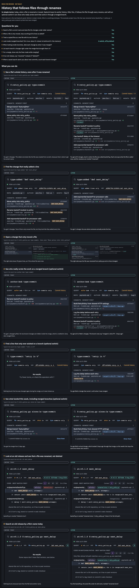
</a>

The built panel

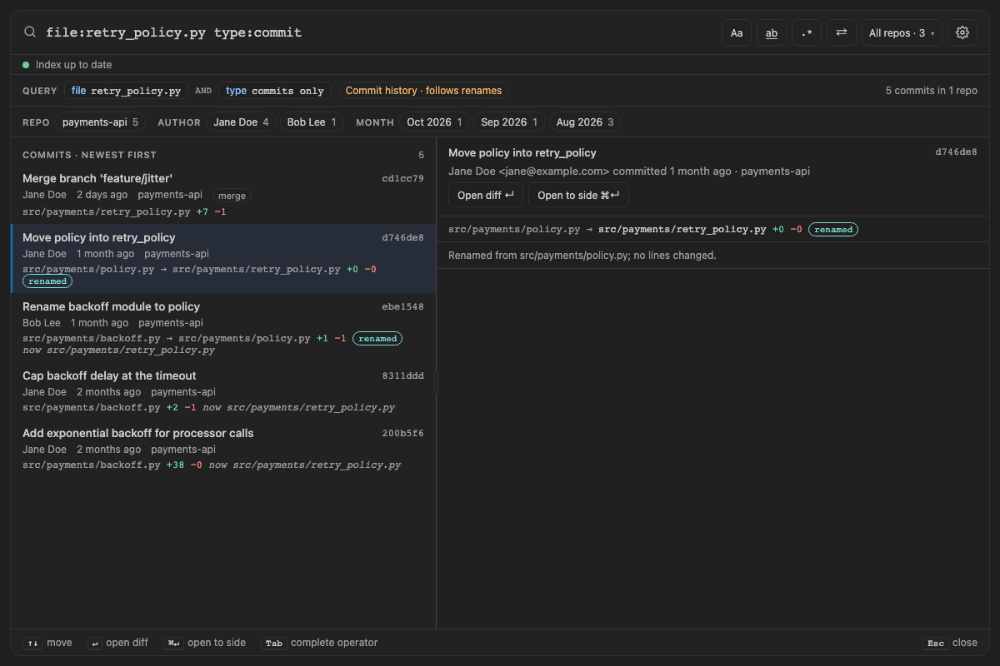

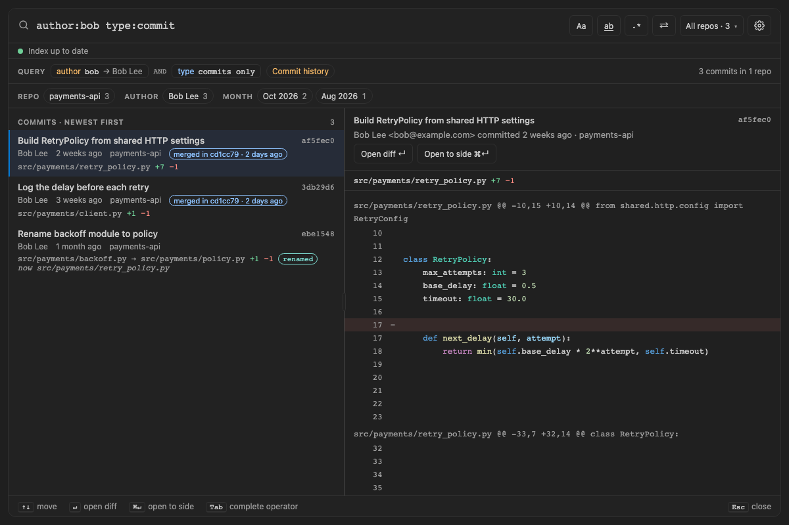

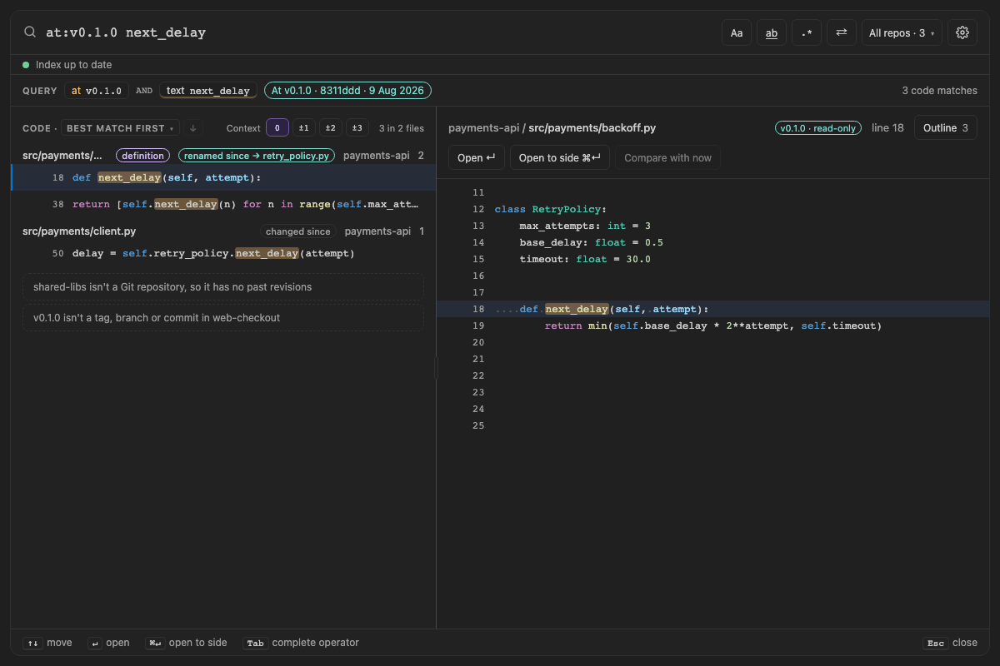

<!-- /screen -->

## `author:`

| Short | Takes | Searches | Example |
| --- | --- | --- | --- |
| `a:` | Part of a name or email (`jane`, `@acme.dev`), or an exact name in quotes (`"Jane Doe"`, not compared with emails), after `.mailmap` | Commits only | `author:jane timeout` |

<!-- screen:author-history -->
**Screen 3: `author:` + `f:` + text → commit diffs** · Screen id `author-history` · milestone M3

<a href="images/mocks/AuthorHistory.png">
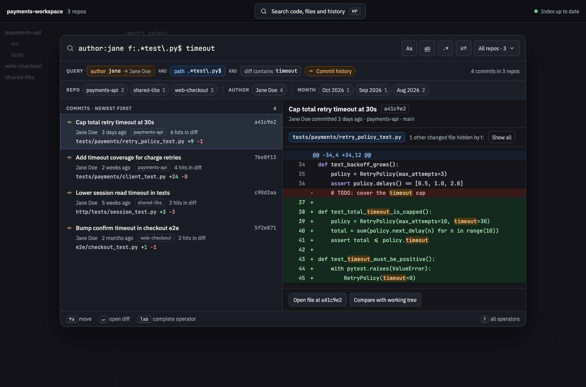
</a>

The built panel

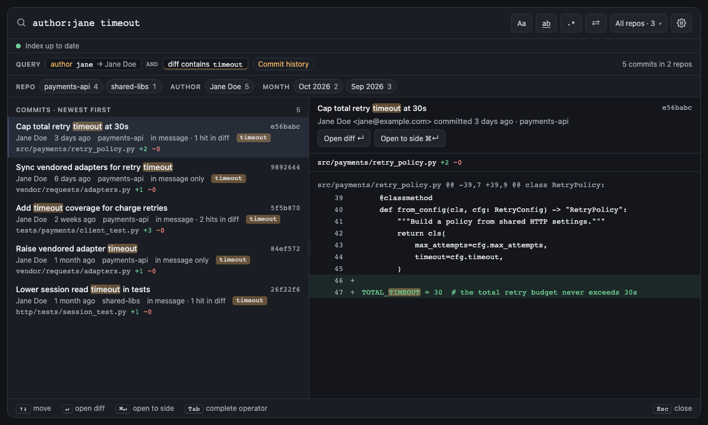

<!-- /screen -->

<!-- screen:test-history -->
**Screen 27: `author:` + `is:test` → the test changes in commits** · Screen id `test-history` · milestone 1.1

In a commit search `is:test` works like `file:`: Jane's commits that touched a test file, with the other files
hidden until **Show all**.

<a href="images/mocks/TestHistory.png">
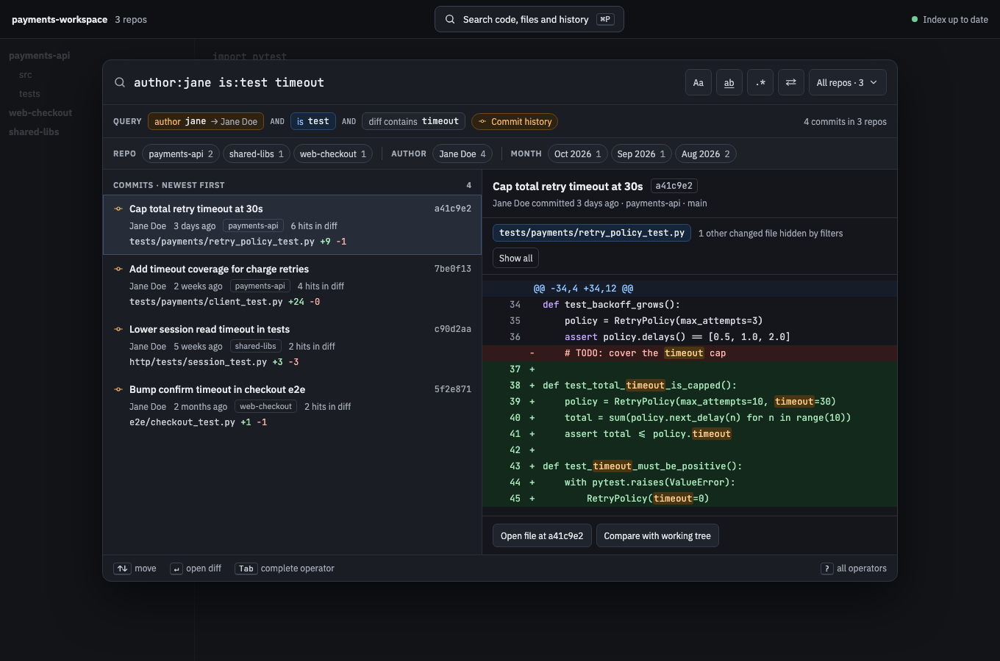
</a>

The built panel

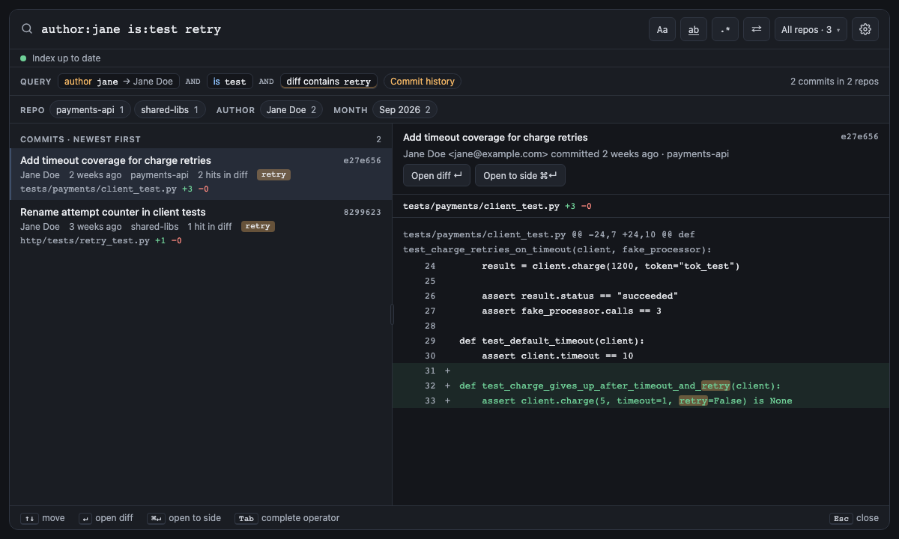

<!-- /screen -->

## `message:`

| Short | Takes | Searches | Example |
| --- | --- | --- | --- |
| `msg:` | Words, a `"phrase"` or a `/regex/` on the commit message | Commits only | `message:"fix flaky"` |

Bare words match commit messages too, so `timeout` alone, in a commit search, finds commits that say it in their
message or in a changed line. `message:` matches the message only.

<!-- screen:words-in-messages -->
**Screen 23: Bare words match commit messages too** · Screen id `words-in-messages` · milestone M3

<a href="images/mocks/MessageWords.png">
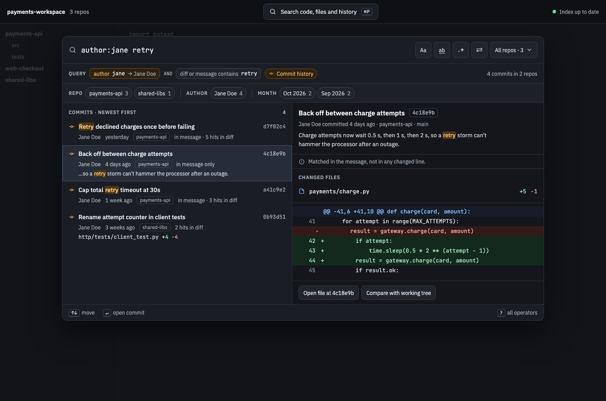
</a>

The built panel

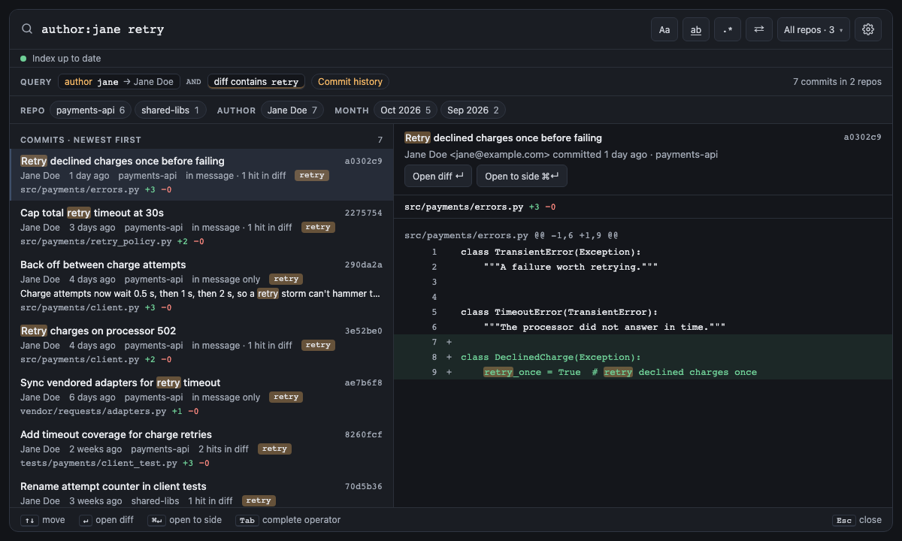

<!-- /screen -->

<!-- screen:message-repo-count -->
**Screen 11: `msg:"phrase"` + `repo:` + `count:`** · Screen id `message-repo-count` · milestone M3

<a href="images/mocks/MessageCount.png">
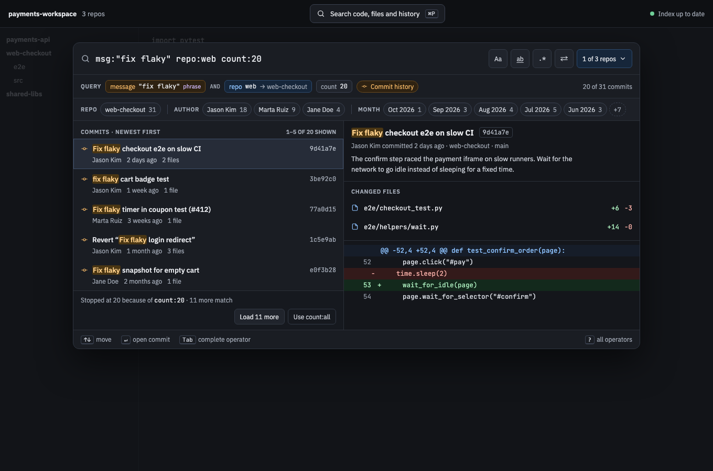
</a>

The built panel

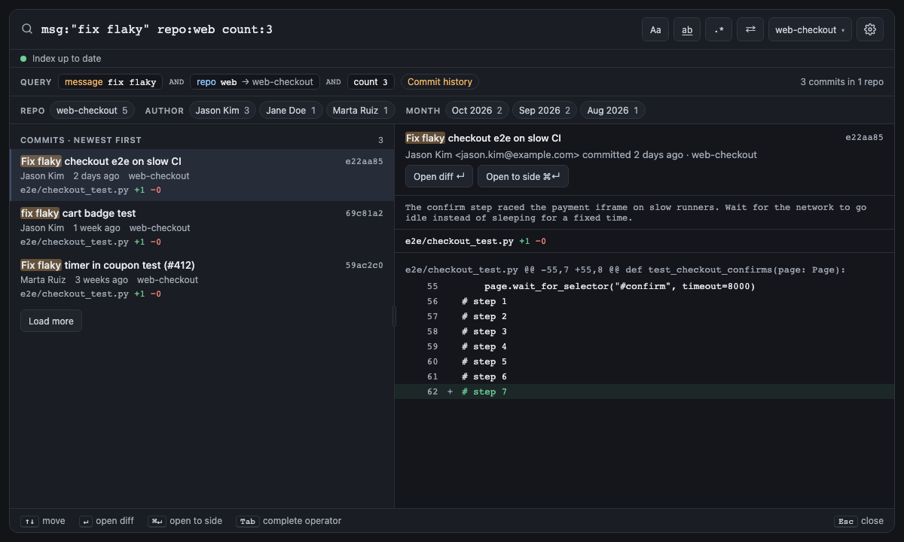

<!-- /screen -->

## `type:`

| Short | Takes | Searches | Example |
| --- | --- | --- | --- |
| none | `file` (names only), `code` (lines only), `commit` (switches to history), or `added` or `removed` (history, only the lines commits added or removed) | Current files and commits | `type:file retry` |

`type:commit` searches commits without naming an author or message. `type:added` and `type:removed` search only the
lines commits added or removed, never their messages: who introduced a line, and when it went away.

<!-- screen:added-removed-lines -->
**Screen 34: `type:added` finds the commits that added a line** · Screen id `added-removed-lines` · milestone 1.1

`type:added retry_policy` lists the commits whose added lines mention `retry_policy`: who introduced it, and where.
Each commit counts its hits "in added lines", and the preview marks the term only on `+` lines, so the `-` line
that `Name max_attempts…` replaced stays unmarked. Messages aren't searched. A note counts the commit that only
removed `retry_policy` lines, with **Search every changed line**, which writes `type:commit`. `type:removed` is the
same for `-` lines: when something went away.

<a href="images/mocks/AddedLines.png">
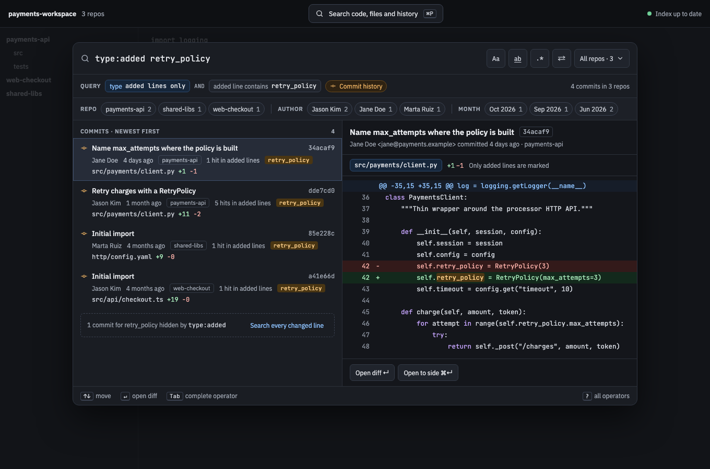
</a>

The built panel

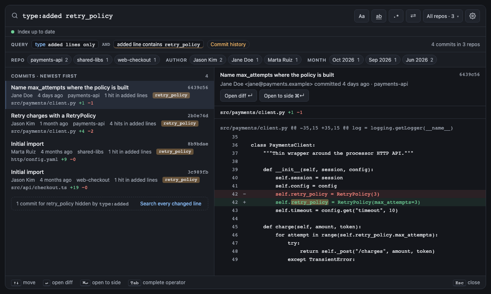

<!-- /screen -->

## `since:`

| Short | Takes | Searches | Example |
| --- | --- | --- | --- |
| none | `today`, `yesterday`, a number + `min`, `h`, `d`, `w`, `m` (months), `y`, or a date: `2026-09-30` (from that day's midnight) or `2026-09` (from the 1st) | Current files and commits | `since:2w timeout` |

<!-- screen:since-on-files -->
**Screen 10: `since:` on current files** · Screen id `since-on-files` · milestone M4

<a href="images/mocks/SinceWorkingTree.png">
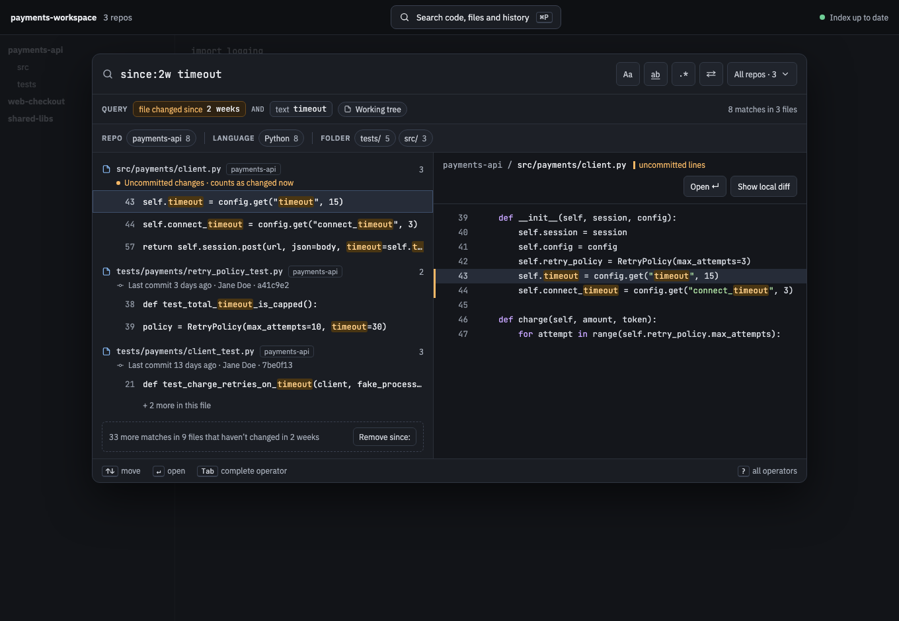
</a>

The built panel

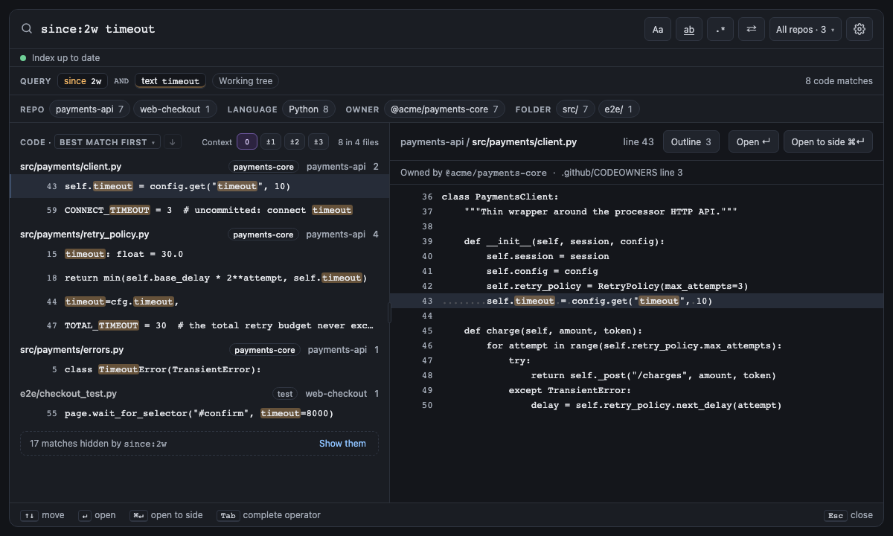

<!-- /screen -->

## `until:`

| Short | Takes | Searches | Example |
| --- | --- | --- | --- |
| none | `since:`'s values; keeps what is before the end of the day or month (`until:2026-09` is before October), or older than the length of time (`until:2w`) | Current files and commits | `since:2026-09 until:2026-09 timeout` |

`until:` is the other end of `since:`: `since:` keeps changes from when its value starts, `until:` keeps changes before
its value ends. A day or a month counts in full, so `until:2026-09-30` and `until:2026-09` both keep everything
before October 1, `until:yesterday` everything before today and `until:today` everything up to now. A length of
time ends where `since:` would start: `until:2w` keeps what is older than two weeks. Together they make a range:
`since:2026-09 until:2026-09` is September 2026. Dates and `today` are in your time zone, and a date that doesn't
exist (`2026-02-30`) is an error that offers the nearest real one. `is:test`, `is:generated` and `is:vendored` keep
commits' changes to those files too.

## `at:`

| Short | Takes | Searches | Example |
| --- | --- | --- | --- |
| none | A tag, branch or commit (`v1.0.0`, `main`, `3f9c2e1`, `HEAD~10`), or a time as `until:` takes it (`6m`, `2026-01-31`): the files as they were then (see [Past revisions](Commits-and-Time#at)) | Current files only | `at:v1.0.0 retry_after` |

`at:` searches the files as they were at a revision instead of today's: `at:v1.0.0 retry_after` finds `retry_after`
in the code you released as v1.0.0, including in files deleted or renamed since. It takes a tag, a branch or a commit,
in full or
in part (`3f9c2e1`), or one of those with `~` or `^` after it (`HEAD~10`), or a time as `until:` takes it: `at:6m` is
the newest commit made six months ago, `at:2026-01-31` the newest by the end of that day, on the first-parent line of
the branch you have checked out. A value that reads as a time is one, unless it's quoted: `at:"6m"` is a branch or tag
called `6m`. Each repo reads its own commit of that name; one
without it, or outside Git, is left out, and a note under the results says why ("v1.0.0 isn't a tag, branch or commit
in web-checkout").

Nothing is indexed ahead of time: the first search of a revision reads its files from Git, every open repo at once (the
ones the index would hold: `index.exclude` and `index.maxFileSizeKB` apply), and keeps them in memory for the next
search and for previewing
and opening its results, the two newest revisions at a time. Everything that searches current files works there: words,
regexes, `file:`, `symbol:`, `kind:`,
`ref:`, `struct:`, `is:test`, best-match order, facets and context lines. Each result whose file was deleted since,
changed since, or renamed since says so (**renamed since → retry_policy.py**, its full path in the tooltip), and
`file:` finds a renamed file by its name then or its name now: `at:v0.1.0 file:retry_policy.py` finds `backoff.py`. The
mode chip names the commit read and its date ("At v1.0.0 · 3f9c2e1 · 14 Mar 2026").
A result opens read-only as the file was, and **Compare with now** in its preview shows what changed since as a
diff.

`is:open`, `is:changed`, `since:`, `until:` and `owner:` describe files as they are now, or when they last changed,
which a past revision's files can't answer, so they're errors beside `at:`, each with a fix that removes it. `at:`
searches files, not commits, so a commit search can't have it, and Replace changes current files only.

<!-- screen:past-revision -->
**Screen 41: `at:` searches the files as they were at a tag, branch, commit or time** · Screen id `past-revision` ·
milestone 1.2

`at:v1.0.0 retry_after` searches each repo's files as they were at its v1.0.0 tag. In payments-api, `backoff.py`
defined `parse_retry_after` then and was deleted since, so its result says **deleted since** in red; `client.py`
called it then and reads differently now, so it says **changed since**. The mode chip after the query's chips names
the commit read and its date, **At v1.0.0 · 3f9c2e1 · 14 Mar 2026**, and the notes under the results say why the other
repos weren't searched: web-checkout has no v1.0.0, and shared-libs isn't a Git repository. The preview reads the file
from the commit and says **v1.0.0 · read-only**; **Open** shows it as it was, read-only, and **Compare with now**
opens a diff of `client.py` then against `client.py` now. For a file deleted since, or the same now, Compare is off.
Nothing was indexed for this: the first search of v1.0.0 read its files from Git and kept them for the next one.

<a href="images/mocks/PastRevision.png">
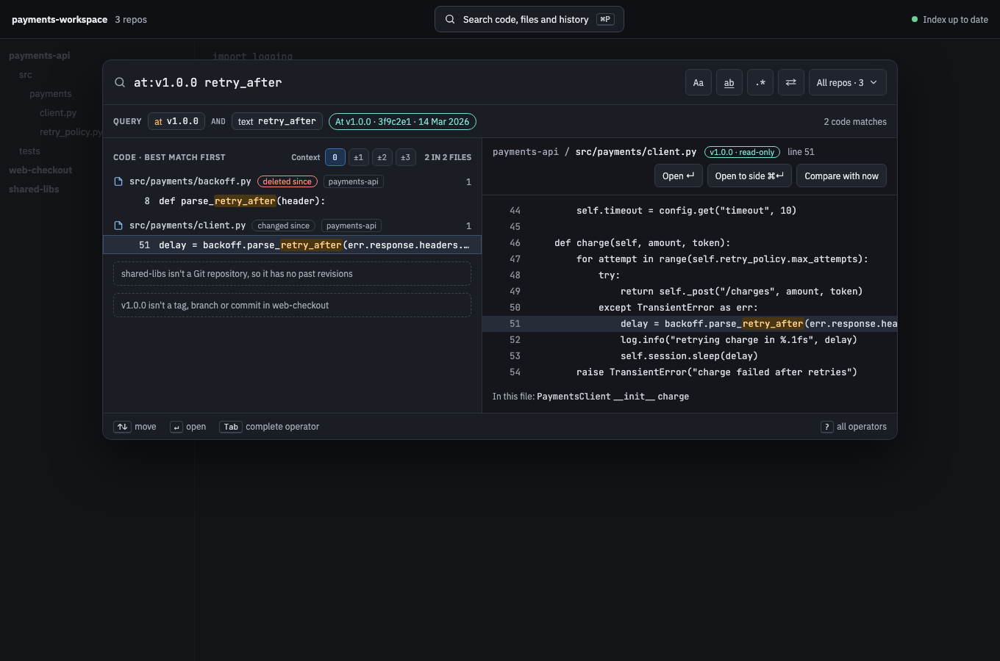
</a>

The built panel

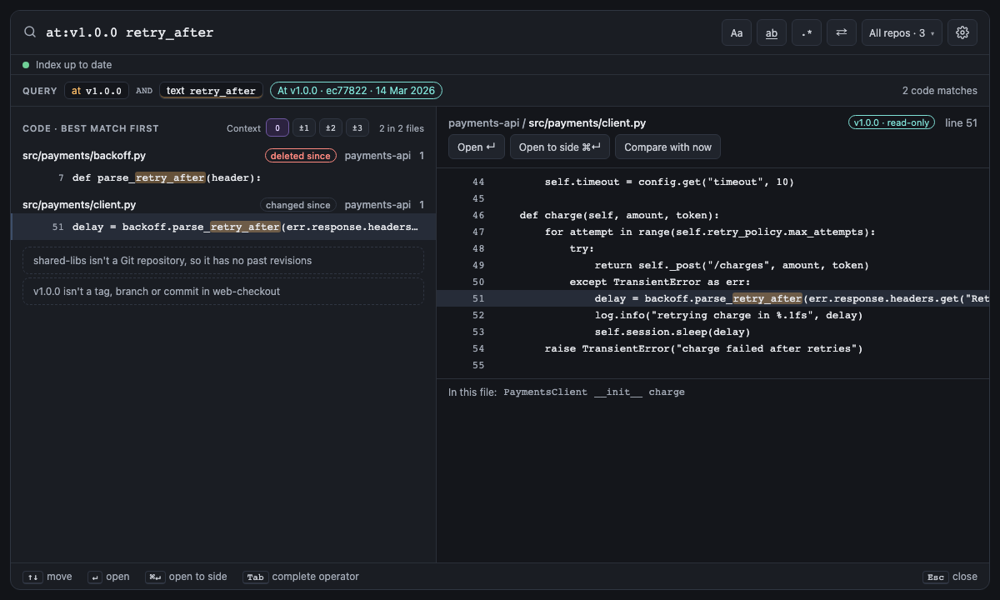

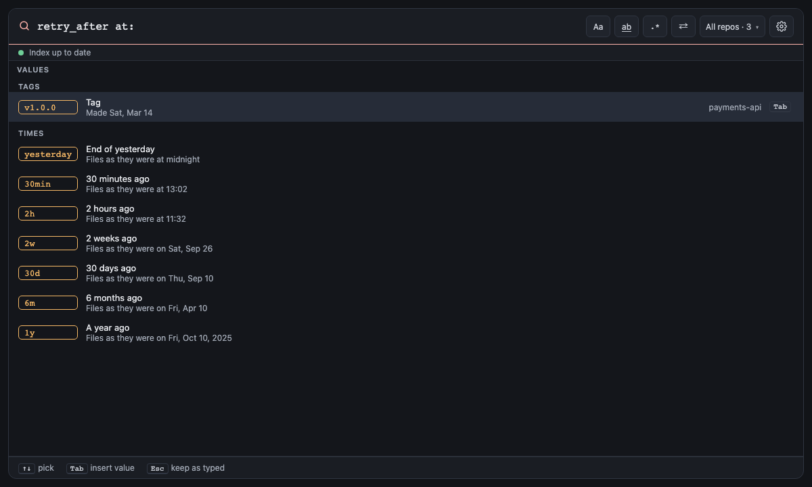

<!-- /screen -->

---

**Next:** [[Results and ranking|Results and Ranking]]: how many results, in what order, and how to narrow them.
