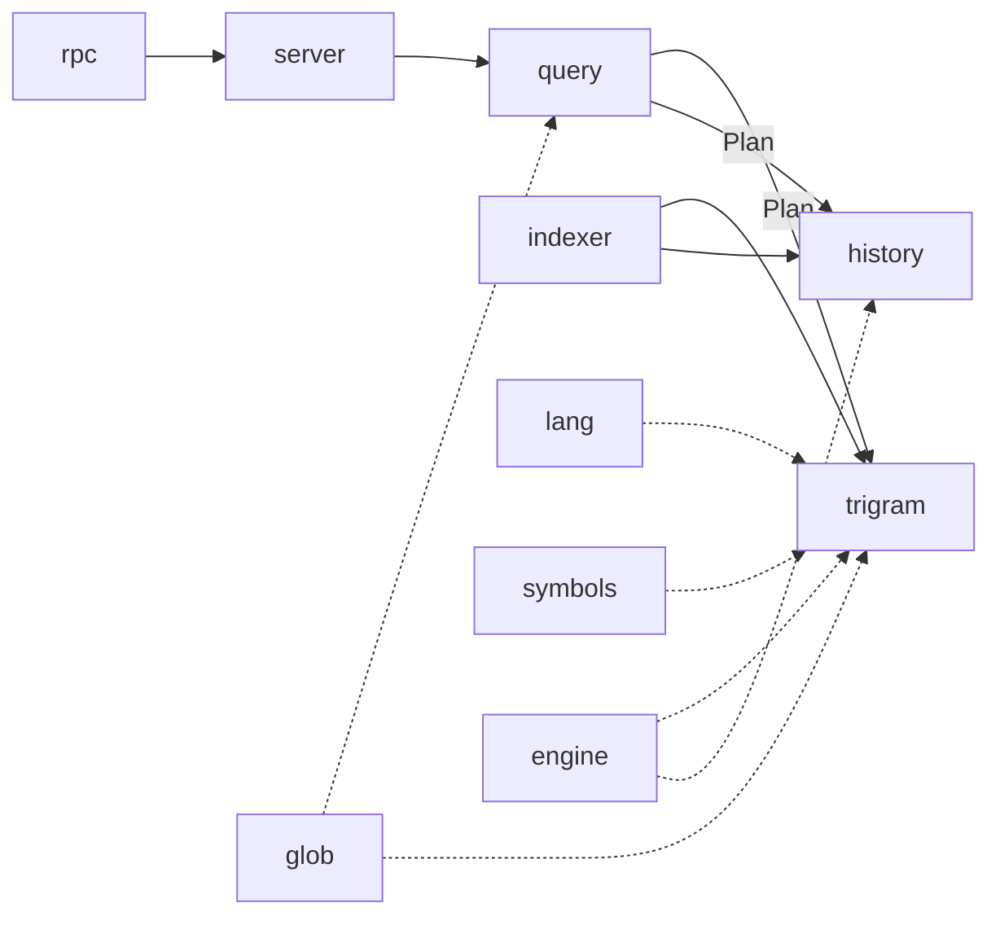

# Daemon

<!-- Repository source filename. -->
<!-- cspell:words filestate -->

The Go binary the extension spawns, one per VS Code window. Lives in
[`daemon/`](https://github.com/cruisinme30/spelunk/blob/main/daemon).

| Package | Owns | Knows nothing about |
| --- | --- | --- |
| [`cmd/spelunk-daemon`](https://github.com/cruisinme30/spelunk/blob/main/daemon/cmd/spelunk-daemon) | The binary's entry point | |
| [`internal/rpc`](https://github.com/cruisinme30/spelunk/blob/main/daemon/internal/rpc) | JSON-RPC framing, concurrency, cancellation | Search |
| [`internal/server`](https://github.com/cruisinme30/spelunk/blob/main/daemon/internal/server) | Maps each method to the parts below; search IDs, batching; runs the watched queries over each update's new commits (`watches.go`); reads `at:`'s revision of each repo into a shard it keeps for the next search (`revisions.go`) | Index contents |
| [`internal/query`](https://github.com/cruisinme30/spelunk/blob/main/daemon/internal/query) | **The only parser.** Diagnostics, fix-its, completions, and the planner that turns a query into a `Plan` | Files and Git |
| [`internal/trigram`](https://github.com/cruisinme30/spelunk/blob/main/daemon/internal/trigram) | Working-tree index and engine: list files, build shards, run a `Plan` (best match first, `rank.go`; file names by their letters in order, `fuzzy.go`; open, changed and test files and CODEOWNERS owners, `filestate.go`; the lines around each code match, `context.go`; a regex with `\n` matched across lines, `span.go`; a `struct:` template matched by each file's language, `structure.go`), preview, and a replace's edits (`replace.go`); why a folder's files aren't indexed, and the Git repo inside a root that holds it, for `folder/explain` (`folders.go`); definitions by a few letters of their names, for `symbols/find` (`definitions.go`) | Commits |
| [`internal/history`](https://github.com/cruisinme30/spelunk/blob/main/daemon/internal/history) | Commit index and engine behind `author:`, `msg:`, `type:commit`, `type:added` and `type:removed` (each changed line keeps its `+` or `-`); last commit per file for `since:` and `until:`. Uses `trigram`'s `TextIndex` and line matcher, so a term matches the same way in both, and its `SaveGob` to save the store; the commits an update brought in, for query watches (`watch.go`); a past commit's files and tags, read from Git for `at:`, and which were renamed since (`revision.go`); renames followed back through history (`store.go`), and with `index.mergedBranches` the commits merges brought in, in the order they landed (`merges.go`) | The working tree's shards |
| [`internal/engine`](https://github.com/cruisinme30/spelunk/blob/main/daemon/internal/engine) | What both engines share: `Stats` with its facets (results counted by repo, language, folder, owner, author or month), the search time budget, counting what `case:yes`, `case:smart` and `word:yes` hid, narrowing a `Plan` to candidate ids | Either engine |
| [`internal/structural`](https://github.com/cruisinme30/spelunk/blob/main/daemon/internal/structural) | `struct:` templates: parsed, read as tokens by each language's strings and comments, and matched with holes that take code whose brackets pair up, within a bounded number of steps | |
| [`internal/codeowners`](https://github.com/cruisinme30/spelunk/blob/main/daemon/internal/codeowners) | A repo's CODEOWNERS file, read and matched by GitHub's rules, for `owner:`, the Owner facet and the preview's "Owned by" line | |
| [`internal/permalink`](https://github.com/cruisinme30/spelunk/blob/main/daemon/internal/permalink) | What a permalink to a result names (`link/resolve`): the remote (tracked, else `origin`, else the only one), the commit the remote has (HEAD, or the newest pushed commit HEAD builds on), the path in the repository (following a rename) and the lines, mapped from the file on disk by `git diff --no-index`. A `Linker` reads each repo and file once for an export's thousands | Building the web address, which the host does |
| [`internal/glob`](https://github.com/cruisinme30/spelunk/blob/main/daemon/internal/glob) | Turning a glob's `*`, `**` and `?` into regex, for `file:`/`repo:` and `index.exclude` | How each caller anchors it |
| [`internal/indexer`](https://github.com/cruisinme30/spelunk/blob/main/daemon/internal/indexer) | Keeps both indexes current and publishes snapshots, announcing each history update's new commits; reads each repo's CODEOWNERS file with its index. **Only writer** to the index directory, and only for the repos whose lock it holds (`lock.go`); it follows another window's saves for the rest (`follow.go`), and the command's reader re-reads files changed since a save (`sweep.go`) | Answering searches |
| [`internal/cli`](https://github.com/cruisinme30/spelunk/blob/main/daemon/internal/cli) | The `spelunk` command: `search`, `status`, `help`, the background reader it starts, and the MCP server for agents (`mcp.go`, on the official MCP Go SDK). It asks a window's socket, or the reader, and never writes an index | Indexing |
| [`internal/lang`](https://github.com/cruisinme30/spelunk/blob/main/daemon/internal/lang) | A file's language from its name and shebang; `lang:` values; whether a file is a test, generated or vendored (`is:test`, `is:generated`, `is:vendored`, ranking) | |
| [`internal/symbols`](https://github.com/cruisinme30/spelunk/blob/main/daemon/internal/symbols) | Definitions in a file, by a few regexes per language, for `sym:`, `kind:`, leaving definitions out of `ref:`, and the preview outline | |
| [`internal/testutil`](https://github.com/cruisinme30/spelunk/blob/main/daemon/internal/testutil) | Helpers the tests share across packages, such as writing a tree of files; only tests import it | |
| [`internal/protocol`](https://github.com/cruisinme30/spelunk/blob/main/daemon/internal/protocol) | Generated types (see [[Protocol]]) | |

Run its tests alone with `cd daemon && go test ./...`. Trace a session with `SPELUNK_TRACE=<file>`.
