# Definitions and Code Shape

<!-- Linked screenshots and expandable previews require these HTML elements. -->
<!-- markdownlint-configure-file {"MD033": {"allowed_elements": ["a", "details", "img", "summary"]}} -->

Find code by what it is rather than what it says: where a name is defined, what kind of definition it is, where it
is used, and code that has a given shape however it is laid out. These search current files only.

## `symbol:`

| Short | Takes | Searches | Example |
| --- | --- | --- | --- |
| `sym:` | Part of a definition's name, or a `/regex/`; returns definitions only | Current files only | `symbol:RetryPolicy` |

`symbol:` returns definitions only: the function, method, class, interface or type whose name contains the value.
With no match, the panel offers to search the name as text. **Spelunk: Find Definitions**, on the editor's right-click
menu, searches
the name at the cursor exactly, as `sym:/^RetryPolicy$/` (see
[Searching from your code](Using-the-Panel#searching-from-your-code)).

<!-- screen:symbol-definitions -->
**Screen 9: `sym:` definitions** · Screen id `symbol-definitions` · milestone M4

<a href="images/mocks/Symbols.png">
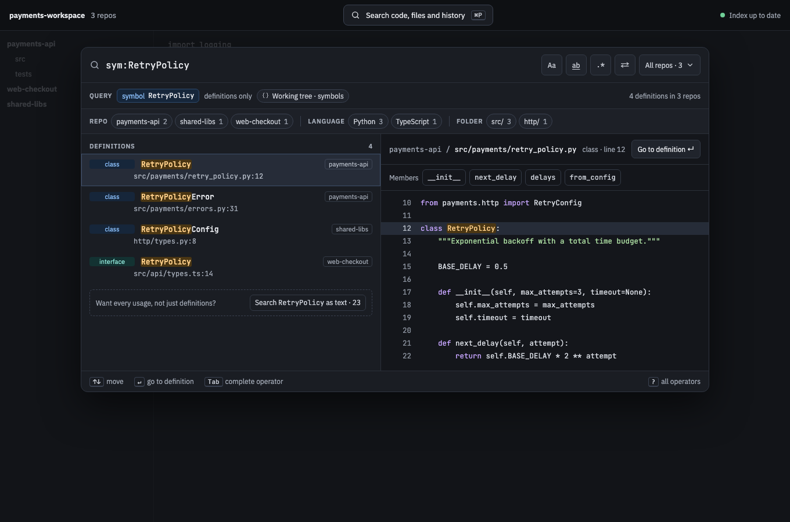
</a>

The built panel

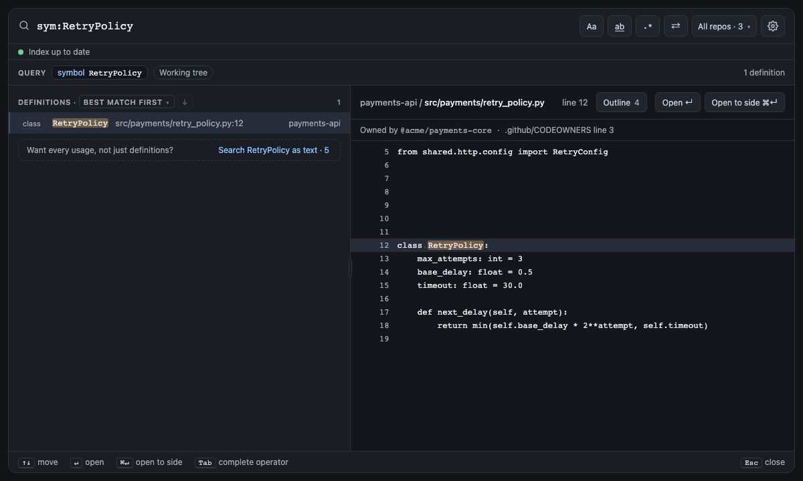

<!-- /screen -->

## `kind:`

| Short | Takes | Searches | Example |
| --- | --- | --- | --- |
| none | `function`, `method`, `class`, `interface`, `type` or `other`; returns definitions of that kind only | Current files only | `kind:class symbol:Retry` |

`symbol:` finds where things are defined; `kind:` keeps one kind of definition. The kinds are what Spelunk's
per-language rules tell apart: `function` (top-level functions, and functions assigned to a name), `method` (functions
inside a class, struct or interface), `class` (classes, and structs, enums and objects in languages that call them
classes), `interface` (interfaces, traits and protocols), `type` (type aliases, and structs, enums and unions in Go,
Rust and C) and `other` (Ruby modules). `kind:` returns definitions on its own too, so `kind:class file:models/` lists
the classes under `models/`, and `-kind:method` leaves methods out. When `kind:` hides definitions the panel says how
many, with **Show every kind**.

A word or regex next to `kind:` or `symbol:` matches the definition's name, as `symbol:` does: `kind:function parse`
returns the functions whose names contain `parse`, such as `parseLine`, and `kind:function -test` leaves out the ones
named for tests.

### Inside definitions

`ref:`, `content:`, `struct:` and a regex across lines next to `kind:` or `symbol:` match inside the definitions it
keeps, from a definition's first line to its last. `kind:function ref:RetryPolicy` lists each line that uses
`RetryPolicy` inside a function, and each result ends in the function it is in (**in function build_client**); a
use inside a method of a class names the method, the innermost definition the query keeps. `kind:method
content:timeout` lists the lines inside methods that mention `timeout`, and `kind:function parse ref:RetryPolicy` the
uses inside functions named for parsing. Left out, they leave out definitions: `kind:function -ref:RetryPolicy` lists
the functions that never use it.

Definitions inside string and comment contents are ignored. C and C++ definitions with complete brace bodies end
at the matching code brace, regardless of body indentation; braces in literals and comments do not close a body.
C/C++ multiline prototypes and initialized variables are excluded when the declaration is identifiable. One-line
function bodies and trailing implementation attributes are recognized; unknown continuations keep the existing
fallback. Macro expansion and C++ constraint expressions still need a language parser for complete accuracy.
Python multiline literal extents remain inside their definitions even when closing quotes have no indentation.
Other languages retain their indentation/end-based span rules, so extraction remains heuristic rather than AST-backed.
Selecting a result marks those lines in the preview, which says
**In method from_config, lines 40–45** under its title. The uses outside every definition the query keeps, such as an
import, are counted in a note: "2 matches outside a method hidden by `kind:method`", with **Show every match**, which
removes `kind:`.

<!-- screen:uses-in-definitions -->
**Screen 45: Uses inside definitions** · Screen id `uses-in-definitions` · milestone 2.1

`kind:method ref:RetryPolicy` lists the two uses of `RetryPolicy` inside methods, `from_config` and `__init__`, each
row naming its method, and the note counts the two outside one: the import and a test's module-level line. The
preview marks `from_config`'s lines. `kind:method content:timeout` does the same for any text.

<a href="images/mocks/UsesInDefinitions.png">
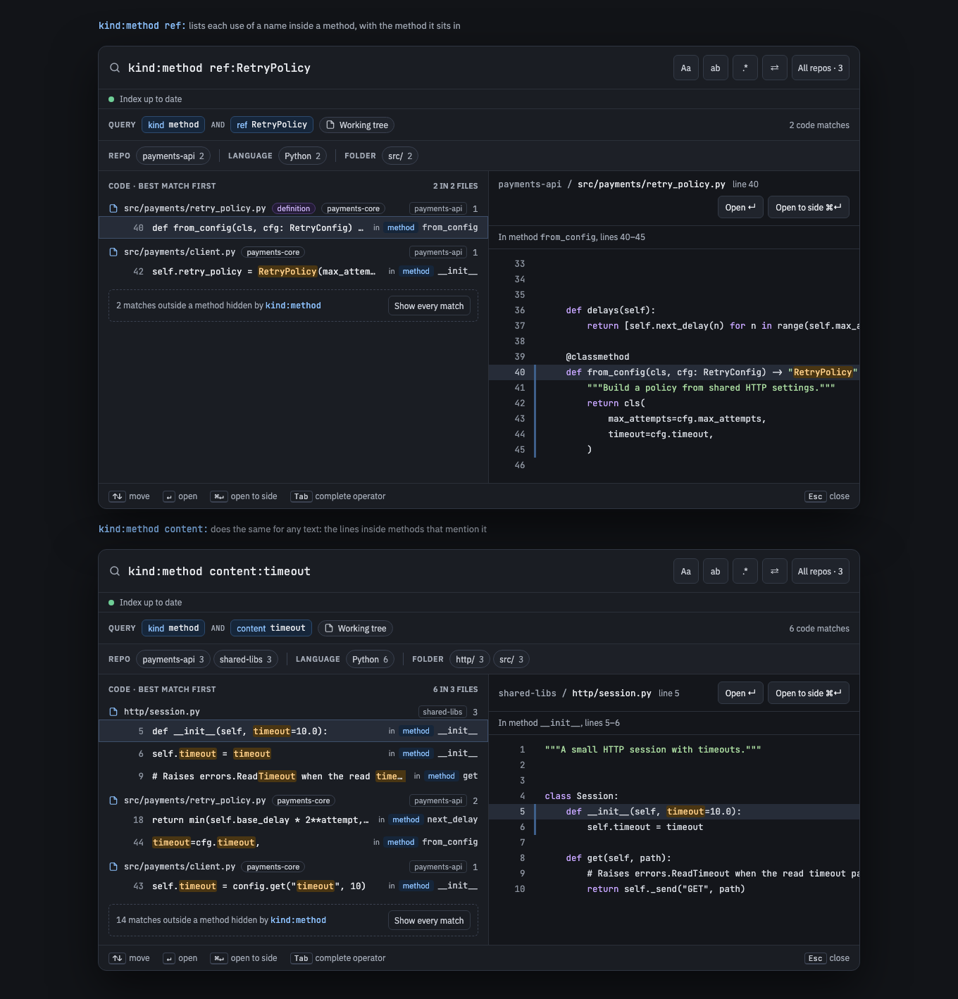
</a>

The built panel

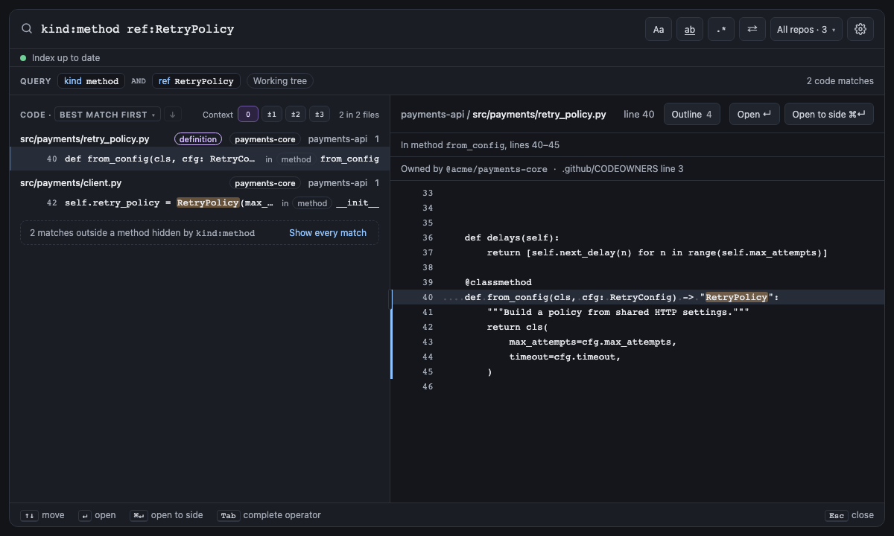

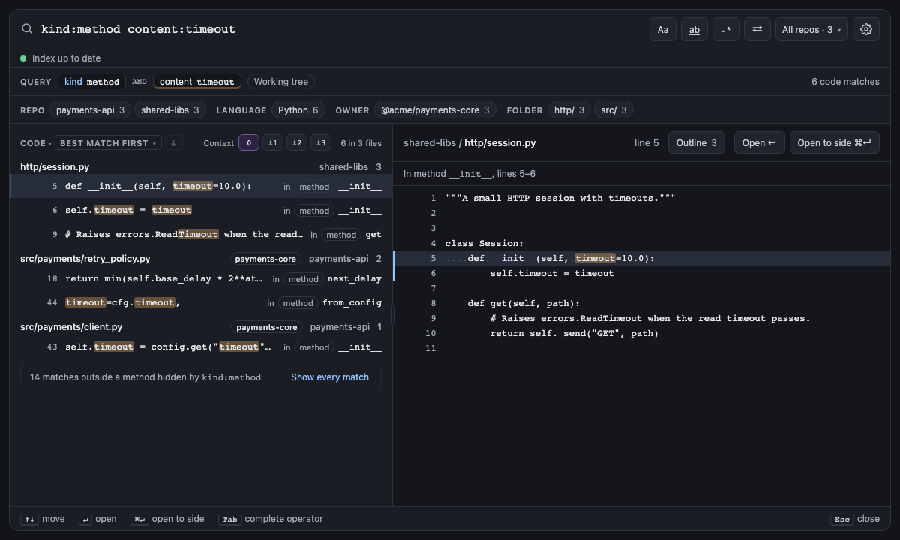

<!-- /screen -->

## `ref:`

| Short | Takes | Searches | Example |
| --- | --- | --- | --- |
| none | A name, or a `"quoted name"`; returns the lines that use it as a whole word, without the lines that define it | Current files only | `ref:RetryPolicy` |

`ref:RetryPolicy` finds the lines that use a name: it matches `RetryPolicy` as a whole word, whatever `word:` says,
and leaves out the lines that define it, so `class RetryPolicy:` is not a result but `RetryPolicy(max_attempts=3)` is.
It matches by name, not by meaning, unlike VS Code's Find All References: a different `RetryPolicy` in another repo
counts too, and so does the name in a comment or a string. **Spelunk: Find Uses**, on the editor's right-click menu,
searches `ref:` for
the name at the cursor.

<!-- screen:symbol-kinds -->
**Screen 35: `kind:` keeps one kind of definition; `ref:` finds a name's uses** · Screen id `symbol-kinds` · milestone
1.1

`sym:retry kind:class` keeps the classes whose names contain `retry`, `RetryPolicy` and `RetryConfig`, and a note
counts the definitions of other kinds it hid (the `retry` functions), with **Show every kind**, which removes
`kind:class`. `ref:RetryPolicy` finds the lines that use `RetryPolicy` as a whole word: the import, the calls and the
return annotation, but not `class RetryPolicy:`, which defines it, nor `RetryPolicyError` or `retry_policy`.

<a href="images/mocks/SymbolKinds.png">
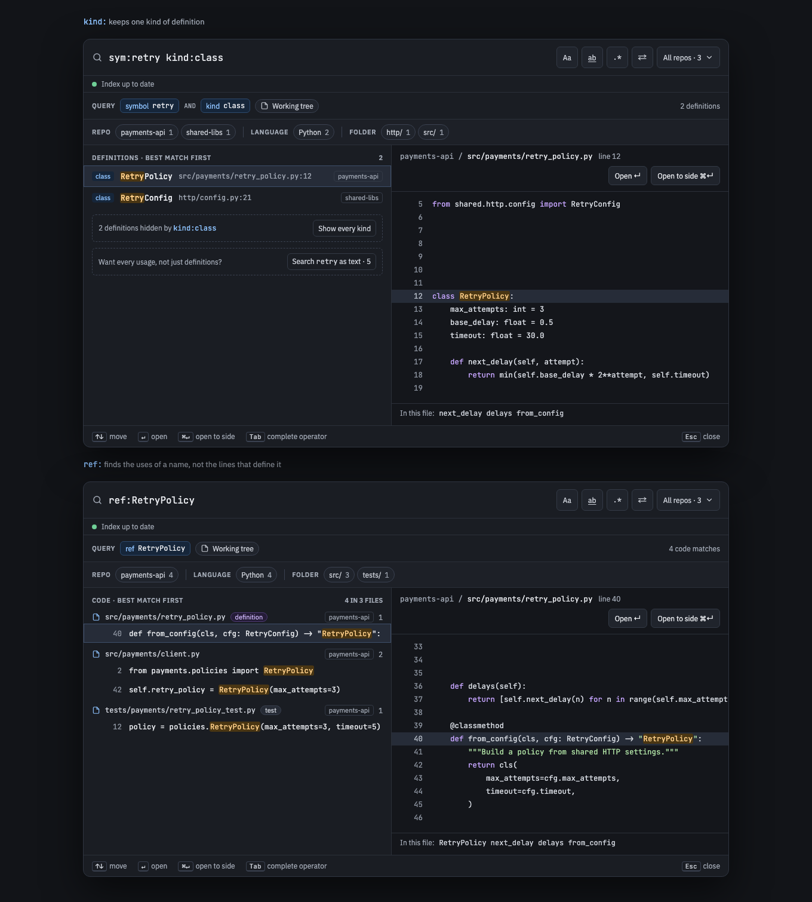
</a>

The built panel

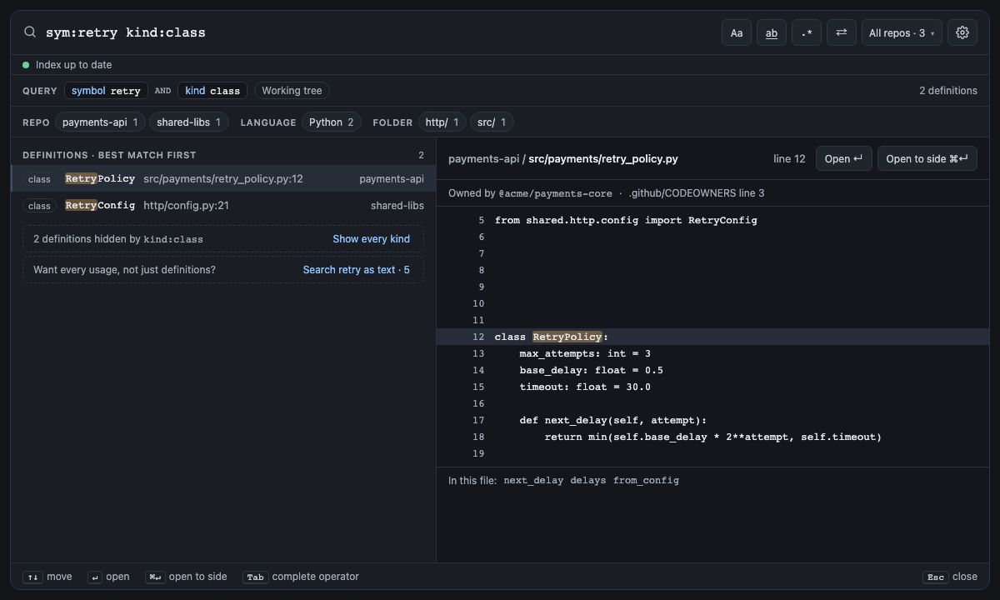

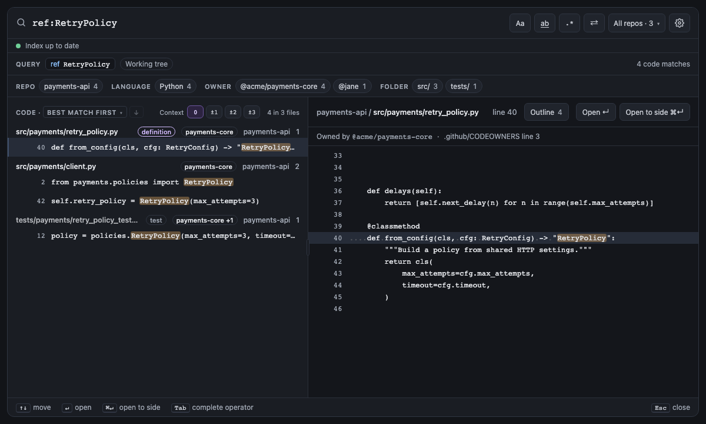

<!-- /screen -->

## `struct:`

| Short | Takes | Searches | Example |
| --- | --- | --- | --- |
| none | A `"quoted template"`: code with `:[holes]`, matched by its shape in file text (see [Code by its shape](Definitions-and-Code-Shape#struct)) | Current files only | `struct:"backoff(:[call], tries=:[n])"` |

`struct:` takes a template: code with holes. `struct:"backoff(:[call], tries=:[n])"` finds every call of `backoff`
whose last argument is `tries=`, however it is laid out, so a call over three lines is found as well as one on a single
line. The template and each file are read as tokens by the file's language: words, punctuation, brackets and whole
strings.

- A hole, `:[name]`, takes any code whose brackets pair up, so `:[call]` takes `lambda: send(event.url, event.body)`
  whole, brackets and commas and all. It takes as little as it can: in `f(:[a], :[b])`, `:[a]` ends at the first
  comma outside brackets. It may take nothing, so `f(:[args])` finds `f()`.
- Inside the template's brackets a hole may run over lines; outside them it stays on the line where it starts, so
  `return :[x];` can't take the rest of a file without semicolons.
- Spaces and line breaks don't matter, except between two words: `foo(a,b)` finds `foo( a ,\n b )`, and `return x`
  doesn't find `returns`. Punctuation written together stays together: `a == :[b];` doesn't find `a = = 1;`.
- Code in comments and strings never matches, by each language's rules (Python's `#` and triple quotes, Go's raw
  strings, Rust's lifetimes, SQL's `--`, and so on); a hole may take a string or a comment whole. A file in no known
  language reads `"…"` as a string and has no comments.
- A name used twice must take the same code, spaces aside: `if :[x] == :[x] {` finds a value compared with itself.
  `:[_]` takes anything and is never compared.
- A template's brackets needn't pair up (`if err != nil {` is a template), but it must start and end with code, and
  two holes need code between them, or the query says what's wrong. A hole takes as little as it can, so one at
  the end would always take nothing: end `a == :[b]` with what comes after `b`, as in `a == :[b];`.

Each match is one result on the line it starts, showing every line it spans like a [regex across
lines](Words-Regex-and-Logic#regexes-across-lines): the template's code is marked in the term's color and each hole's
code in its own
paler, underlined color, and a chip under the result says what each hole took (`:[call] lambda: send(event.url,
event.body)`), its spaces squeezed and cut after 80 characters. Matches don't overlap, and a call inside another's hole
is part of it. `case:` applies to the template's words and strings; `word:yes` changes nothing, since words already
match whole. It never matches file names, works in current files only, and Replace can't change it.

<!-- screen:structural-search -->
**Screen 40: `struct:` finds code by its shape: a template's holes take any code, over lines** ·
Screen id `structural-search` · milestone 1.2

`struct:"backoff(:[call], tries=:[n])"` finds the three calls of `backoff` in `http/webhooks.py`: one over three
lines, one over two and one on a single line. In 1.1 the nearest search was `/backoff\(.*tries=/`, which found only
the one-line call, and the comment and the string that look like one (below). Now each match is one result showing
every line it spans: `backoff(`, the `,`, `tries=` and `)` are marked in the term's color, what `:[call]` took in blue
and what `:[n]` took in green, each underlined, and a chip under the result lists what each hole took. The comment on
line 6 and the string on line 18 aren't code, so they don't match. The preview's header says **lines 7–9** and marks
the same, and opening the result selects the whole call.

<a href="images/mocks/Structural.png">
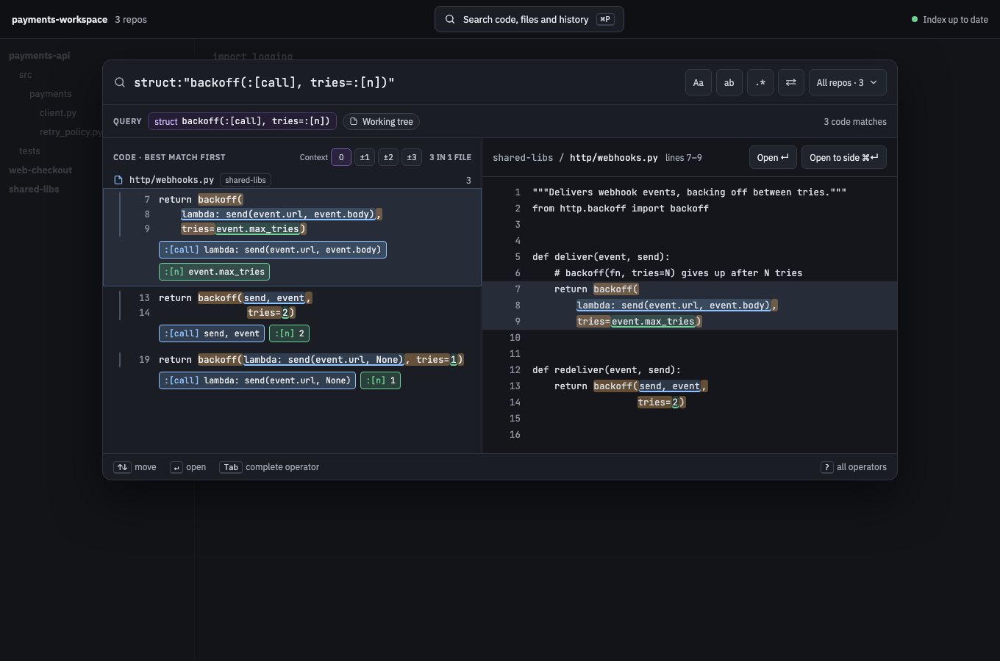
</a>

In 1.1: a regex finds the one-line call, the comment and the string

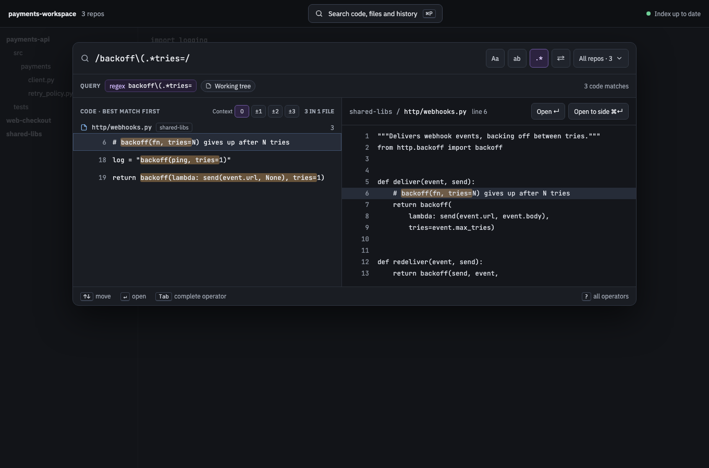

The built panel

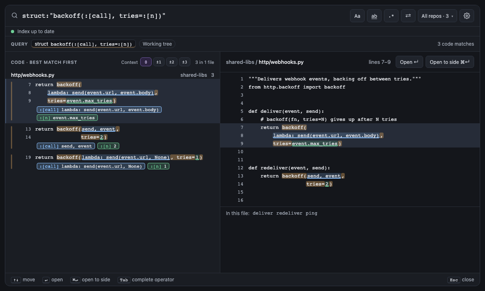

<!-- /screen -->

---

**Next:** [[Commits and time|Commits and Time]]: search Git history, and the code as it was.
