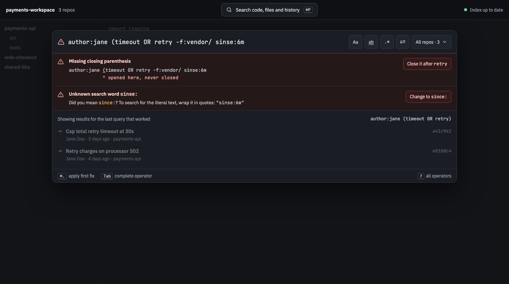
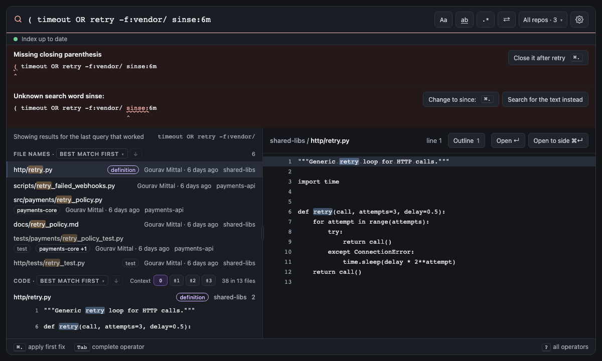

# Error Index

<!-- Linked screenshots and expandable previews require these HTML elements. -->
<!-- markdownlint-configure-file {"MD033": {"allowed_elements": ["a", "code", "details", "img", "summary"]}} -->

Every error and warning the query box can show, by its code. Tests name these codes as `@covers diag:<code>`, and
the daemon defines them in
[`daemon/internal/query/diagnostics.go`](https://github.com/cruisinme30/spelunk/blob/main/daemon/internal/query/diagnostics.go).

| Errors | Warnings |
| --- | --- |
| [`unclosed_paren`](#unclosed_paren) | [`pipe_in_word`](#pipe_in_word) |
| [`unmatched_paren`](#unmatched_paren) | [`bad_value`](#bad_value-warning) |
| [`empty_group`](#empty_group) | [`history_full_scan`](#history_full_scan) |
| [`unclosed_quote`](#unclosed_quote) | [`multiline_in_history`](#multiline_in_history) |
| [`unclosed_regex`](#unclosed_regex) | |
| [`invalid_regex`](#invalid_regex) | |
| [`missing_operand`](#missing_operand) | |
| [`no_positive_term`](#no_positive_term) | |
| [`query_too_long`](#query_too_long) | |
| [`unknown_operator`](#unknown_operator) | |
| [`bad_value`](#bad_value) | |
| [`global_misplaced`](#global_misplaced) | |
| [`duplicate_global`](#duplicate_global) | |
| [`mixed_mode_or`](#mixed_mode_or) | |
| [`op_wrong_mode`](#op_wrong_mode) | |
| [`op_with_at`](#op_with_at) | |

## How errors look

The panel underlines the problem, says what's wrong, and offers a fix (⌘. applies the first; ⌘Z undoes it). **An
error stops the search, but the last good results stay on screen**, under "Showing results for the last query that
worked", until the query is fixed. A warning doesn't stop the search; it flags something you probably didn't mean.

A fix that turns an unknown operator into literal text preserves its backslashes and quotes, and leaves following
terms separate. For example, repairing `unknown:\ schedule` must keep `schedule` as its own term.

<!-- screen:query-errors -->
**Screen 13: Query errors with fixes** · Screen id `query-errors` · milestone M1

The built panel

<!-- /screen -->

## Brackets, quotes and regexes

### `unclosed_paren`

**Missing closing parenthesis.** A `(` has no `)`.

| You type | Fix it offers |
| --- | --- |
| `author:jane (timeout OR retry -f:vendor/` | Closes it after the OR: `(timeout OR retry) -f:vendor/` |

### `unmatched_paren`

**This ) has no matching (.**

| You type | Fix it offers |
| --- | --- |
| `a ) b` | Remove the extra `)` |

### `empty_group`

**Empty parentheses.**

| You type | Fix it offers |
| --- | --- |
| `a () b` | Remove `()` |

### `unclosed_quote`

**Missing closing quote.**

| You type | Fix it offers |
| --- | --- |
| `x "abc` | Close the quote |

### `unclosed_regex`

**Missing closing / of the regex.**

| You type | Fix it offers |
| --- | --- |
| `x /abc` | Close the regex |

### `invalid_regex`

**The regex isn't valid RE2**, and the message says why. RE2 has no backreferences or lookaround.

| You type | Fix it offers |
| --- | --- |
| `/Retry(/`, `f:a[b` | None |

## Words and logic

### `missing_operand`

**Nothing after OR to combine**, or **Nothing after NOT to exclude.**

| You type | Fix it offers |
| --- | --- |
| `a OR` | Remove the OR |
| `a NOT` | Remove the NOT |

### `no_positive_term`

**Add something to search for: every term is excluded with - or NOT**, or, for a query of only operators that
shape the search, **Add something to search for: case:yes only shapes the search**.

| You type | Fix it offers |
| --- | --- |
| `-timeout`, `NOT timeout` | None |
| `case:yes`, `case:yes count:5` | None |

### `query_too_long`

**Queries can be at most 1000 characters.** The query isn't run.

| You type | Fix it offers |
| --- | --- |
| A query over 1,000 characters | None |

## Operators and their values

### `unknown_operator`

**Unknown search word.** The fix offers the nearest one, or quoting the word when nothing is close. A one-letter name
that has gone, or `path:`, says the search word it became and offers that one: **Unknown search word s: (now symbol:)**.

| You type | Fix it offers |
| --- | --- |
| `sinse:6m timeout` | The nearest one: `since:6m` |
| `s:Retry` | The search word it became: `symbol:Retry` |
| `path:src/ retry` | The search word it became: `file:src/` |
| `wibble:x y` | Quote it: `"wibble:x"` |

### `bad_value`

**The value doesn't fit the operator**, and the message says what it takes. When there's a valid value close by, the fix
offers it.

| You type | Fix it offers |
| --- | --- |
| `since:6x`, `count:-1`, `lang:pyhton` | A valid one: `since:30d`, `count:50`, `lang:python` |
| `since:2026-02-30`, `until:2026-13` | The nearest date: `since:2026-02-28`, `until:2026-12` |
| `author:` | None: `author:` needs a value |
| `author:/j.*/`, `ref:/Retry.*/` | None: they take a name, not a regex |
| `sym:Retry kind:func` | The nearest kind: `kind:function` |
| `struct:retry` | None: `struct:` takes a template in quotes, as in `struct:"retry(:[args])"` |
| `struct:":[fn](:[args])"`, `struct:"f(:[a]:[b])"` | None: a template can't start or end with a hole, and two holes need code between them |
| `at:v1..v2 retry`, `at:HEAD:README.md retry` | None: `at:` takes a tag, branch or commit, or a time |

### `global_misplaced`

**This operator applies to the whole query**, so it can't be inside `( )`, after `-` or `NOT`, or in an OR branch. That
holds for `type:`, `case:`, `word:`, `match:`, `count:`, `order:` and `at:`, and for `in:`, which may take a minus at
the top level (`-in:comments`) and keeps it when it moves.

| You type | Fix it offers |
| --- | --- |
| `(case:yes a) OR b` | Move it out: `case:yes ((a) OR b)` |
| `retry (timeout -in:code)` | Move it out, minus and all: `-in:code retry (timeout)` |

### `duplicate_global`

**This operator can appear only once.**

| You type | Fix it offers |
| --- | --- |
| `case:yes a case:no` | Remove the second |

## Files or commits

### `mixed_mode_or`

**Each side of OR must search the same thing:** commits (`author:`, `msg:`) or current files. See
[Files or commits](Commits-and-Time#files-or-commits).

**Each side of OR must find the same thing:** definitions (`symbol:`, `kind:`) or code and file names. One list can't
hold both, and showing one side alone would drop the other's results without a word. AND binds tighter than OR, so
`kind:function parse OR lex` means `(kind:function parse) OR lex`; write `kind:function (parse OR lex)`.

| You type | Fix it offers |
| --- | --- |
| `author:jane OR f:x` | None |
| `symbol:Parse OR timeout` | None |

### `op_wrong_mode`

**This operator searches current files, but the query searches commits** (`author:`, `msg:` or `type:commit`).

| You type | Fix it offers |
| --- | --- |
| `author:jane sym:Foo` | Remove `sym:Foo` |
| `author:jane struct:"retry(:[a])"` | Remove it |
| `at:v1.0.0 author:jane retry` | Remove `at:v1.0.0` |

It also says when `type:` rules out what an operator finds: `symbol:` and `kind:` list definitions, which neither
`type:file` (file names only) nor `type:code` (code lines only) lists, and `ref:`, `content:` and `struct:` find code
lines, which `type:file` doesn't list. Left out, as in `type:file -content:TODO`, they still work.

| You type | Fix it offers |
| --- | --- |
| `type:file symbol:Parse` | Remove `symbol:Parse`, or remove `type:file` |
| `type:code kind:function` | Remove `kind:function`, or remove `type:code` |
| `type:file ref:Parse` | Remove `ref:Parse`, or remove `type:file` |

### `op_with_at`

**This operator describes files as they are now, or when they last changed, but `at:` searches the files as they were
then.** That holds for `is:open`, `is:changed`, `since:`, `until:` and `owner:`.

| You type | Fix it offers |
| --- | --- |
| `at:v1.0.0 since:30d retry`, `at:v1.0.0 is:open retry` | Remove it |

## Warnings

### `pipe_in_word`

**The pipe is matched literally.** A `|` inside a plain word is just a character.

| You type | Fix it offers |
| --- | --- |
| `daemon\|search` | `daemon OR search`, or `/daemon\|search/` |

### `bad_value` (warning)

Some values run but probably don't mean what you wanted.

| You type | Warning | Fix it offers |
| --- | --- | --- |
| `since:30m` | `m` means months (warned above 12m) | `since:30min` |
| `since:2026-09 until:2026-08` | `until:` ends before `since:` starts, so nothing can match both | None |
| `owner:payment-core` | No CODEOWNERS file names it, so it matches nothing | The nearest owners |

### `history_full_scan`

**The regex has no 3-character literal, so every commit is scanned.**

| You type | Fix it offers |
| --- | --- |
| `type:commit /\d+/` | None; add `author:`, `since:`, `until:` or `file:` to narrow it |

### `multiline_in_history`

**A regex with `\n` matches across lines only in current files**; commits are searched one changed line at a time.

| You type | Fix it offers |
| --- | --- |
| `author:jane /except\n\s*raise/` | None |

---

**Next:** [[Using the Panel]]: the keys, suggestions, previews and Replace.
