# Files and Repos

<!-- Linked screenshots and expandable previews require these HTML elements. -->
<!-- markdownlint-configure-file {"MD033": {"allowed_elements": ["a", "details", "img", "summary"]}} -->

Narrow a search to some files: by path, repo, language, file state (open, uncommitted, tests, generated, vendored)
or CODEOWNERS owner. The files VS Code's excludes hide are left out unless you ask for them. Each of these works on
current files, and most also keep the commits that changed those files.

## `file:`

| Short | Takes | Searches | Example |
| --- | --- | --- | --- |
| `f:` | A regex on the path (`\.go$`) or a glob (`*.go`, `src/**/*.ts`) | Current files and commits | `file:_test\.py$ timeout` |

A value with `*` is a glob (`src/**/*.ts`); anything
else is a regex on the path (`_test\.py$`). In a commit search `file:` keeps the commits that
changed a matching path, and the preview hides the other files until **Show all**. It follows a file through its
renames: `file:retry_policy.py` also finds the commits made while the file had an older name (see
[Renames and merged branches](Commits-and-Time#renames-and-merged-branches)).

Right-click a folder in the Explorer and **Search in Folder with Spelunk** writes it for you, anchored at its repo's
root: see [Searching a folder](Using-the-Panel#searching-a-folder).
<!-- screen:path-scoped-search -->
**Screen 2: `f:` path regex + text** · Screen id `path-scoped-search` · milestone M1

<a href="images/mocks/PathScoped.png">
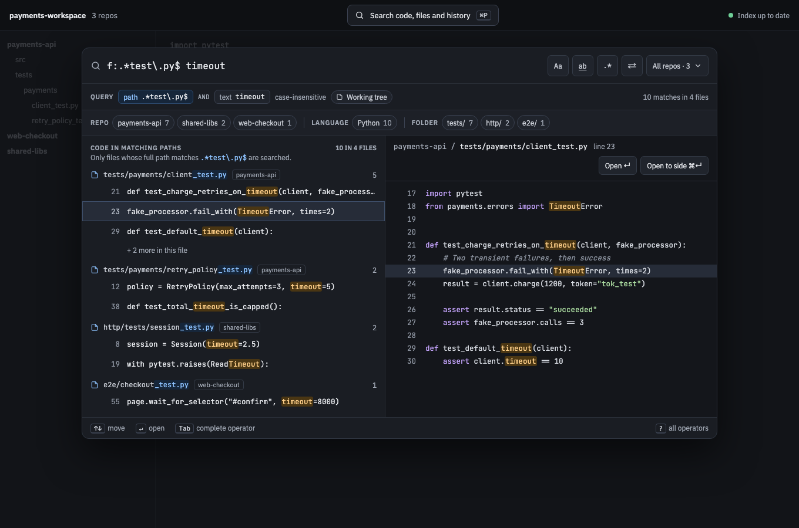
</a>

The built panel

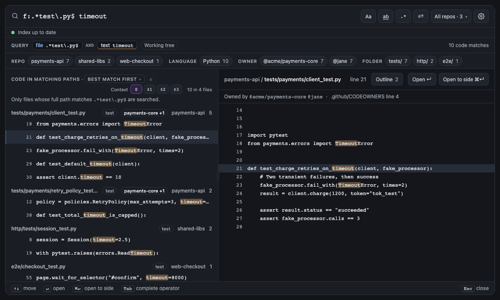

<!-- /screen -->

## `repo:`

| Short | Takes | Searches | Example |
| --- | --- | --- | --- |
| none | A regex (`^web`) or a glob (`web-*`) on the repo name | Current files and commits | `repo:payments retry` |

The repo menu (**All repos · N**) and the repo facet write it anchored to the whole name, `repo:^api$`, so picking
`api` doesn't also search `payments-api`. See [Using the Panel](Using-the-Panel#while-you-type).

## `language:`

| Short | Takes | Searches | Example |
| --- | --- | --- | --- |
| `lang:` | A language or alias: `python`, `py`, `ts`, `golang` | Current files and commits | `language:python retry` |

A Jupyter notebook is in its kernel's language: `language:python` keeps a Python notebook's cells (see
[Jupyter notebooks](Using-the-Panel#jupyter-notebooks)). In a commit search it goes by file names, so it leaves
notebooks out.

## Names only or code only

`type:file` returns file names only, and `type:code` code lines only. The other values of
[`type:`](Commits-and-Time#type)
switch the search to commits.

<!-- screen:file-names-only -->
**Screen 12: `type:file` + `lang:`** · Screen id `file-names-only` · milestone M2

<a href="images/mocks/TypeFile.png">
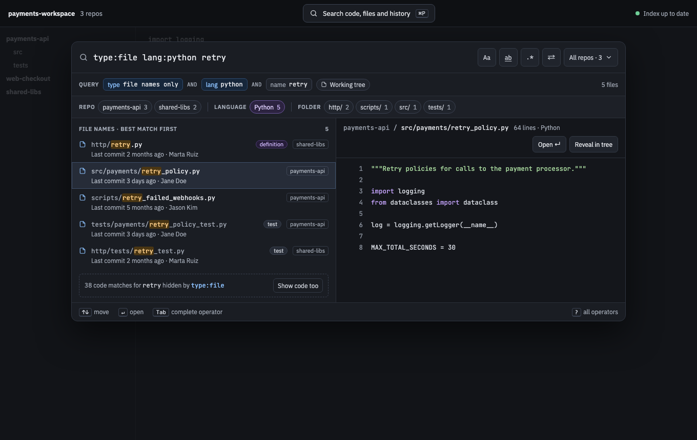
</a>

The built panel

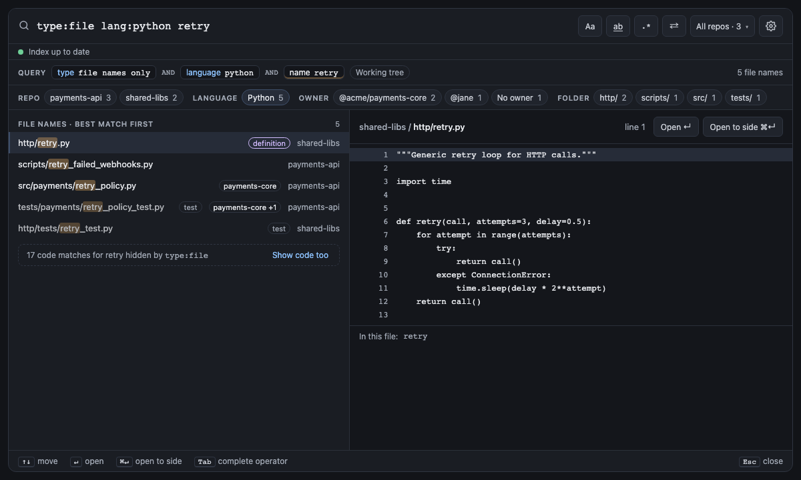

<!-- /screen -->

## `is:`

| Short | Takes | Searches | Example |
| --- | --- | --- | --- |
| none | `open` (open in an editor tab), `changed` (uncommitted: edited, added or staged), `test` (a test file), `generated` (written by a tool) or `vendored` (someone else's code, or a build's) | Both (`test`, `generated`, `vendored`); files only (`open`, `changed`) | `RetryPolicy -is:generated -is:vendored` |

A test file is one in a `test/`, `tests/`, `__tests__/`, `spec/`, `e2e/` or `testdata/` folder, or one named the
way its language names tests: `client_test.go`, `test_client.py`, `client_test.py`, `conftest.py`,
`client.test.ts`, `client.spec.js`, `client_spec.rb`, `ClientTest.java`, `ClientTests.swift`. Outside Git nothing
is uncommitted, so `is:changed` matches no files.

A generated file is one a tool wrote: named like generated code (by default `*.pb.go`, `*_gen.go`, `*.gen.go`,
`*.gen.ts`, `*_pb2.py`, `*_pb2_grpc.py`, `*_pb2.pyi`, `*.min.js`, `*.min.css`; `spelunk.index.generatedSuffixes` sets
the endings), or with `@generated`, or `DO NOT EDIT` beside the
word "generated", in its first kilobyte, as Go's `Code generated … DO NOT EDIT.` and protoc's header put it. A
commit's files have no header to read, so in a commit search `is:generated` goes by the name alone. A vendored file
is one in a `vendor/`, `node_modules/`, `third_party/` or `dist/` folder, or the folders `spelunk.index.vendoredFolders`
names instead; `index.exclude` leaves the first two out of the index by default. These are the files best-match ranking
puts last, so `-is:generated -is:vendored` keeps a search
or a replace to code people wrote, and a note under the results says how many matches each one left out.

<!-- screen:test-files -->
**Screen 26: `is:test` keeps test files** · Screen id `test-files` · milestone 1.1

`is:test` keeps the test files, here the two that mention `retry`; `-is:test` leaves them out instead. `is:open`
keeps the files open in editor tabs and `is:changed` the ones with uncommitted changes.

<a href="images/mocks/TestFiles.png">
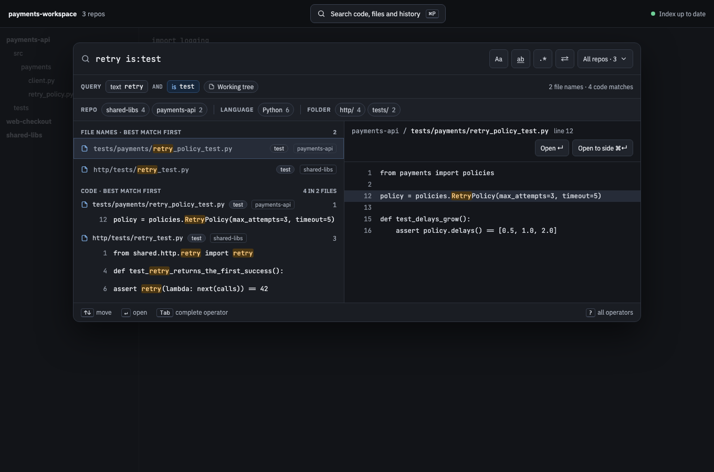
</a>

The built panel

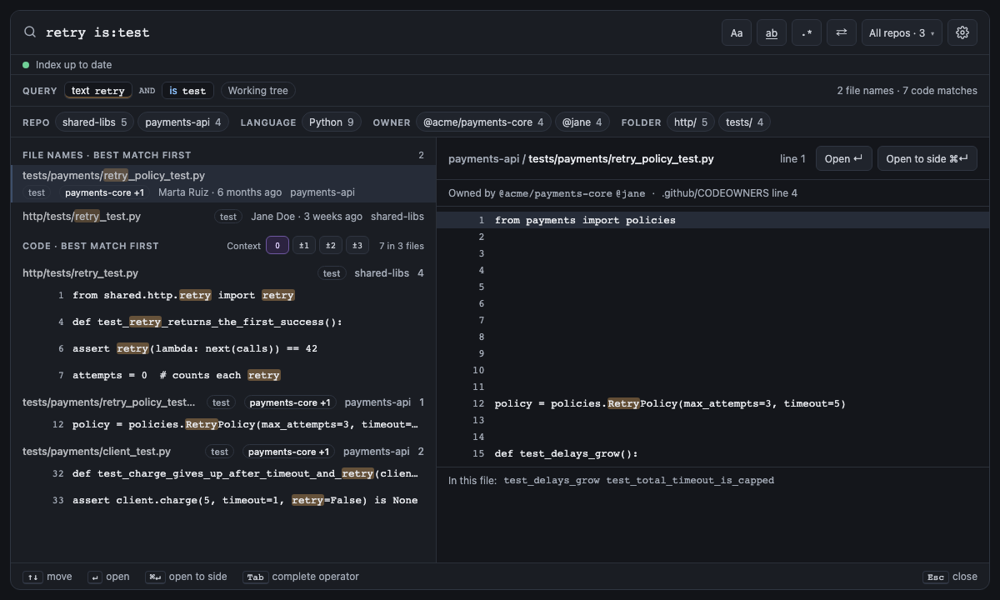

<!-- /screen -->

<!-- screen:generated-vendored -->
**Screen 37: `-is:generated` / `-is:vendored` leave tool-written and third-party files out** ·
Screen id `generated-vendored` · milestone 1.2

Renaming `RetryPolicy` to `BackoffPolicy` would also edit protoc's `retry_pb2.py`, a copy of someone else's code in
`third_party/` and a bundle in `dist/`. `-is:generated -is:vendored` leaves those files out, so **Replace all** only
touches the code people wrote, and a note under the code says how many matches each filter left out, with **Show
them**. `is:generated` and `is:vendored` keep only those files instead, and in a commit search they keep the commits'
changes to them. Typing `is:` lists both, with how many files are in each and what counts. The mock's first panel
shows 1.1, before the two filters, when `retry_pb2.py` wasn't even recognised as generated.

<a href="images/mocks/GeneratedVendored.png">
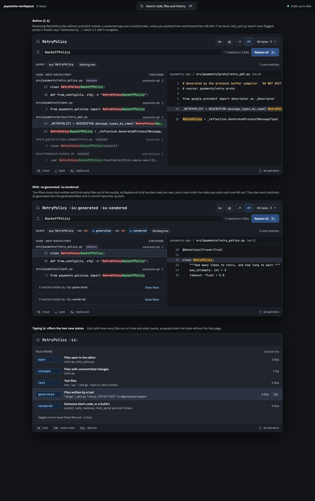
</a>

The built panel

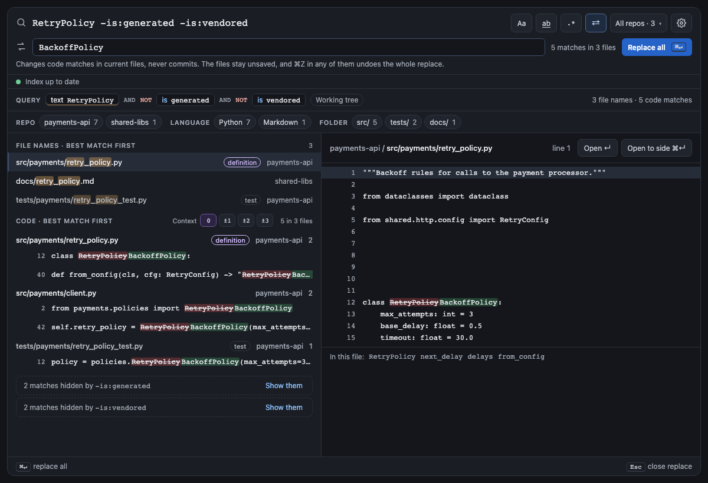

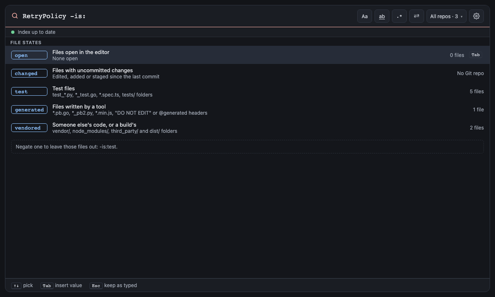

<!-- /screen -->

## `owner:`

| Short | Takes | Searches | Example |
| --- | --- | --- | --- |
| none | An owner in the repo's CODEOWNERS file: a team (`@acme/payments-core`, or `payments-core` alone), a person (`@jane` or `jane`) or an email, matched whole and ignoring case; or `none`, for files no line gives an owner | Current files only | `owner:payments-core retry` |

`owner:` asks each repo's CODEOWNERS file who owns a file, the way GitHub does: the first of `.github/CODEOWNERS`,
`CODEOWNERS` and `docs/CODEOWNERS` (or the places `spelunk.index.codeownersFiles` names) that exists counts, and the
last line whose pattern matches the file decides. A file reached through a symlink doesn't count, since it could point
outside the repo.
Patterns match like `.gitignore`'s: one with a slash at its start or in its middle matches from the repo root, one
without matches at any depth, one ending in `/` takes a folder's files at every depth, `docs/*` only the folder's own
files, and `**` spans folders. A line with a pattern and no owners leaves its files unowned, which `owner:none` finds.
Lines GitHub skips are skipped: `!` patterns, `[ ]` ranges, and owners that aren't a `@user`, an `@org/team` or an
email. A repo without a CODEOWNERS file matches no owner (so `-owner:@acme/platform` keeps all its files), and when no
open repo has one, or none names the owner you typed, the panel warns and offers the nearest owners. The file is read
again whenever you save it.

<!-- screen:owner-filter -->
**Screen 42: `owner:` keeps the files a team owns in CODEOWNERS** · Screen id `owner-filter` · milestone 1.2

payments-api's `.github/CODEOWNERS` gives `src/payments/` and `tests/` to `@acme/payments-core`, so
`retry owner:payments-core` keeps the matches in that team's files and a note under the code says how many it left
out, with **Show them**. Each result's badge names its file's owner (a team by its name alone, `payments-core +1`
when there are more; the tooltip names them all), the facet row counts the results by owner, and the preview says
which line of CODEOWNERS decided. Typing `owner:` lists the owners the CODEOWNERS files name, with how many files each
has, and `none`; an owner no file names gets a warning that offers the nearest one.

<a href="images/mocks/OwnerFilter.png">
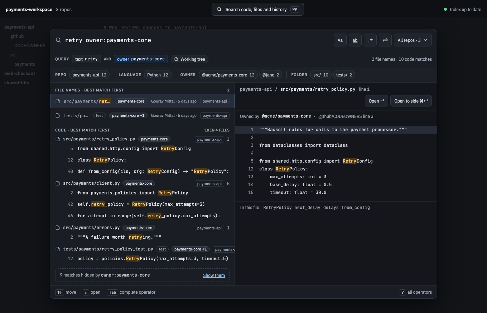
</a>

The built panel

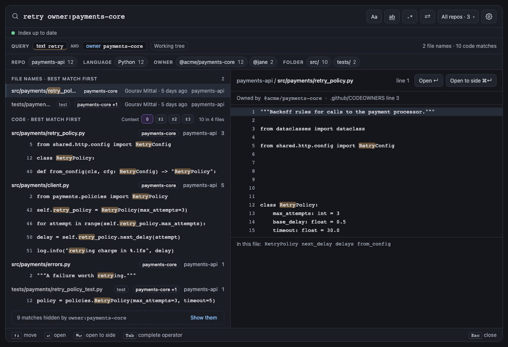

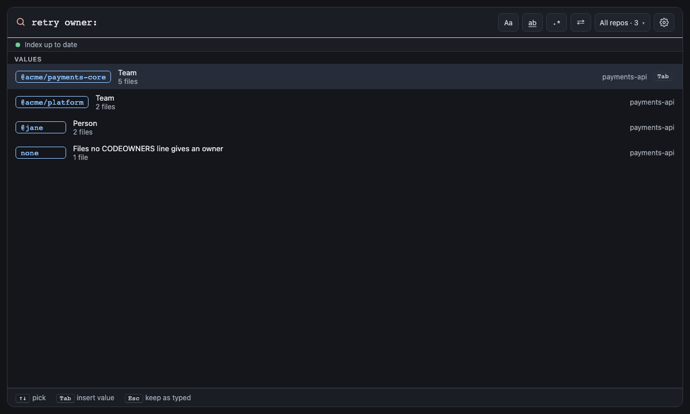

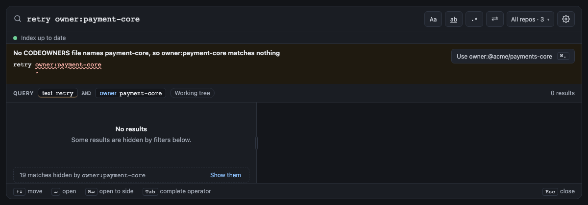

<!-- /screen -->

## `excludes:`

| Short | Takes | Searches | Example |
| --- | --- | --- | --- |
| none | `yes` (leave out what VS Code's excludes hide, the default) or `no` (show it too) | Current files and commits | `excludes:no retry` |

Files you hide from VS Code with `files.exclude` or `search.exclude` (a build folder, a coverage report, generated docs,
compiled `.js` beside its `.ts`) are left out of every search, as VS Code's own search leaves them out. Each workspace
folder uses its own settings, with your user settings, the workspace's and the folder's merged as VS Code merges them,
and `search.exclude` can turn off a `files.exclude` pattern by setting it to `false`. Patterns read the way VS Code
reads them, which differs from `spelunk.index.exclude`: one without a slash matches at the top of the folder only
(`build` hides `build/`, not `http/build/`), `{dist,out}` and `[Tt]emp` work, and a pattern that matches a folder
hides everything in it. A `when` clause hides a file only beside its sibling: `"**/*.js": { "when": "$(basename).ts" }`
hides `checkout.js` next to `checkout.ts` and keeps `legacy.js`.

A note under the results counts what was left out and names the patterns that did it, and the summary at the top
counts it too. **Show them** adds `excludes:no` to the query, so the choice shows in the box and stays in a pinned
query: the hidden files come back last, marked `excluded`, and the note offers **Hide them**. A search whose every
match is hidden says so, with Show them, even when `file:` names the hidden folder (VS Code does the same). History
leaves out the commits that only change hidden files, and drops hidden files from the other commits' file lists and
diffs. Replace changes only the files that show and says how many matches in hidden files it left alone.

Excludes apply when searching, not when indexing, so changing them, or turning `spelunk.search.useExcludeSettings`
off, changes the next search at once and an open panel searches again. `spelunk.index.exclude` is different: those
files are never indexed, so `excludes:no` can't show them.

<!-- screen:editor-excludes -->
**Screen 52: VS Code's `files.exclude` and `search.exclude` hide results too; a note counts them, and Show them adds
`excludes:no`** · Screen id `editor-excludes` · milestone 2.1

Three folders hide their build copy (`build`), coverage report (`**/coverage`), generated docs (`docs/generated`),
bundle (`dist`) and compiled `.js` beside its `.ts`. `retry_policy` shows only the real source files, the facets count
only them, and the note names the patterns that hid 6 matches. `excludes:no retry_policy` brings them back last,
marked `excluded`; a history search hides the commit that only rebuilt the bundle; and Replace leaves the hidden
matches alone and counts them.

<a href="images/mocks/EditorExcludes.png">
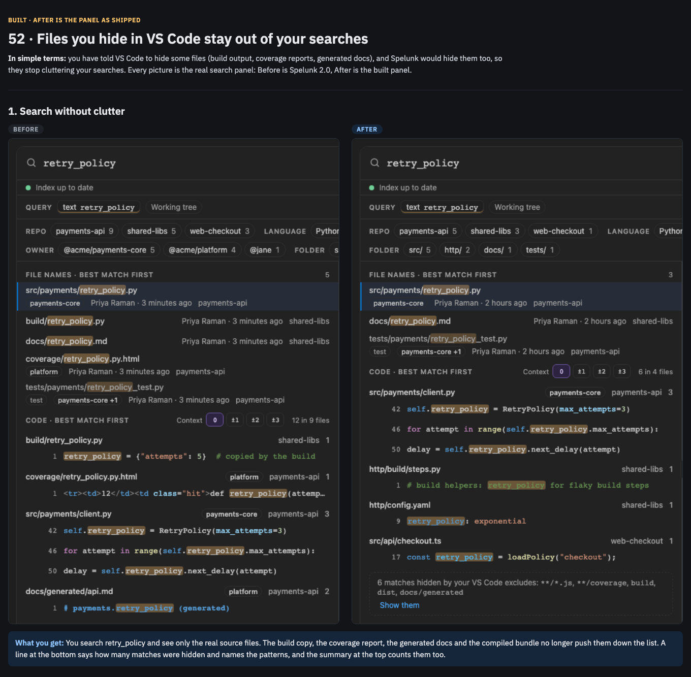
</a>

The built panel

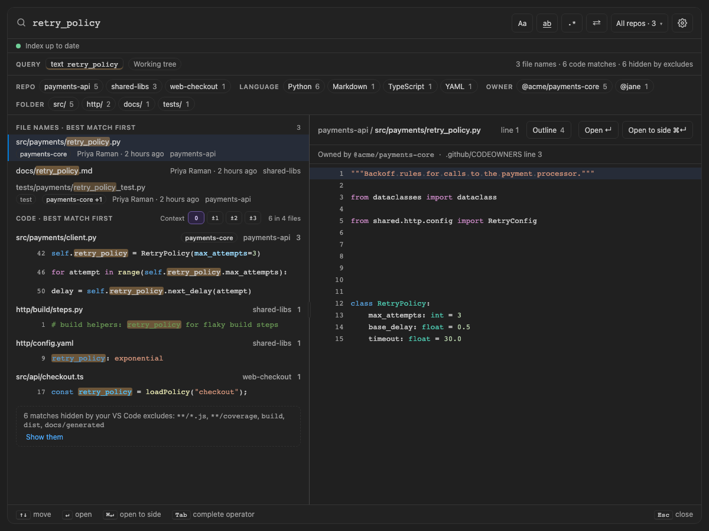

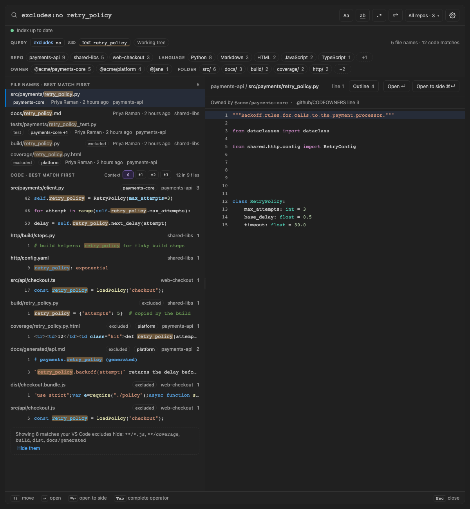

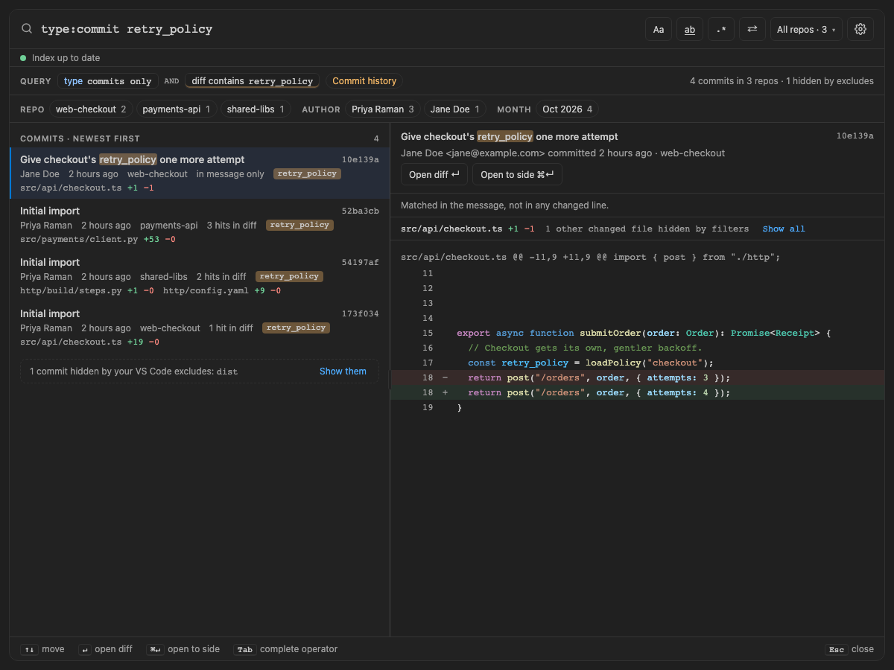

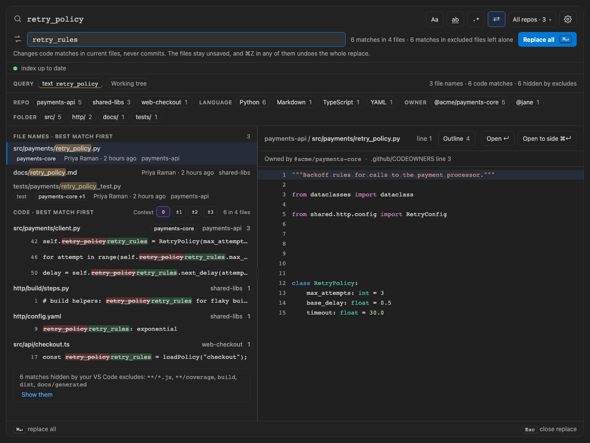

<!-- /screen -->

---

**Next:** [[Definitions and code shape|Definitions and Code Shape]]: find where things are defined and used.
