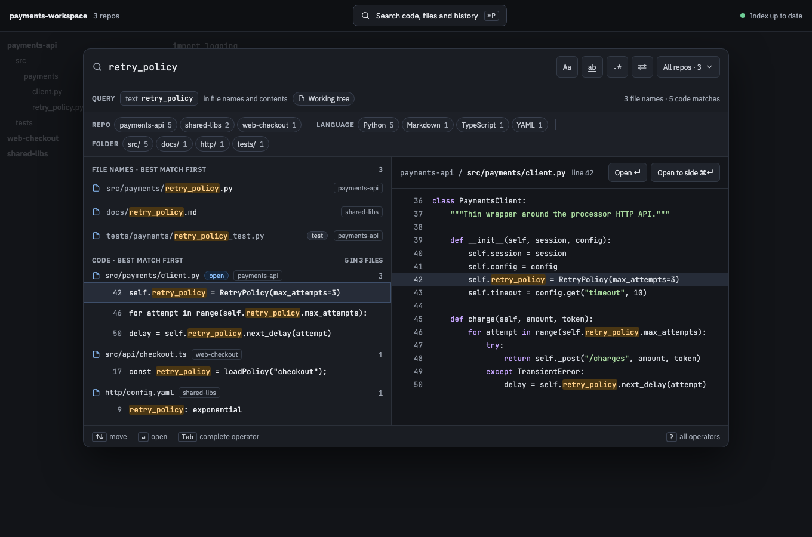
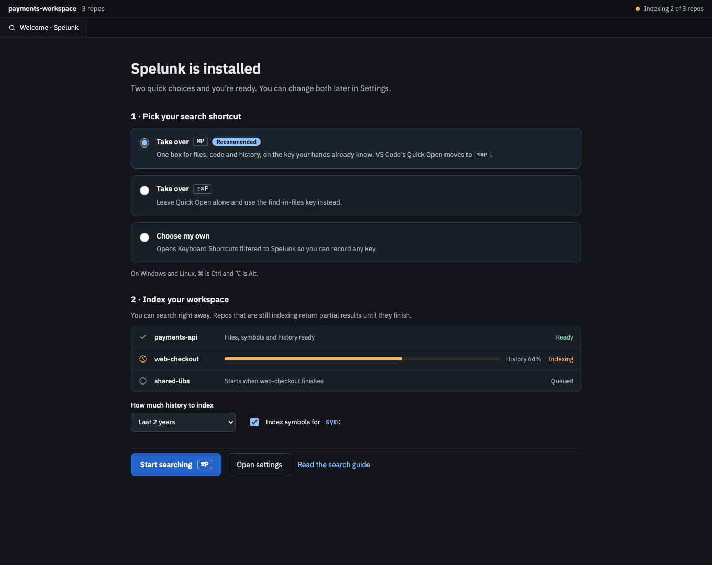
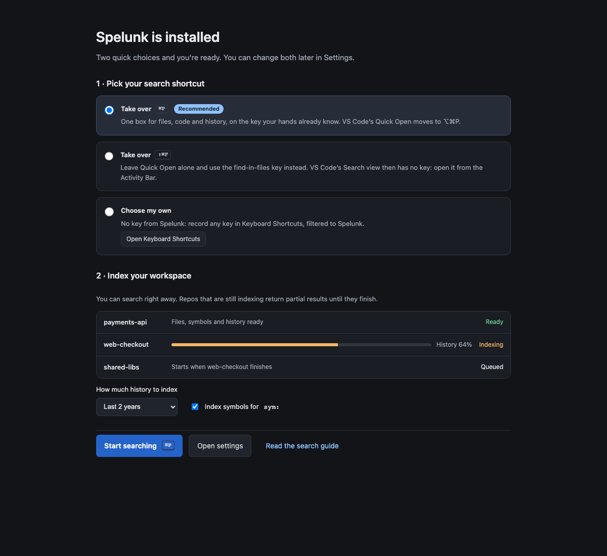

# Getting Started

<!-- Linked screenshots and expandable previews require these HTML elements. -->
<!-- markdownlint-configure-file {"MD033": {"allowed_elements": ["a", "details", "img", "summary"]}} -->

**Spelunk** is a VS Code extension that replaces several searches with one box. Type a query and see, as you
type, matching **file names**, **code lines**, **symbol definitions** and **Git commits** from every repo in your
workspace. Everything is indexed and searched on your machine; nothing is sent anywhere.



## Install

Spelunk isn't on the Marketplace yet. Download the `.vsix` for your platform (macOS, Linux or Windows, x64 or arm64)
from the [latest release](https://github.com/cruisinme30/spelunk/releases/latest) and run
**Extensions: Install from VSIX…** in VS Code, or from a terminal:

```sh
code --install-extension spelunk-2.0.0-darwin-arm64.vsix
```

To build it from a clone instead, see [Contributing](Contributing).

It works the same in desktop VS Code and code-server.

## First run

The welcome page opens once, after installing (**Spelunk: Show Welcome** opens it again):

1. **Pick the key that opens search.** ⌘P (Ctrl+P) is recommended; VS Code's Quick Open moves to ⌥⌘P (Ctrl+Alt+P).
   Or take over ⇧⌘F (Ctrl+Shift+F), which leaves VS Code's Search view without a key, or pick **Choose my own** and
   press **Open Keyboard Shortcuts** to record your own key. Each choice is saved as you pick it, ↑ ↓ included.
2. **Choose what to index:** how much history (2 years, 6 months or all) and whether to find definitions for
   `symbol:`.
3. **Watch each repo index.** You can search straight away; a repo that is still indexing returns partial results
   until it finishes. A folder that isn't a Git repository gets files but no history.

<!-- screen:first-run -->
**Screen 15: First run: pick a shortcut, index repos** · Screen id `first-run` · milestone M5

<a href="images/mocks/FirstRun.png">

</a>

<details>
<summary>The built panel</summary>



</details>

<!-- /screen -->

## Your first searches

| Type | You get |
| --- | --- |
| `retry_policy` | Files whose name or contents contain it |
| `file:*.py retry` | Only Python files |
| `symbol:RetryPolicy` | Where `RetryPolicy` is defined |
| `author:jane timeout` | Jane's commits that mention `timeout` in a changed line or the message |
| `message:"fix flaky"` | Commits whose message says "fix flaky" |
| `since:2w timeout` | Files changed in the last two weeks that contain `timeout` |
| `since:2026-09 until:2026-09 timeout` | Files last changed in September 2026 that contain `timeout` |

Click a result to preview it, press ↵ to open it at the match, and F4 to jump to the next one later.

## Next

- [[Recipes]]: ready-made queries for everyday jobs
- [[Query Language]]: every operator on one screen
- [[Using the Panel]]: keys, suggestions, recent queries, previews
- [[Troubleshooting]]: empty results, indexing, Git and limits
