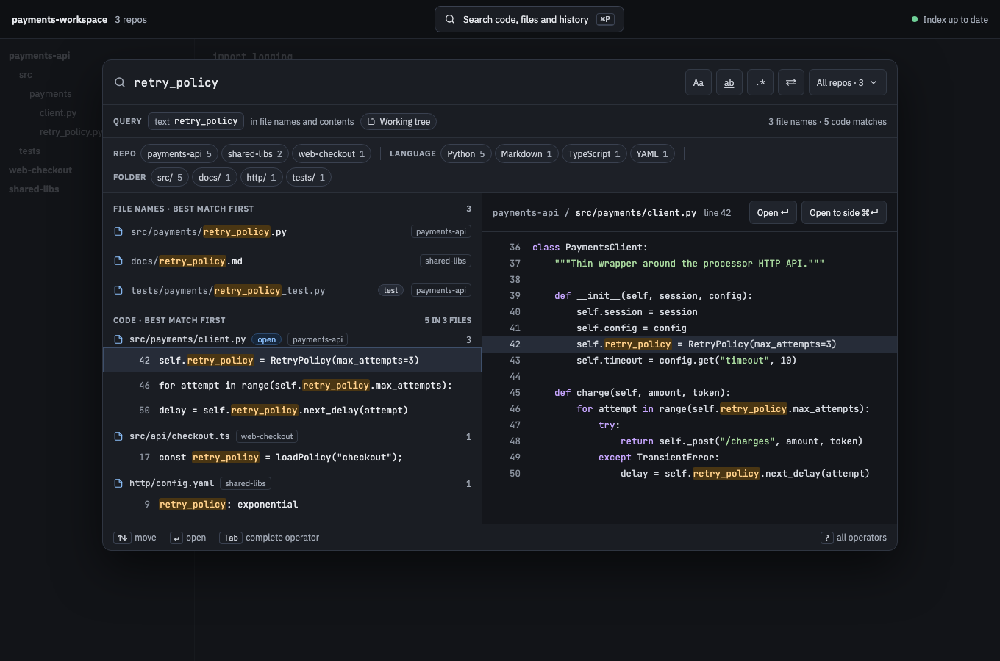
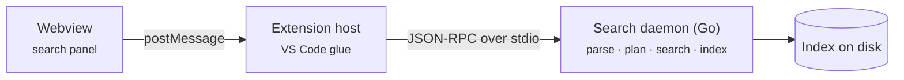

# Home

<!-- Linked screenshots and expandable previews require these HTML elements. -->
<!-- markdownlint-configure-file {"MD033": {"allowed_elements": ["img"]}} -->

**Spelunk** is a VS Code extension with one search box for your whole workspace: file names, code, definitions and
Git history, across every repo you have open. Results update as you type, and everything is indexed and searched on
your machine.

## What you can ask it

| Question | Query |
| --- | --- |
| Where is `RetryPolicy` defined? | `symbol:RetryPolicy` |
| Who introduced `retry_policy`? | `type:added retry_policy` |
| What did Jane change in the tests? | `author:jane is:test` |
| Where was `retry_after` used in the v1.0.0 release? | `at:v1.0.0 retry_after` |
| Every call of `backoff`, however it's laid out | `struct:"backoff(:[call], tries=:[n])"` |

More on [[Recipes]], and how it compares with the searches you already have on [[Why Spelunk]].

## Where to go

| I want to… | Start with |
| --- | --- |
| **Try it** | [[Getting Started]]: install, first run and your first searches |
| **Look something up** | [[Query Language]]: every operator on one screen, each linked to its full card |
| **Fix a query or a surprise** | [Error index](Error-Index) and [[Troubleshooting]] |
| **Understand how it works** | [[Architecture Overview]]: three processes, and what happens on each keystroke |
| **Change it** | [[Contributing]]: set up, make a change, pass the presubmit, keep the wiki in sync |

## In the repo

- [README](https://github.com/cruisinme30/spelunk/blob/main/README.md) and
  [CHANGELOG](https://github.com/cruisinme30/spelunk/blob/main/CHANGELOG.md)
- [Implementation plan](https://github.com/cruisinme30/spelunk/blob/main/docs/dev/implementation-plan.md): the full
  original design
- [Progress](https://github.com/cruisinme30/spelunk/blob/main/docs/dev/progress.md): what each milestone delivered
