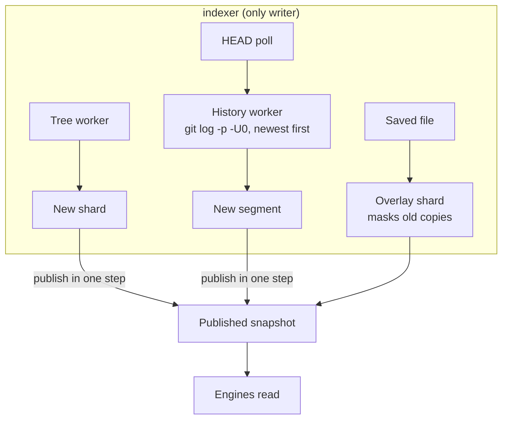

# Indexing

Each workspace root has two indexes, both built in-house on trigram posting lists
([ADR 0003](https://github.com/cruisinme30/spelunk/blob/main/docs/adr/0003-in-house-trigram-index.md),
[ADR 0004](https://github.com/cruisinme30/spelunk/blob/main/docs/adr/0004-in-house-history-index.md)).

| Index | Package | Holds | Powers |
| --- | --- | --- | --- |
| Working tree | `daemon/internal/trigram` | Shards of file contents and paths | Text, `file:`, `language:`, `symbol:`, `kind:`, `ref:`, `type:file` |
| History | `daemon/internal/history` | Segments of commits: author, date, message, changed lines with their `+` or `-`, each file's old path in a rename and its name now, and with `index.mergedBranches` the merge that brought a commit in | `author:`, `message:`, `type:commit`, `type:added`, `type:removed`, `since:`, `until:` |

## Keeping it fresh

| Event | What happens |
| --- | --- |
| A file is saved | Re-read into a small overlay shard that masks its old copy, until the next build folds it in |
| A folder is created, copied in, renamed or deleted | The editor reports only the folder: the files now in it are read into the overlay, and the indexed files of a folder that is gone are masked |
| A file changes where VS Code doesn't look, or while it was closed | A folder `files.watcherExclude` leaves out, a disk VS Code can't watch, or edits made with VS Code closed: the window lists its repos' files a few seconds after it opens and every two minutes after, and re-reads those whose time changed, as it does a saved file |
| New commits | HEAD is polled; new commits become searchable within seconds, as a small segment that merges with the ones before it (at most 2,000 commits each), so a day of commits leaves a few segments, not one apiece |
| A folder becomes a Git repo, or stops being one | Noticed at the next HEAD poll: history is read or turned off, and the files are rebuilt with or without `.gitignore` |
| A second VS Code window opens the same repo | Only one writes a repo's index: the first to take its lock (`locks/` beside the indexes). The second serves the saved index, loads each newer save at the HEAD poll, re-reads the files its editor saves, and reads new commits without saving them; it takes over when the first window closes |
| Time passes | Each update drops commits made before the `index.historyDepth` window, which moves on with the clock |
| First build of history | Read newest first; a 200-commit segment is searchable within a second, later ones hold 2,000 |
| Next window opens | Indexes saved under `index.location` give results at once. One saved by a version with another format, or under another `index.historyDepth`, `index.exclude` or `index.mergedBranches`, is read again from scratch, once |

## Jupyter notebooks

A notebook (`.ipynb`) is indexed as its cells' text: each cell's source in turn, each followed by a line end, so a cell
of n lines is n lines of the text and a line maps to its cell by counting (`daemon/internal/notebook`). The doc keeps
the cells (number, kind, language, first line, run count, outputs), and results and previews carry the cell of each
line. With `index.notebookOutputs`, code cells' text outputs follow every cell's source, so source lines number the
same either way. `index.maxFileSizeKB` bounds the cells' text; the file is read up to 64 MB. A file that doesn't parse
as nbformat 4 is indexed as text.

History reads a notebook's diff through a Git textconv filter: the daemon's own executable, run as `spelunk-daemon
notebook-text <file>`, prints the cells' source, so `git log -p` and `git show` diff notebooks by it. The filter is
set for the daemon's Git commands only, by `-c` options: a `diff` driver for `*.ipynb` in an attributes file holding
the user's global attributes too. A repo's own `.gitattributes` still wins.

## Matching

The history engine reuses the working tree's line matcher (`trigram.LineFinder`), so a term, a regex and case
rules mean the same thing on current files and on commits. Regexes are RE2: linear time, no query can hang the daemon.

---

**Next:** [[Protocol]]: the messages between the processes.
