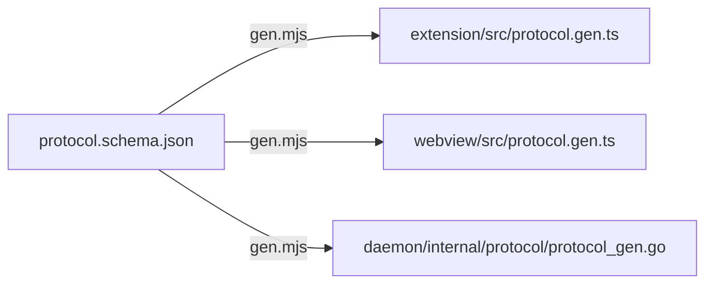

# Protocol

Every message that crosses a process boundary is defined once, in
[`protocol/protocol.schema.json`](https://github.com/cruisinme30/spelunk/blob/main/protocol/protocol.schema.json).
`npm run gen` writes the TypeScript and Go
types from it; nothing else defines a cross-boundary type. See
[ADR 0002](https://github.com/cruisinme30/spelunk/blob/main/docs/adr/0002-json-schema-as-protocol-source.md).

## Webview ↔ extension host

Envelope: `{ v: 1, type, seq?, payload }` over `postMessage`.

| Webview → host | Host does |
| --- | --- |
| `query.changed` | Parses; if valid, cancels the running search and starts a new one |
| `result.select` | Fetches a preview |
| `result.open` | Opens the file at the line (or, with `position`, from a double-click in a file preview, at the word double-clicked), or the commit diff; a file at a revision (`at:`) read-only, or, with `where: "compare"`, as a diff against the file now (read-only when the file was deleted since) |
| `results.more` | Loads the next page |
| `replace.preview` | Asks the daemon what replacing the query's matches would change (`replace/plan`) |
| `replace.apply` | Plans again, requires the current preview, verifies complete source and document versions, and applies one `WorkspaceEdit` |
| `replace.save` | Saves the files the last replace changed |
| `panel.close` | Hides the panel, keeps the query |
| `settings.open` | Opens Settings at Spelunk's settings, or at the `spelunk.*` setting it names, as a folder note's fix does; any other setting opens Spelunk's |
| `pinned.save` / `pinned.remove` | Pins, renames or unpins a query in `spelunk.ui.pinnedQueries` |
| `pinned.watch` | Starts or stops watching a pinned query (the bell), for a query that searches history only |
| `context.set` | Saves `spelunk.results.contextLines` from the Context buttons; the settings change runs the query again, and each code result then carries `contextBefore` and `contextAfter` |

| Host → webview | Drives |
| --- | --- |
| `parse.result` | Chips, errors, autocomplete, Aa, ab and .* toggles |
| `search.batch` / `search.done` | Streaming results, counts, Load more, hidden-result notes, facets (each bucket's count and the filter that keeps it), each result's CODEOWNERS owners, the commits a watch found since the query last ran (`newCommits`, tagged New), and for `at:` the commit each repo read or why it has none (`revisions`) and how each result's file differs now (`sinceRevision`, with `renamedTo` for a file renamed since). A commit result's files carry a rename's `oldPath`, a file's `currentPath` after later renames, and a merge's conflict `resolution`; the commit carries a merge's `parents` and, with `index.mergedBranches`, the merge it came in by (`mergedIn`, `mergedAt`). After Search in Folder, `folderNotes` says which picked folders' files aren't searched, and why, and, in a history search, which are in a Git repo of their own |
| `preview.result` | The right-hand preview |
| `index.status` | Header dot and indexing banner |
| `state.restore` | Reopening where you left off: the box, recent queries (each with the question Ask wrote it for, if any) and pinned queries, and settings; after a settings change, all but the box, which keeps what is being typed. `seeded` marks a query from the editor, which the box types in over the last one, selected; with `keepTyping` too, as Search in Folder's scope is, the cursor goes to its end instead |
| `watch.state` | Which pins search history (and get a bell), and each watched pin's count of new commits |
| `replace.plan` / `replace.done` | The Replace row: the preview, then what Replace all changed and skipped |
| `remotes.state` | Which kind of Git host each repo's links go to (`github`, `gitlab`, `bitbucket`, `gitea`, `azure`, `other`, `none`, or `pick` for several remotes), sent each time the panel gets its state. Each result row puts it, with its `ref` and kind, in `data-vscode-context`, which VS Code's right-click menu reads to name its link items |
| `syntax.lines` | Syntax colors: the theme's colors, and each line's tokens by its file and text, sent after the batch or preview that shows the line; `reset` drops the colors sent before (a theme change, or colors turned off) |

## Extension host ↔ daemon

JSON-RPC 2.0 on the daemon's stdin/stdout with LSP-style `Content-Length` framing. No network port.
See [ADR 0001](https://github.com/cruisinme30/spelunk/blob/main/docs/adr/0001-go-daemon-over-stdio.md).

| Method | Kind |
| --- | --- |
| `initialize`, `shutdown` / `exit` | Lifecycle |
| `workspace/setRoots`, `workspace/didChangeFiles`, `settings/update`, `watch/set` | Notifications from the host (`watch/set` lists the watched pins). The daemon applies new roots and changed files in the background, in the order they came, so no request waits for the indexer |
| `query/parse` | Request |
| `search/start` → `search/batch` × n | Request, results streamed as notifications |
| `$/cancelRequest` | Cancel a running search |
| `preview/get`, `open/resolve` | Requests on a result's `ref`; a result at a revision (`at:`) previews the file from its commit, and opens with the commit's `revision` |
| `revision/text` | Request: the whole text of the file a result at a revision names, for its read-only editor |
| `replace/plan` | Request: edits as UTF-16 ranges into whole lines, with each file's source digest, notebook source-cell metadata, and an output digest when that index searched outputs. An over-limit response contains no edits |
| `repo/remotes` | Request: a repo's Git remotes, and the one links go to (the one its branch tracks, else `origin`, else the only one) |
| `folder/explain` | Request: for a folder of an open repo, why none of its files is indexed when the index holds none (`ignored` by `.gitignore`, `excluded` by `index.exclude`, reached through a `link`, or `empty`), and the Git repo inside the open one that holds it (`gitRepo`), whose commits history doesn't read |
| `symbols/find` | Request: the current definitions whose names hold `text`'s letters in order, ignoring case, best first, with each name's path, line and UTF-16 column, for VS Code's Go to Symbol in Workspace; `exact` wants the whole name, case and all, for Go to Definition, and `languageOf` keeps to a file's language when it has any and returns that `language`. Generated and vendored files only with `includeGeneratedAndVendored`, marked by `rankReason`; at most `limit` (200, up to 1,000) |
| `link/resolve` | Request: for each `ref`, what its permalink names: the remote, the commit (HEAD when the remote has it, else the newest commit of the remote's branch HEAD builds on; an `at:` result's revision; a commit result's own), the path in the repository (the old path of a file renamed since) and the lines, mapped from the file on disk by git's diff. Or why there's none: `notGit`, `noRemote`, `pickRemote` (with the remotes), `notPushed`, `lineChanged` or `notOnRemote`. An export sends every result at once |
| `index/status`, `index/progress`, `index/rebuild` | Index state. Each repo's status names its `root`, when its index was saved (`savedAt`), how many files were re-read since (`reread`), and whether this daemon writes it (`writer`) |
| `share/hello`, `share/open` | Requests from the `spelunk` command and agents on a daemon's socket: which repos it has, and (the background reader only) to load the saved index of the root that holds a folder. A guest may also call `index/status`, `query/parse`, `search/start` (with `roots`, `timeLimitMs`, `count` and `resultLimit`) and `preview/get`, and nothing else ([[Agents and the Terminal]]) |
| `watch/matched` | Notification from the daemon: a watched query matched commits a history update brought in |

`search/start.resultLimit` is an optional hard ceiling on emitted results, independent of a query's `count:`.
Zero or omission leaves the query limit unchanged; the maximum is 50,000. MCP sets it from the tool's limit.

Replacement source digests do not replace path checks. The daemon validates indexed paths, and the host binds them
to its selected roots and rechecks path identity before opening, applying and saving. See
[ADR 0010](https://github.com/cruisinme30/spelunk/blob/main/docs/adr/0010-bind-replacement-to-complete-source.md)
for the source contract and the remaining asynchronous editor-write boundary.

Replacement planning has a 16 MiB request-wide JSON payload budget, including escaped text and conservative
metadata reserves. Oversized capture expansion is rejected before building the expanded string. A budget failure
returns `Overloaded` with no partial plan; it is a payload bound, not a total process-memory limit.

## Changing the protocol

Internal host/daemon RPC is version 2. Its replacement contract requires the complete-source digest, so the host
and daemon must be updated together; a version 1 peer does not provide the same replacement checks.
This is separate from MCP's standard wire protocol and the webview message version, which are unchanged.

1. Edit the schema, run `npm run gen`, commit both together.
2. Additive changes (a new optional field or message) keep the protocol version.
3. Anything an older peer would misread bumps it.

Full field-level detail:
[implementation plan, contracts 2 and 3](https://github.com/cruisinme30/spelunk/blob/main/docs/dev/implementation-plan.md#contract-2-webview--extension-host).

---

**Next:** [[Invariants]]: the rules a change must not break.
