# Results and Ranking

<!-- Linked screenshots and expandable previews require these HTML elements. -->
<!-- markdownlint-configure-file {"MD033": {"allowed_elements": ["a", "details", "img", "summary"]}} -->

What comes back and in what order: best match first, path order, recently changed first, how many results, the
facet row that narrows them, and the lines shown around each match.

## Best match first

Results from current files come best match first: files that define what you searched for, are open in the editor,
or are named after it come first, then recently changed ones; tests, vendored and generated files come last. Commits
are always newest first. How the order is kept stable from page to page is on
[Search Flow](Search-Flow#what-keeps-it-correct).

<!-- screen:ranked-results -->
**Screen 24: Best match first: definitions and names first, tests last** · Screen id `ranked-results` · milestone 1.1

Results from current files come best match first: `http/retry.py` defines `retry` and is named after it, so it leads
both sections, files open in the editor come next, and the tests sink to the bottom. Each section title says the
order, and a badge says why a file moved: **definition**, **open**, or **test**, **vendored** or **generated**, whose
path reads dimmer.

<a href="images/mocks/Ranking.png">
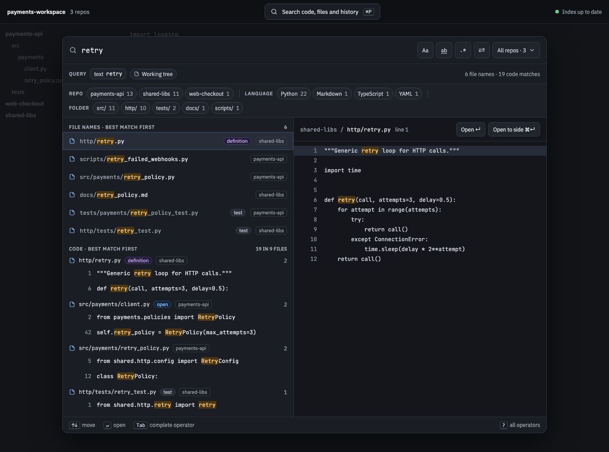
</a>

The built panel

<!-- /screen -->

## `order:`

| Short | Takes | Searches | Example |
| --- | --- | --- | --- |
| none | `best` (best match first, the default), `file:asc` or `file:desc` (by repo, file path and line, A to Z or Z to A), or `recent:desc` or `recent:asc` (by when each file last changed, newest or oldest first) | Current files only | `order:recent:desc retry` |

The order name in each results heading (**Best match first**) is a menu of the three orders, with an arrow beside it
for the direction, so you don't have to type one. A pick saves `spelunk.results.order`, the order a query without
`order:` uses; when the query has an `order:`, the menu and arrow rewrite it there instead. Plain `order:file` runs A
to Z and plain `order:recent` newest first. Path order is `file`, as `file:` names paths: `order:path`, its old name,
is an error whose fix is `order:file:asc`. Lines inside a file always stay top to bottom, and commits are always
newest first, so the Commits heading has no menu.

<!-- screen:path-order -->
**Screen 25: `order:file` keeps path order** · Screen id `path-order` · milestone 1.1

`order:file`, or the `spelunk.results.order` setting, sorts by repo, then path, then line, as before ranking.

<a href="images/mocks/PathOrder.png">
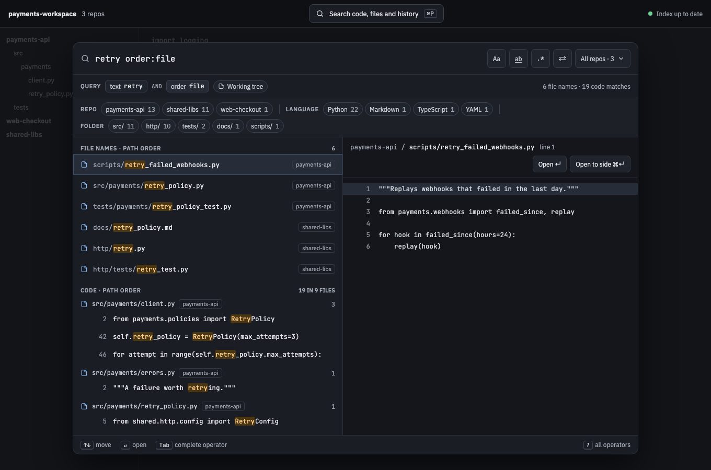
</a>

The built panel

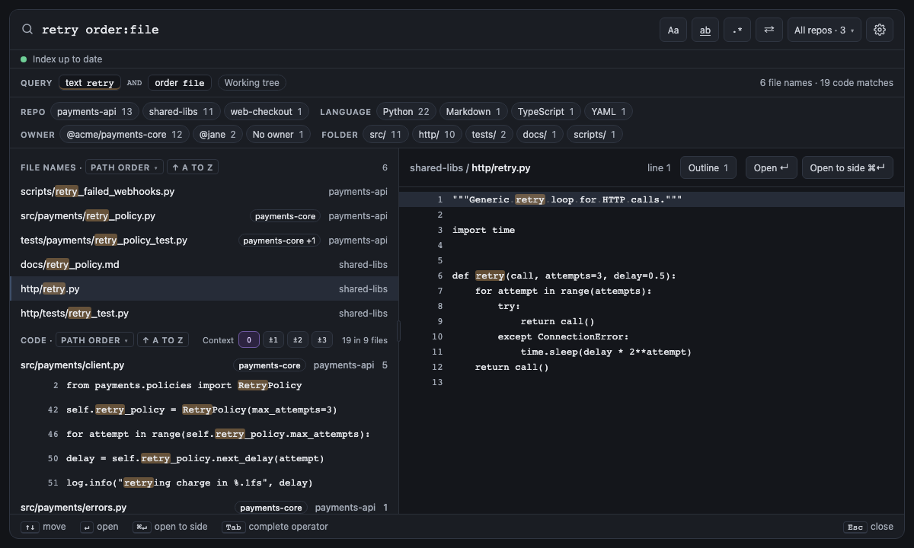

<!-- /screen -->

<!-- screen:recent-order -->
**Screen 54: Recently changed first: the order name above the results is a menu, with an arrow for the direction; each
code result says when its file changed** · Screen id `recent-order` · milestone 2.1

Pick **Recently changed** from the menu in a results heading and the files changed most recently come first: one
saved 10 minutes ago with uncommitted edits, then one committed 2 hours ago, then one outside Git saved yesterday.
A file's time is its save time when it has uncommitted edits or is outside Git, otherwise its newest commit, and each
code result says it ("Uncommitted · 10 minutes ago", "2 hours ago", with the author in the tooltip). The arrow flips
to oldest first (`↑ oldest`); a file with no commit in the history window Spelunk reads goes last either way, with no
time. Files changed in the same commit fall back to best match, and tests aren't moved down. Path order gets the
arrow too (`↑ a to z`, `↓ z to a`); best match runs one way, so its arrow is greyed out. At a past revision (`at:`)
the files have no last change: Recently changed is greyed out there, a setting of it falls back to best match, and a
typed `order:recent` is an error with **Remove**. Spelunk already knows each file's last commit, so the order costs no
extra Git work.

<a href="images/mocks/RecentOrder.png">
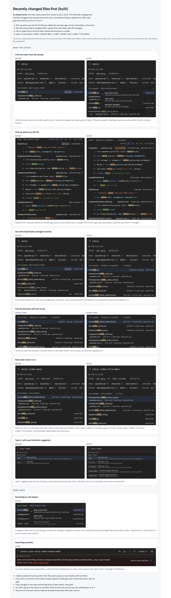
</a>

The built panel

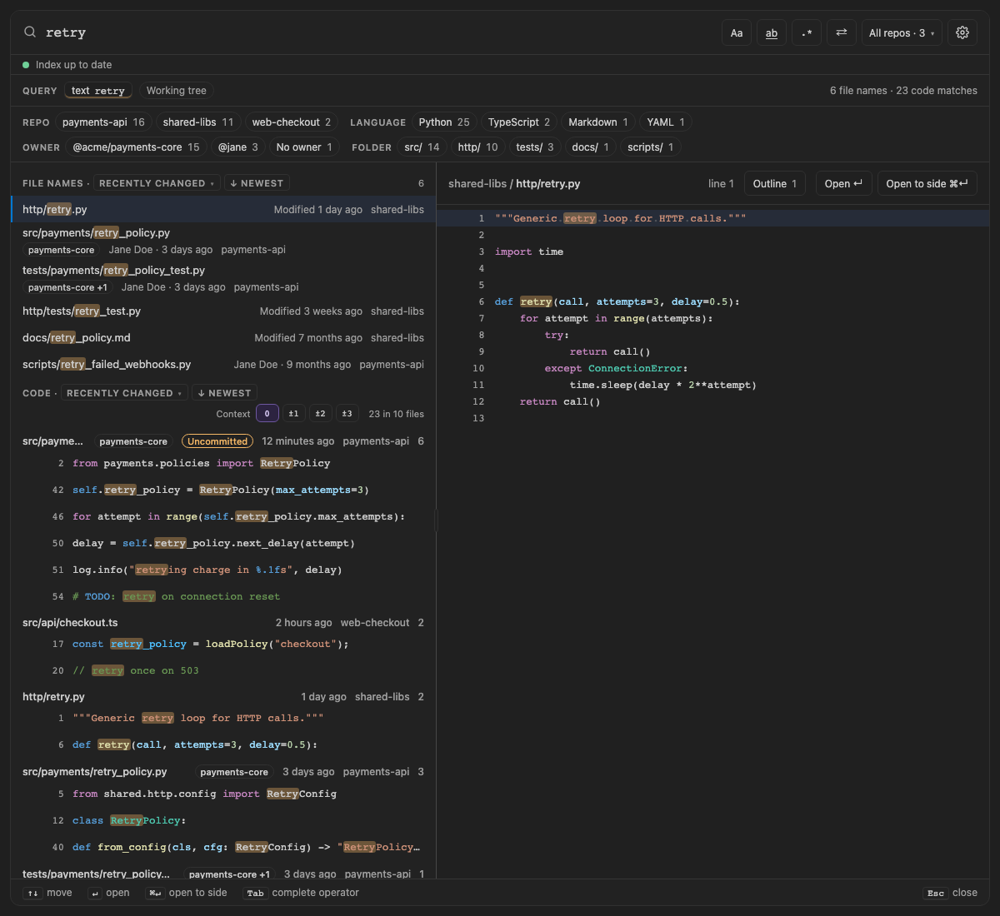

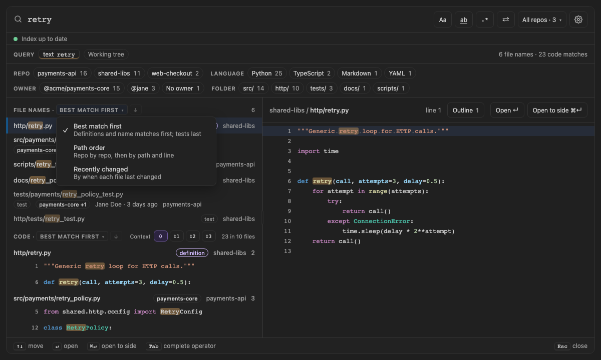

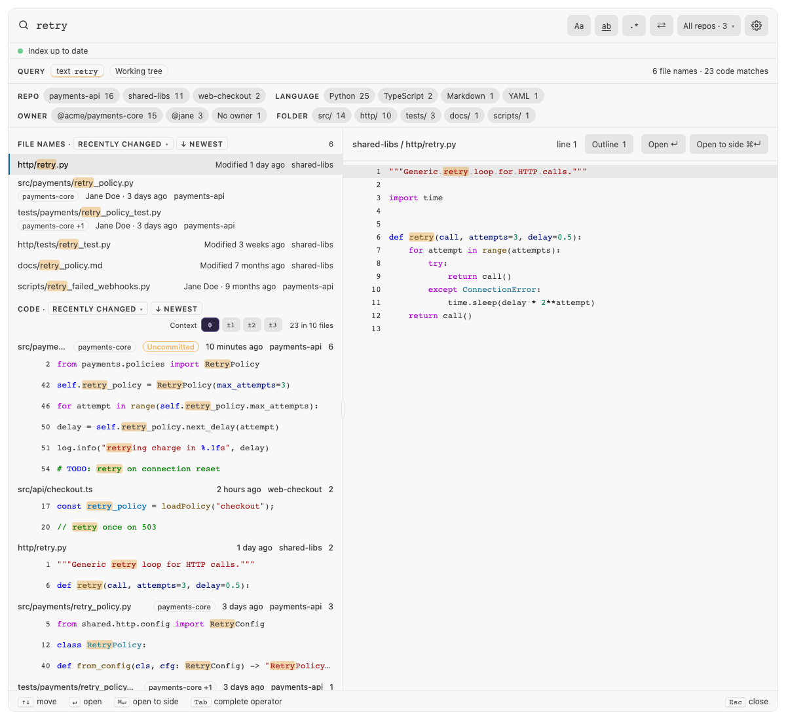

<!-- /screen -->

## `count:`

| Short | Takes | Searches | Example |
| --- | --- | --- | --- |
| none | A positive number (capped at 50,000), or `all` | Current files and commits | `count:all retry` |

The first page holds 500 results (`spelunk.results.count`); **Load more** fetches the next. Any count over
50,000 stops there, and the results say they were truncated.

A note that counts what a filter hid ("18 matches hidden by `case:yes`") shows only when every one could be counted:
a search that runs out of time, or whose count without the filter passes 50,000, leaves the note out rather than
show a number too small.

## Facets

<!-- screen:result-facets -->
**Screen 30: Facets — counts by repo, language and folder (author and month for commits) narrow the results** ·
Screen id `result-facets` · milestone 1.1

A row between the query chips and the results counts every result the search found, not just the page shown: by repo,
language and top folder for file names and code, and by repo, author and month (newest first) for commits. Each facet
shows its five biggest buckets, then **+N**, which shows the rest until the next search. Click a bucket to keep only its
results: it adds that bucket's filter to the query, such as `repo:^payments-api$`, `lang:python`, `f:^src/`,
`author:"Jane Doe"` or, for a month, `since:2026-09 until:2026-09`. Alt-click (or Alt+Enter) adds the filter that leaves
it out instead (`-repo:^shared-libs$`, or `-(since:2026-09 until:2026-09)`). A query with OR at its top level goes in
parentheses first, as `(retry OR timeout) lang:python`, since AND binds tighter than OR and the filter would otherwise
narrow only the last branch. A bucket the query keeps shows pressed; one it leaves out stays in the row, struck through,
though it no longer finds anything. Clicking either takes its filter back out. The row hides when there's nothing to
choose between, such as one repo and one language.

<a href="images/mocks/Facets.png">
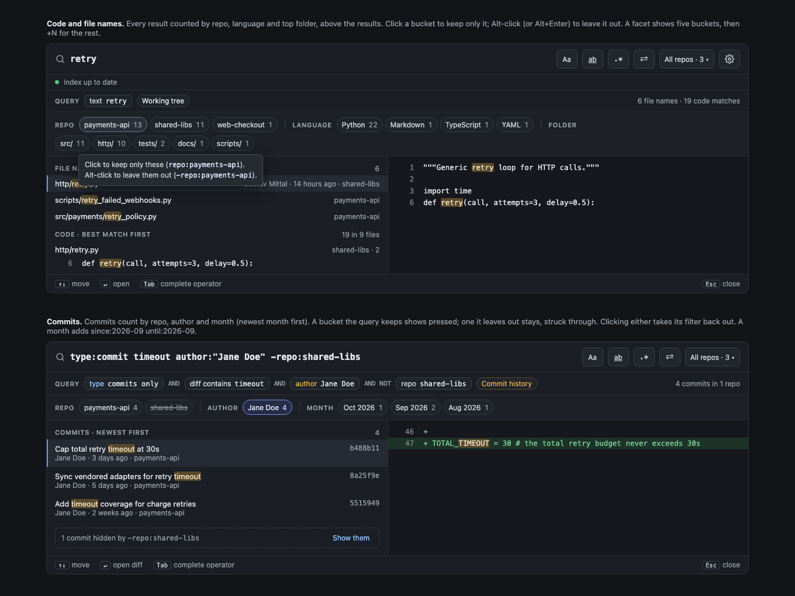
</a>

The built panel

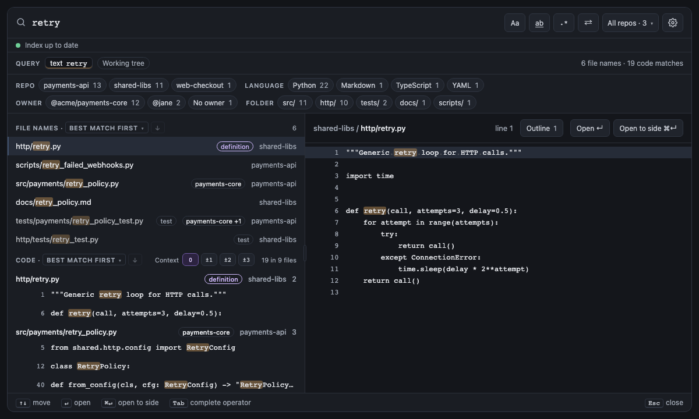

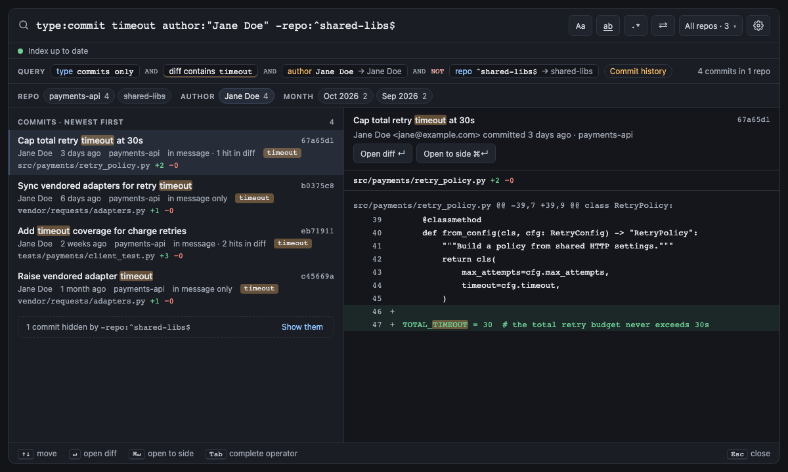

<!-- /screen -->

## Context lines

<!-- screen:context-lines -->
**Screen 36: Context lines: a few lines around each code match, merged when they touch** · Screen id `context-lines` ·
milestone 1.2

With **±2** pressed in the Code heading, each match of `_retry` shows two dimmed lines above and below it. The
matches on lines 14 and 17 of `client.py` share one run from 12 to 19 instead of repeating lines 15 and 16, and
**⋯** marks the jump to the run around line 31. A run drops only the indentation all its lines share, so the code
keeps its shape. ↑ ↓ step from match to match, skipping the dimmed lines, and **0** (the default) shows only the
matching lines. The buttons save `spelunk.results.contextLines`.

<a href="images/mocks/ContextLines.png">
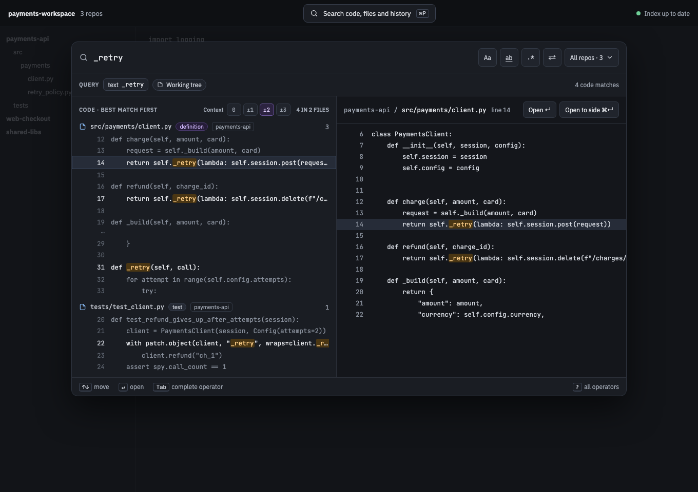
</a>

The built panel

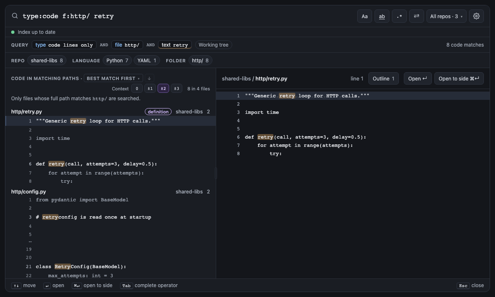

<!-- /screen -->

## Syntax colors and whitespace

<!-- screen:syntax-colors -->
**Screen 43: Syntax colors and whitespace: code in the theme's colors, by VS Code's grammars** ·
Screen id `syntax-colors` · milestone 2.1

Code reads as it does in the editor. Results, their context lines and the preview take the active color theme's
syntax colors, worked out by the same grammars VS Code colors the editor with, so a keyword, a string or a comment is
the color it is in your editor, and a match keeps its highlight on top. Switching the theme, or customizing it with
`editor.tokenColorCustomizations`, colors the panel again. A file no installed grammar knows stays plain, and so does
a line the Replace row shows replaced. Code shows first and its colors follow a moment later, so they never slow
results down.

The preview marks whitespace as `editor.renderWhitespace` says: a faint dot for each space and an arrow for each tab,
drawn over the character, so the code keeps its width and copies as written. By default (`selection`) that's the
matched line, as the editor marks a selection; `boundary` marks indentation, trailing whitespace and runs of spaces,
`trailing` only trailing whitespace, and `all` every space. Code also follows `editor.tabSize`, `editor.fontSize` and
`editor.fontLigatures`.

`spelunk.ui.syntaxHighlighting` turns the colors off, and `spelunk.ui.renderWhitespace` picks whitespace marks for the
panel alone (`editor`, the default, follows the editor).

<a href="images/mocks/SyntaxColors.png">
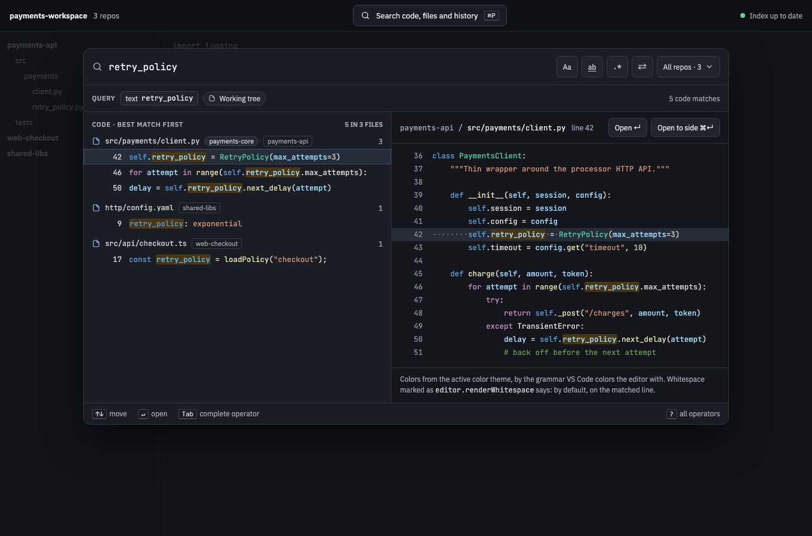
</a>

The built panel

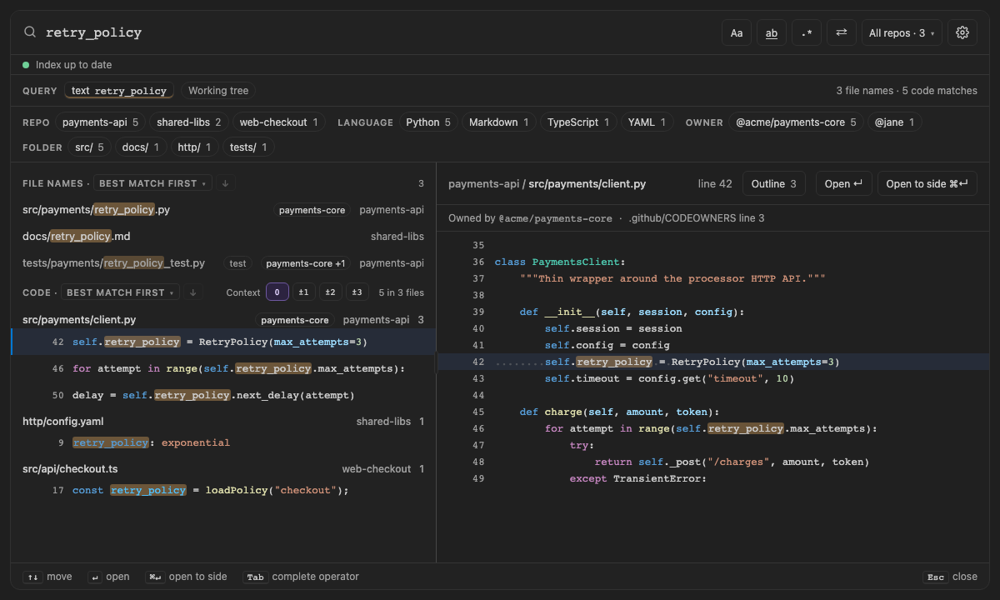

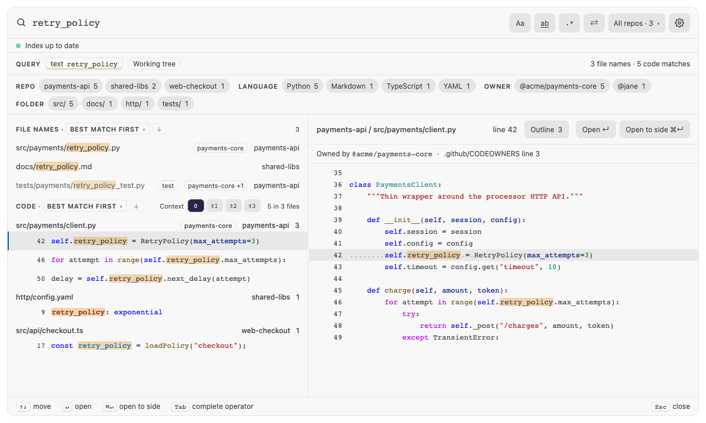

<!-- /screen -->

---

**Next:** [[Error index|Error Index]]: what each error and warning means, and the fix it offers.
