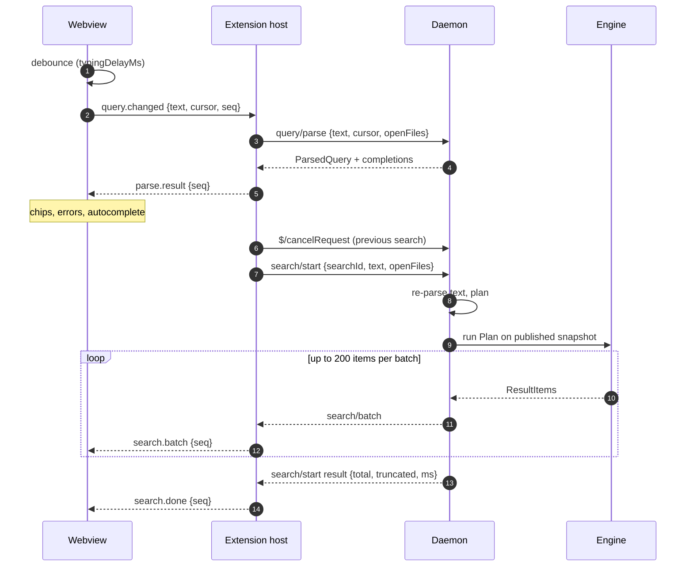
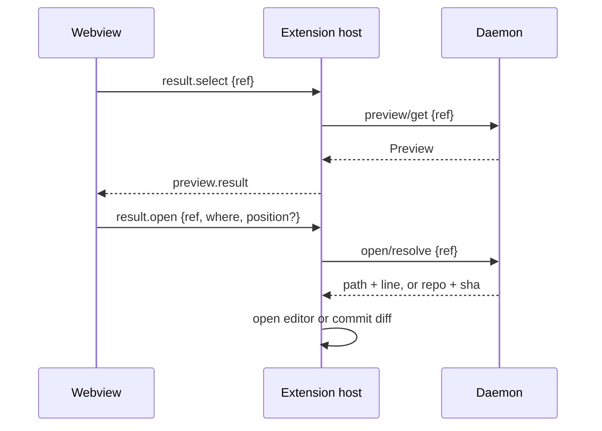

# Search Flow

<!-- Mermaid sequence-diagram keyword. -->
<!-- cspell:words autonumber -->

When you type, the panel waits briefly for a pause, then sends your query through the extension to the daemon.
The daemon checks the query and streams results back in batches. A new query cancels the previous search.

For the component map, start with [[Architecture Overview]]. The diagrams below show the messages used by
contributors working on search, preview or editor integration.

## From typing to results

## What keeps it correct

- **Stale responses are dropped.** Every message carries the keystroke's `seq`; the webview ignores anything older
  than the newest it sent.
- **Every keystroke cancels the last search.** Daemon loops check `ctx.Done()`.
- **The daemon re-parses.** `search/start` takes text, not an AST, so the daemon never trusts a parse it didn't make.
- **Searches read snapshots.** The indexer publishes complete indexes in one step, so a search never sees a
  half-written one.
- **Pages never overlap.** In best-match order the engine sorts candidate files by what it knows before reading
  them (definitions, file names, open and recently changed files, tests, vendored and generated code), then scans them
  in that order,
  so the Nth result is the same whichever page asks for it. How well lines match only reorders files within a page,
  which is held until it is full or 50 ms have passed.

## Selecting and opening

`ref` is opaque outside the daemon: hosts and webviews pass it back unchanged.

---

**Next:** [[Indexing]]: how the indexes are built and kept fresh.
