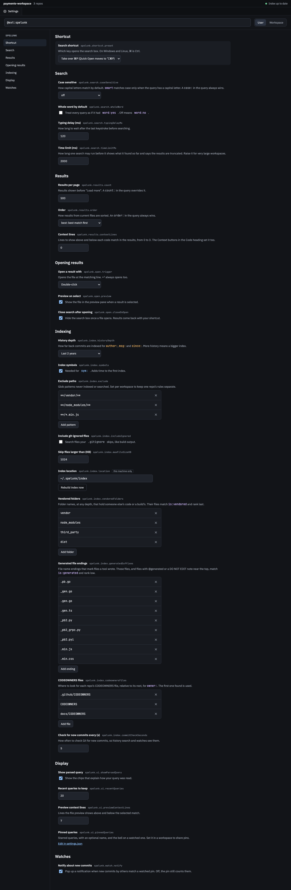

# Settings and Commands

<!-- Linked screenshots and expandable previews require these HTML elements. -->
<!-- markdownlint-configure-file {"MD033": {"allowed_elements": ["a", "img"]}} -->

Every Spelunk command and setting.

## Commands

Run from the Command Palette.

| Command | Does |
| --- | --- |
| **Spelunk: Open** | Open the search panel. Its key, pressed in the editor with text selected, searches that text (see [Searching from your code](Using-the-Panel#searching-from-your-code)) |
| **Spelunk: Find Definitions** | Search where the name at the cursor is defined, exactly that name. Also on the editor's right-click menu |
| **Spelunk: Find Uses** | Search the lines that use the name at the cursor. Also on the editor's right-click menu |
| **Search in Folder with Spelunk** (`spelunk.searchInFolder`) | Search only inside the folders right-clicked in the Explorer. On the Explorer's right-click menu only, not in the Command Palette (see [Searching a folder](Using-the-Panel#searching-a-folder)) |
| **Spelunk: Open Help** | The guide: operators, examples, keys |
| **Spelunk: Next Result** / **Previous Result** | Step through results (F4 / ⇧F4); listed while there are results |
| **Spelunk: Rebuild Index** | Pick a repo, or All repos, and build its index again from scratch |
| **Spelunk: Restart Search** | Restart the search process |
| **Spelunk: Show Welcome** | Reopen the welcome page |
| **Spelunk: Install 'spelunk' Command in PATH** | Put the `spelunk` command in `~/.local/bin` (Windows: `%LOCALAPPDATA%\Programs\Spelunk`), kept current after updates (see [[Agents and the Terminal]]) |
| **Spelunk: Add to Claude Code** | Ask, install the command, run Claude Code's `claude mcp add`, and offer a short note for the folder's `CLAUDE.md` |
| **Spelunk: Set or Change Anthropic API Key** | Ask for the key that lets Ask turn a question into a query, keep it in VS Code's secret storage, and turn Ask on (see [Asking in plain words](Using-the-Panel#asking-in-plain-words)). When a key is saved, it shows the key's last four characters: enter a new one to replace it, or leave it empty to remove it. The `spelunk.ask.provider` setting links here |
| **Spelunk: Choose Ask Model** | List the models your Anthropic key can use, newest first, with the effort levels each takes; the one you pick sets `spelunk.ask.model`, and its levels are offered for `spelunk.ask.effort`. Without a key, asks for it first |

### The result menu

Right-click a result in the panel. These commands are on that menu only, not in the Command Palette, and act on the
result clicked. See [Sharing a result](Using-the-Panel#sharing-a-result).

| Command | Does |
| --- | --- |
| **Open** / **Open to the Side** (`spelunk.result.open`, `spelunk.result.openToSide`) | Open the result, as ↵ and ⌘↵ do |
| **Copy** (`spelunk.result.copy`) | Copy the path, line and code: `src/payments/client.py:46: for attempt in range(3):` |
| **Copy Path** (`spelunk.result.copyPath`) | Copy the file's full path and line. ⌥⌘C (Shift+Alt+C) while the panel has the focus, on the selected result |
| **Copy Relative Path** (`spelunk.result.copyRelativePath`) | Copy the path from the workspace folder and line: `src/payments/client.py:46`. ⇧⌥⌘C (Ctrl+K Ctrl+Shift+C) |
| **Copy SHA** / **Copy SHA and Subject** (`spelunk.result.copySha`, `spelunk.result.copyShaAndSubject`) | On a commit: its full sha, or `4421bd6 Retry charges` |
| **Copy GitHub Permalink** / **Open on GitHub** (`spelunk.result.copyPermalink.github`, `spelunk.result.openOnRemote.github`) | Copy, or open in the browser, the result's address on GitHub: the line in the file, or the commit |
| **Copy GitLab Permalink** / **Open on GitLab**, **Copy Bitbucket Permalink** / **Open on Bitbucket**, **Copy Gitea Permalink** / **Open on Gitea**, **Copy Azure DevOps Permalink** / **Open on Azure DevOps** (`.gitlab`, `.bitbucket`, `.gitea`, `.azure`) | The same, named after the repo's host; the menu shows the pair for that host only |
| **Copy Permalink** / **Open on Remote** (`spelunk.result.copyPermalink`, `spelunk.result.openOnRemote`) | The same, for a server Spelunk can't name (the first time, it asks which kind of server it is, and remembers), a repo with several remotes (it asks which), or one with none (greyed out) |
| **Copy All Results** (`spelunk.results.copyAll`) | Copy the results loaded so far as text, one per line; it says when the search found more |
| **Export Results** › **Text (.txt)**, **Markdown (.md)**, **CSV (.csv)**, **JSON (.json)** (`spelunk.results.exportText`, `spelunk.results.exportMarkdown`, `spelunk.results.exportCsv`, `spelunk.results.exportJson`) | Save every result, up to 10,000, to a file; Markdown, CSV and JSON link each to its permalink |
| **Copy Link to This Search** (`spelunk.results.copySearchLink`) | Copy `vscode://spelunk.spelunk/search?q=…`, which opens Spelunk on the query when clicked |

## Settings

Search for "Spelunk" in Settings. They're grouped the way the Settings page lists them, and each key starts with its
group's name. One value serves the whole window, so they're set in user or workspace settings (a folder's
`.vscode/settings.json` when you open just that folder), never per folder of a multi-root workspace. Some only in
user settings: the shortcut, the typing delay, the three opening choices, `ui.showParsedQuery`, `ui.recentQueries`,
`ui.syntaxHighlighting` and `ui.renderWhitespace`;
and `index.location` only in this machine's user settings.

### Shortcut

| Setting | Default | Does |
| --- | --- | --- |
| `spelunk.shortcut.preset` | `quickOpen` | Which key opens search: `quickOpen` (⌘P; Quick Open moves to ⌥⌘P), `findInFiles` (⇧⌘F; VS Code's Search view then has no key, so open it from the Activity Bar or bind `workbench.view.search`), or `none` |

### Search

| Setting | Default | Does |
| --- | --- | --- |
| `spelunk.search.caseSensitive` | `off` | How capital letters match by default: `off` (ignore case), `on` (match case) or `smart` (match case only when the query has a capital letter). A `case:` in the query always wins. |
| `spelunk.search.wholeWord` | `false` | Match whole words by default, so `retry` doesn't match `retryCount`. A `word:` in the query always wins |
| `spelunk.search.match` | `exact` | How a word matches file names by default: `exact`, its text only, or `fuzzy`, also file names that have its letters in order (`rtrypol` finds `retry_policy.py`). A `match:` in the query always wins; lines of code always match exactly |
| `spelunk.search.useExcludeSettings` | `true` | Leave out the files `files.exclude` and `search.exclude` hide, as VS Code's own search does; a note under the results counts them, and its Show them adds `excludes:no`. Off, every indexed file shows |
| `spelunk.search.seedFromSelection` | `true` | Search the editor's selection when the search key is pressed in the editor. Off, the panel reopens with the last query, as it does with nothing selected |
| `spelunk.search.typingDelayMs` | `120` | Milliseconds to wait after a keystroke before searching |
| `spelunk.search.timeLimitMs` | `2000` | Milliseconds one search may run, 100 to 60000, before it shows what it found so far, marked truncated. Raise it for very large workspaces |

### Results

| Setting | Default | Does |
| --- | --- | --- |
| `spelunk.results.count` | `500` | Results per page without `count:` |
| `spelunk.results.order` | `best` | How results from current files are sorted without `order:`: `best` (best match first), `file` or `file:desc` (path order, A to Z or Z to A; a value saved as `path` still works), or `recent` or `recent:asc` (recently changed, newest or oldest first). The order menu and arrow in each results heading set it, where its value comes from (workspace or user) |
| `spelunk.results.contextLines` | `0` | Lines shown above and below each code match, 0 to 3. The **Context** buttons in the Code heading set it, where its value comes from (workspace or user) |

### Opening results

| Setting | Default | Does |
| --- | --- | --- |
| `spelunk.open.trigger` | `doubleClick` | Whether a single or double click opens a result. A single click always previews |
| `spelunk.open.preview` | `true` | Open results in a preview editor that the next result replaces |
| `spelunk.open.closeOnOpen` | `true` | Hide the panel after opening a result, except to the side |

### Indexing

| Setting | Default | Does |
| --- | --- | --- |
| `spelunk.index.historyDepth` | `2y` | How much Git history to index: `6m`, `2y` or `all` |
| `spelunk.index.symbols` | `true` | Find definitions for `symbol:` and `kind:` while indexing |
| `spelunk.index.exclude` | `**/vendor/**`, `**/node_modules/**`, `**/*.min.js` | Globs never indexed, in files or history. Without a slash a pattern matches at any depth; as in `.gitignore`, a trailing slash names a folder (`node_modules/`) and a leading one anchors it at the repo root (`/build`) |
| `spelunk.index.includeIgnored` | `false` | Also index files matched by `.gitignore` |
| `spelunk.index.maxFileSizeKB` | `1024` | Skip larger files. A Jupyter notebook counts only its cells' code and notes, not its outputs and plots |
| `spelunk.index.mergedBranches` | `false` | Also search the commits made on branches that were merged in, each under its own author, marked **merged in** with its merge, and dated by when it was merged for `since:`, `until:` and the order of results; a merge then holds only the lines it changed itself, such as a conflict's resolution. Takes longer to read and more memory on a repo with many merges. See [Renames and merged branches](Commits-and-Time#renames-and-merged-branches) |
| `spelunk.index.notebookOutputs` | `false` | Also search the text a Jupyter notebook's code cells printed or returned, as results under **Cell N · Output**. Plots and other images are never searched |
| `spelunk.index.location` | `~/.spelunk/index` | Where indexes are stored: an absolute path, or one starting with `~`. Anything else (`relative/idx`, `${workspaceFolder}/idx`) stores them in the default place, and the **Spelunk** output channel says why. Never synced |
| `spelunk.index.vendoredFolders` | `vendor`, `node_modules`, `third_party`, `dist` | Folder names, at any depth, whose files `is:vendored` matches and best-match order ranks last |
| `spelunk.index.generatedSuffixes` | `.pb.go`, `_gen.go`, `.gen.go`, `.gen.ts`, `_pb2.py`, `_pb2_grpc.py`, `_pb2.pyi`, `.min.js`, `.min.css` | File name endings that mark files a tool wrote, for `is:generated` and ranking. A `@generated` or `DO NOT EDIT … generated` note near the top of a file counts whatever this says |
| `spelunk.index.codeownersFiles` | `.github/CODEOWNERS`, `CODEOWNERS`, `docs/CODEOWNERS` | Where to look for each repo's CODEOWNERS file, relative to its root, for `owner:`. The first one found is used |
| `spelunk.index.commitCheckSeconds` | `5` | How often, 1 to 3600 seconds, to check Git for new commits, so history search and watches see them |

### Display

| Setting | Default | Does |
| --- | --- | --- |
| `spelunk.ui.showParsedQuery` | `true` | Show the chips under the box |
| `spelunk.ui.recentQueries` | `20` | How many recent queries to remember, 0 to 100. Lowering it forgets the oldest; 0 keeps none |
| `spelunk.ui.previewContextLines` | `7` | Lines the file preview shows above and below the selected match, 0 to 100 |
| `spelunk.ui.syntaxHighlighting` | `true` | Color code in results and the preview with the color theme's syntax colors, by the grammars VS Code colors the editor with. See [Syntax colors](Results-and-Ranking#syntax-colors-and-whitespace) |
| `spelunk.ui.renderWhitespace` | `editor` | Which whitespace the preview marks: `editor` follows `editor.renderWhitespace`; or `none`, `boundary`, `selection` (the matched line), `trailing` or `all` |
| `spelunk.ui.pinnedQueries` | `[]` | Starred queries, each `{ "query": …, "name": … }` with an optional name, and `"watch": true` on a watched one (the bell). A query listed twice is one pin, in its first place, watched if either entry is. Set it in a workspace to share pins; pinning then saves there |

### Watches

| Setting | Default | Does |
| --- | --- | --- |
| `spelunk.watch.notify` | `true` | Pop up a notification when new commits by others match a watched pin. Off, the pin still counts them |

### Links

| Setting | Default | Does |
| --- | --- | --- |
| `spelunk.permalinks.hosts` | `{}` | Which kind of Git host a server is, for **Copy Permalink**, which saves your answer here the first time it asks: `{ "git.acme.corp": "gitlab" }`, by the host name in the remote's URL; one of `github`, `gitlab`, `bitbucket`, `gitea` or `azure`. github.com, gitlab.com, bitbucket.org, codeberg.org and dev.azure.com need none, and a name with `github`, `gitlab`, `gitea` or `forgejo` in it is guessed |

### Agents and terminal

| Setting | Default | Does |
| --- | --- | --- |
| `spelunk.agent.shareWindow` | `true` | Let the `spelunk` command and AI agents on this computer search the folders open in this window, live. They only read. Off, they search the saved index through a background reader |
| `spelunk.agent.offerToCopilot` | `true` | List Spelunk's read-only tools for Copilot and other agents in VS Code (VS Code 1.101 or later) |
| `spelunk.agent.timeLimitMs` | `30000` | How long a search from the `spelunk` command or an agent may run before it returns what it found, marked as stopped early (1,000–600,000) |

### Editor navigation

| Setting | Default | Does |
| --- | --- | --- |
| `spelunk.editor.workspaceSymbols` | `true` | List Spelunk's definitions in **Go to Symbol in Workspace** (⌘T), in every repo and language, by a few letters of their names ([how](Using-the-Panel#go-to-symbol-and-go-to-definition)) |
| `spelunk.editor.definitions` | `off` | Whether **Go to Definition** and **Find References** use the index: `off`, `fallback` (only when no language server answers) or `always` (added to theirs). By name, not meaning |
| `spelunk.editor.includeGeneratedAndVendored` | `false` | Include definitions and uses in generated and vendored files in all three, marked and listed last |

### Ask in plain words

| Setting | Default | Does |
| --- | --- | --- |
| `spelunk.ask.provider` | `off` | Who turns a question ending in `?`, or one asked with the **Generate query** button, into a query: `off`, or `anthropic` (Claude; needs **Spelunk: Set or Change Anthropic API Key**). Only the question goes to the provider, never your code ([how](Using-the-Panel#asking-in-plain-words)) |
| `spelunk.ask.model` | `claude-opus-5-5` | The provider's model that writes the query; `claude-haiku-4-5` answers faster and costs less. The setting's **Choose from your Anthropic models** link (or **Spelunk: Choose Ask Model**) opens a list of the models your key can use, fetched from Anthropic, and sets this |
| `spelunk.ask.effort` | `low` | How long the model thinks before writing the query: `low`, `medium`, `high` or `max`. Raise it when a question keeps becoming the wrong query. A level the model doesn't take becomes the nearest it does, and Claude 4.5 and older take none; the models list Anthropic gives says which |
| `spelunk.ask.shareNames` | `true` | Send the repo names and the CODEOWNERS team names with the question, so a query can name them (`repo:web`, `owner:payments-core`). Off, the question goes alone |

### Moved settings

Five settings moved into their groups. A value saved under an old key, in user or workspace settings, moves to the new
key when Spelunk starts or when the value appears, unless the new key already has one; a `true` or `false` saved for
`caseSensitive` moves as `on` or `off`. An old typing delay in workspace settings is removed, since only user settings
hold the new one. In a multi-root workspace, an old key in one folder's settings is left alone: VS Code never applied
it there, and it moves when that folder is opened on its own.

| Old key | New key |
| --- | --- |
| `spelunk.caseSensitive` | `spelunk.search.caseSensitive` |
| `spelunk.wholeWord` | `spelunk.search.wholeWord` |
| `spelunk.typingDelayMs` | `spelunk.search.typingDelayMs` |
| `spelunk.defaultCount` | `spelunk.results.count` |
| `spelunk.order` | `spelunk.results.order` |

## How it looks in Settings

<!-- screen:settings -->
**Screen 18: Settings in VS Code** · Screen id `settings` · milestone M5

<!-- /screen -->

---

**Next:** [[Troubleshooting]]: what the panel does in each situation.
