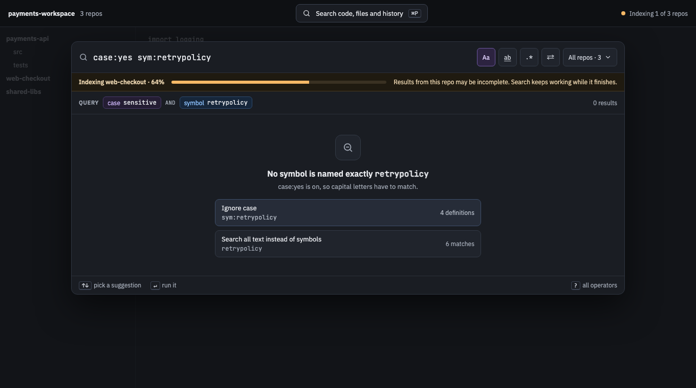
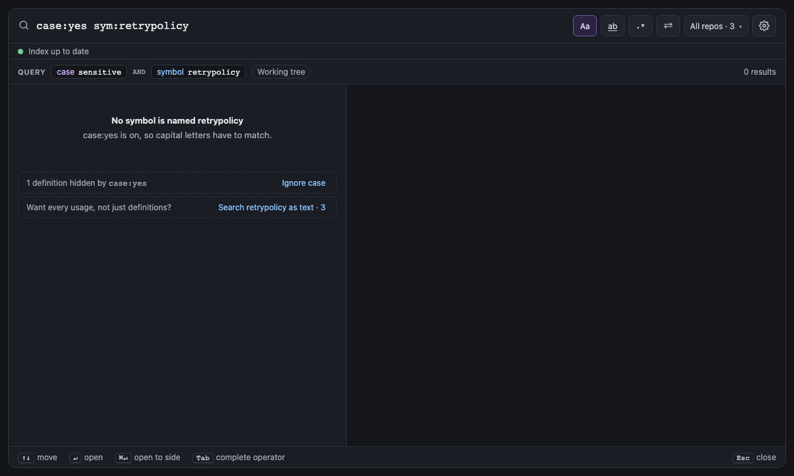

# Troubleshooting

<!-- Linked screenshots and expandable previews require these HTML elements. -->
<!-- markdownlint-configure-file {"MD033": {"allowed_elements": ["a", "details", "img", "summary"]}} -->

What the panel does in each situation, and what you can do about it. For an error or warning under the query, see
the [[Error index|Error Index]].

## Why do the results change while I type?

- Each keystroke waits 120 ms (`search.typingDelayMs`), then cancels the previous search and starts a new one. Results
  from
  an older keystroke are never shown over newer ones.
- While you're still typing an operator or value, the results stay on the finished words. ↵ or Esc searches the word
  as typed.

## Why didn't my query run?

It has an error. The panel underlines it, says what's wrong and offers a fix (⌘. applies the first). The last good
results stay on screen until the query is fixed. Every error is listed, with its fix, in the
[[Error index|Error Index]].

## Why is nothing found?

The panel says "No results" (or "No symbol is named …" for `symbol:`) and why:

- `case:yes` is on, so capital letters have to match;
- smart case matches case when the query has a capital letter;
- `word:yes` is on, so only whole words match;
- or filters hid results, listed below with their counts ("3 commits hidden by `-file:vendor/` · Show them");
- otherwise, try fewer terms.

`symbol:` with no match also offers to search the name as text, with how many matches that finds.

## Why are some results missing while a repo indexes?

You can search at once. A repo still indexing returns what's indexed so far, and a banner says which repos are still
indexing. Recent history is searchable first: Git is read newest commit first.

<!-- screen:no-results-while-indexing -->
**Screen 14: No results while indexing** · Screen id `no-results-while-indexing` · milestone M4

The built panel

<!-- /screen -->

## How soon can I find what I just changed?

| You | Searchable within |
| --- | --- |
| Save, create or delete a file | About a second, without a rebuild |
| Commit, pull or merge | About 5 seconds (HEAD is checked every 5 s, or as often as `spelunk.index.commitCheckSeconds` says) |

## Which folders and files are searched?

| Situation | What happens |
| --- | --- |
| A folder isn't a Git repository | Files are searched; commit searches find nothing there, `since:` uses each file's modification time, and `at:` leaves it out with a note. The welcome page says "not a Git repository, so no history". Run `git init` (or clone) there and history turns on within `index.commitCheckSeconds`, no reload needed |
| Git isn't installed | Same: files only |
| Several repos in the workspace | All are searched together; each result shows its repo. Scope with `repo:` or the repo menu |
| Nested repos, submodules | Indexed |
| A workspace folder inside another | Its files belong to the inner folder alone, so each is found, counted and replaced once; close the inner folder and the outer one takes them back |
| Symlinks | A symlinked root is indexed where it points; symlinks inside a root are skipped, and a preview never follows one out of its folder, even a folder replaced by a link after the search |
| Files in `.gitignore` | Skipped, unless `index.includeIgnored` is on |
| `vendor/`, `node_modules/`, `*.min.js` | Skipped by default (`index.exclude`). History keeps their line counts, not their lines |
| Files over 1 MB, or binary | Skipped (`index.maxFileSizeKB`) |
| UTF-16 files, byte order marks, CR line endings | Searched as the editor shows them |
| History older than 2 years | Not indexed unless `index.historyDepth` is `all` |
| Merge commits | History follows the branch's own line, so a merge shows as one commit holding its whole branch. Turn on `index.mergedBranches` to also search the branch's commits, under their own authors (Git 2.36 or later) |
| Renamed files | Followed: `file:` finds a file's commits under every name it had. A copy, or a file rewritten by more than half, starts its own history |

## What are the limits?

| Limit | Value |
| --- | --- |
| Query length | 1,000 characters; a longer query is flagged as an error and not run, nor kept as the box's text for next time |
| Results per page | 500 by default; `count:all`, or any larger number, is capped at 50,000 |
| Regular expressions | RE2: linear time, no backreferences or lookaround, so no query can hang the search |
| A match across lines | Shows its first line and up to 10 more, then where it ends; the preview shows up to 200 more |
| `at:` | A revision's files are read from Git the first time it is searched, every repo at once, which takes as long as the biggest repo needs, and kept for the next search: the two newest revisions at a time, in memory only |
| A `struct:` template | A result lists up to 80 characters of what each hole took. A template whose holes could split a line in very many ways stops trying in that file after a bounded amount of work (two million steps, and more for a bigger file), so no template can hold the search; the search goes on in other files, and its results are marked truncated |

## Something went wrong. What now?

| Problem | What happens | What you can do |
| --- | --- | --- |
| The search process crashes | Restarted automatically, after a pause that starts at 200 ms and doubles each time up to 30 s, at most 3 times a minute. The panel shows "Search restarting…", then "Search stopped" if it keeps failing | Click **Restart** in the panel, or run **Spelunk: Restart Search** |
| The search process stops answering | When a search, preview or open has waited and nothing has come from it for 20 s, it's asked whether it still answers; no answer within 10 s restarts it, as after a crash, and what waited fails | The same as after a crash |
| A result doesn't open | A result whose file is gone greys out. Otherwise (an editor that can't show the file, a commit or revision that can't be read, a stopped search process) an error message says why, and the **Spelunk** output channel keeps it | Act on the reason; search again for a greyed-out result |
| A saved index is damaged | That repo is rebuilt; others keep working | Nothing |
| The disk is full | The new index is used for this session but not saved ("Index not saved") | Free space, then **Rebuild Index** |
| Anything else | Details are in the **Spelunk** output channel (View → Output) | **Spelunk: Rebuild Index** starts the index from scratch |

Indexes stay on your machine under `index.location`. Nothing is sent anywhere.

---

**Next:** [[Settings and Commands]]: every setting and command.
