# Using the Panel

<!-- Intentional fuzzy-query fragment shown in the editor-navigation screenshot. -->
<!-- cspell:ignore retpol -->

<!-- Linked screenshots and expandable previews require these HTML elements. -->
<!-- markdownlint-configure-file {"MD033": {"allowed_elements": ["a", "details", "img", "summary"]}} -->

How to drive the search panel: opening it, the empty box, what you see as you type, results, Replace and keys.

## Opening it

Press the key you picked on the welcome page: ⌘P (Ctrl+P) by default, or ⇧⌘F (Ctrl+Shift+F). The command
**Spelunk: Open** works too. The panel reopens with your last query and results, unless you press the key with text
selected in the editor: then it searches that text ([below](#searching-from-your-code)). Right-click a folder in the
Explorer to search only inside it ([Searching a folder](#searching-a-folder)).

### Searching from your code

<!-- screen:seed-from-editor -->
**Screen 50: Search from your code: the editor's selection, or the name at the cursor, starts the search** ·
Screen id `seed-from-editor` · milestone 2.1

Select text in the editor and press the search key: the box holds that text, selected so typing replaces it, and the
results are there. ⌘Z in the box brings back the query it replaced, which also stays under **Recent**. With nothing
selected the key reopens your last query, as before.

- **One line** is searched exactly as you selected it, as a `"phrase"`, even a single word: `RetryPolicy` finds the
  lines that say `RetryPolicy`, and no file names, so not `retry_policy.py`, even under `match:fuzzy` (see
  [Fuzzy file names](Words-Regex-and-Logic#fuzzy-file-names)). A selection that looks like query syntax, such as
  `content:"retry"`, `TransientError:`, `-v` or `OR`, is searched as text, and its quotes and
  backslashes are escaped.
- **Aa and ab** stay as they were in the last query, and with **.\*** pressed the selection is a regex that matches
  it exactly: `self.retry_policy.next_delay(attempt)` becomes `/self\.retry_policy\.next_delay\(attempt\)/`.
- **Several lines** are one regex across them, with indentation and blank lines ignored, as in
  [Regexes across lines](Words-Regex-and-Logic#regexes-across-lines).
- **More than 10 lines, or 1,000 characters,** isn't searched: the last query stays, and the status bar says why.
- **Only the editor counts.** With the focus in the Explorer, the terminal or the panel, or on **Spelunk: Open** in the
  Command Palette, the key reopens the last query even if text is selected in a file.
- `spelunk.search.seedFromSelection` turns this off. A key you bind yourself to `spelunk.open` searches the selection
  when it passes `{ "fromEditor": true }` as its `args`.

Right-click a name in the editor for two more:

| Item | Searches |
| --- | --- |
| **Spelunk: Find Definitions** | Where the name is defined, exactly that name: `sym:/^RetryPolicy$/` finds `class RetryPolicy`, not `RetryPolicyConfig`. See [`symbol:`](Definitions-and-Code-Shape#symbol) |
| **Spelunk: Find Uses** | The lines that use it as a whole word, without the ones that define it: `ref:RetryPolicy`. See [`ref:`](Definitions-and-Code-Shape#ref) |

They take the name under the cursor, or a one-line selection, and are in the Command Palette too. On a blank line
nothing opens, and the status bar says to put the cursor on a name. They have no key of their own.

<a href="images/mocks/SeedFromEditor.png">
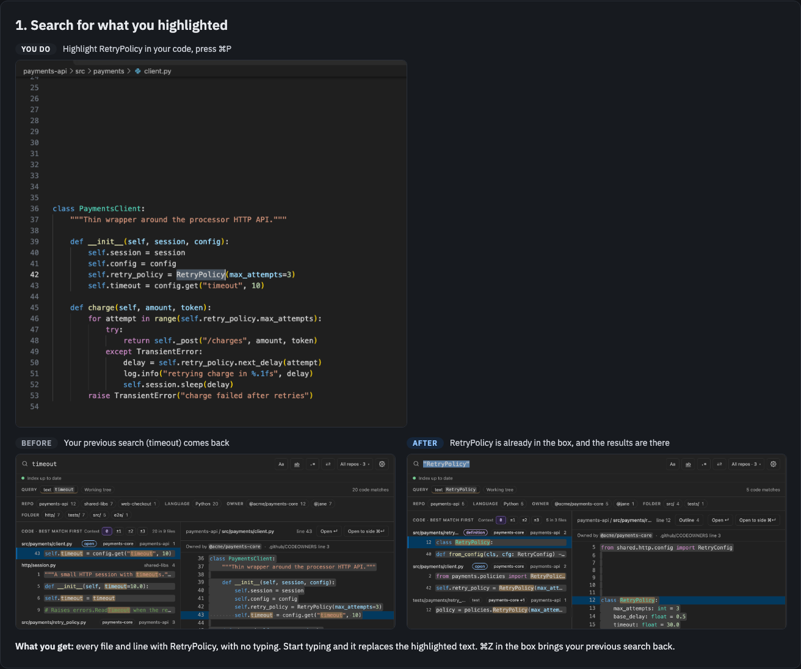
</a>

The built panel

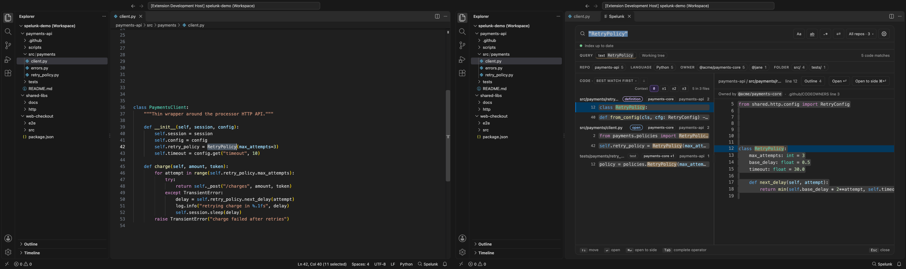

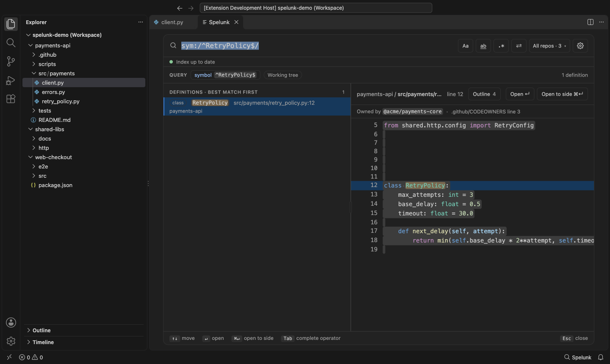

<!-- /screen -->

### Searching a folder

<!-- screen:search-in-folder -->
**Screen 51: Search in Folder: right-click a folder in the Explorer to search only inside it** ·
Screen id `search-in-folder` · milestone 2.1

Right-click a folder in the Explorer and pick **Search in Folder with Spelunk**, just under VS Code's own **Find in
Folder…**. The panel opens with the folder at the front of the box and the cursor after it, so what you type searches
that folder only; with nothing typed yet it lists the folder's files. A search already in the box stays after the
folder, and ⌘Z brings back the box as it was, which also stays under **Recent**.

| Right-click | The box starts with |
| --- | --- |
| A folder, with one workspace folder open | `f:^src/api/`: the path from the repo's root, so `e2e/src/api/` doesn't match |
| A folder, with several open | `repo:^web-checkout$ f:^src/api/`, so another repo's `src/api/` doesn't match |
| A workspace folder itself | `repo:^web-checkout$`: the whole repo |
| A folder that is also a workspace folder of its own, inside another | That workspace folder: `repo:^http$`, as its files belong to it |
| Several folders (⌘-click, then right-click one) | Each folder ORed, grouped by repo: `repo:^web-checkout$ (f:^src/api/ OR f:^e2e/)` |
| A file selected with the folders | The file too, by its whole path: `f:^package\.json$` |

- **Another folder adds to the first.** Right-click a second folder while the box still starts with the first one's
  scope and the results come from either: `(repo:^payments-api$ f:^src/ OR repo:^web-checkout$ f:^src/api/) retry`. A
  folder already covered, or inside one that is, changes nothing. Clear the box to start over; once you edit the scope
  yourself, the next folder goes in front of what you typed instead.
- **Any folder name works.** Regex characters are escaped (`a.b` is `f:^a\.b/`), and a name with a space, a bracket or
  a quote takes the slash form, `f:/^src\/app\/\(shop\)\/orders\/\[id\]\//`, which a bare value can't hold.
- **A folder whose files aren't searched says why**, under the results: "dist/ isn't searched: .gitignore leaves it
  out", with **Include ignored files** to open `spelunk.index.includeIgnored`; one that `spelunk.index.exclude` leaves
  out offers that setting; a folder reached through a symlink, which Spelunk never follows, or one with no files says
  so. No results then points to the note.
- **A folder in a Git repo of its own** (a submodule, or a repo cloned inside another) is searched like any other, but
  its commits aren't in the outer repo's history, so a history search there says "plugins/stripe-adapter/ is a Git repo
  of its own: its files are searched, but not its commits".
- The item shows on folders only, as Find in Folder does, and only for files on this machine. It isn't in the Command
  Palette, since it needs a folder, and has no key of its own.

<a href="images/mocks/SearchInFolder.png">
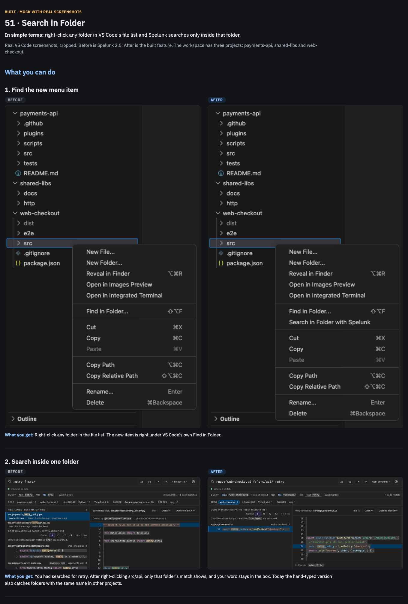
</a>

The built panel

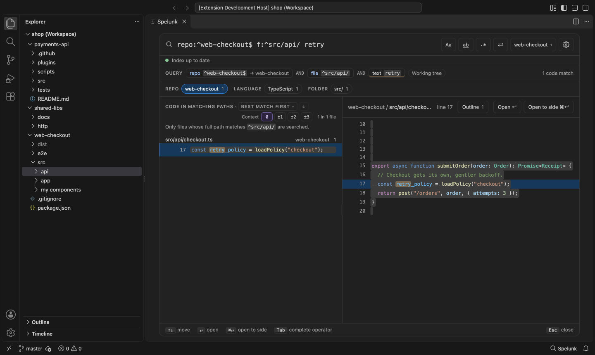

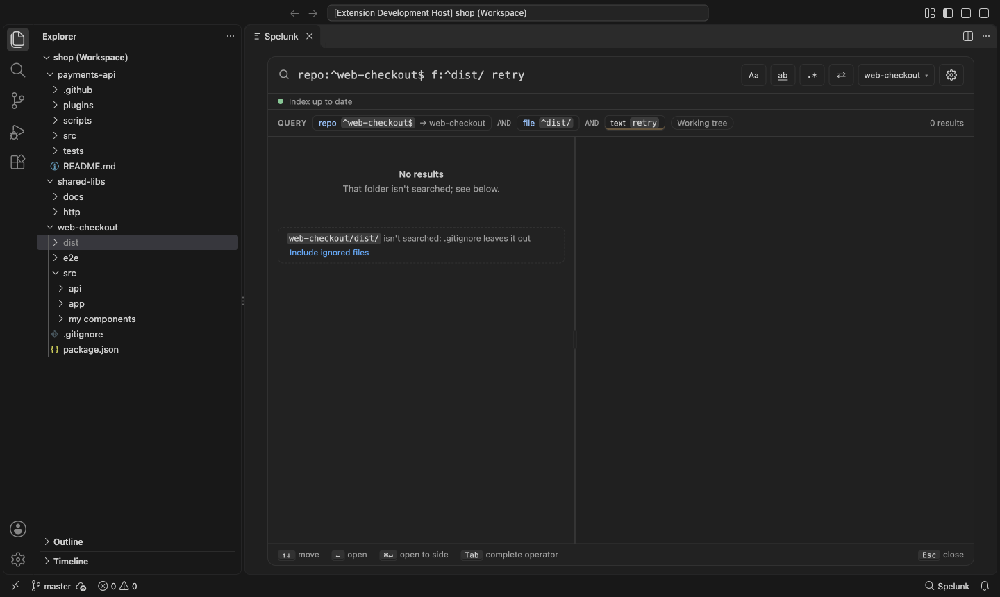

<!-- /screen -->

## Asking in plain words

Type a question the way you'd say it and end it with `?`, or press **Generate query** (first in the toolbar, left of
**Aa**), and Spelunk writes the query for you, shows it under the box and runs it: `which methods use RetryPolicy?`
becomes
`kind:method ref:RetryPolicy`, and the line under the box says **You asked** `which methods use RetryPolicy?` ·
**Searched as** `kind:method ref:RetryPolicy`, with one sentence on what it finds and anything the query had to
assume, such as "last month" read as the last 30 days. The query is in the box like any other: edit it, or press
**Edit question** to put your words back in the box, as if you had typed them, or **Ask again**. The query goes under
**Recent** at once, shown under your question, so it is still there after a reload. A question about who
changed something, or when, becomes a history search. When the query finds nothing, a note offers **Broaden**, which
asks for one looser query for the same question.

A question too vague to search without guessing gets a question back instead of a query: `where are other files?`
leaves "other" unnamed, so the line says **Spelunk asks** "Other than which files?", the box keeps your question, and
nothing is searched. Add what was missing and ask again, or press **Search these words instead**. A `?` on an empty box
still opens the list of operators; a plain query without a final `?` searches as it
always has, and so does one that uses search words (`type:file other?`), `?` and all: only **Generate query** sends
such a box to the AI.

An AI provider writes the query: `spelunk.ask.provider`, off until you pick one. **Spelunk: Set or Change Anthropic API
Key** asks for the key, keeps it in VS Code's secret storage (never a settings file) and turns Ask on; run it again, or
use the link on the provider setting, to replace or remove the saved key. In Settings, the Ask settings come in the
order you set them up: provider, model, effort. **Spelunk: Choose Ask Model** lists the models that key can use and sets
`spelunk.ask.model` and `spelunk.ask.effort` (how long the model thinks) from your pick. Only the question goes to the
provider, with the repo names and the CODEOWNERS team names so a query can name them (`spelunk.ask.shareNames` sends the
question alone); your code never leaves your machine. The provider gets a full guide to the search language: how a
search works, every search word and when to use it, a step-by-step way to choose, what never to do (guess, invent names,
search filler words) and fifty worked examples, each checked to be a valid search; and the daemon's parser checks what
it writes: a query that doesn't parse goes back once for a repair, and if that fails too the box holds the query with
its error, for you to fix. Without a key, or with Ask off, the line says so, with **Set API key** or **Turn on**, and
**Search these words instead** runs the question as a plain query.

<!-- screen:ask-in-words -->
**Screen 62: Ask in plain words** · Screen id `ask-in-words` · milestone 2.1

`which methods use RetryPolicy?` and ↵: the box now holds `kind:method ref:RetryPolicy`, the line under it says what
was asked and what it was searched as, and the results are the usual ones. A question about the past
(`what did Jane change about timeouts last month?`) becomes `type:commit author:jane since:30d timeout`, with the
reading of "last month" said on the line. With no results, **Broaden** asks for a looser query; a question too vague to
search (`where are other files?`) gets **Spelunk asks** "Other than which files?" and keeps the box as typed; without a
key, the line says what Ask needs.

<a href="images/mocks/AskInWords.png">
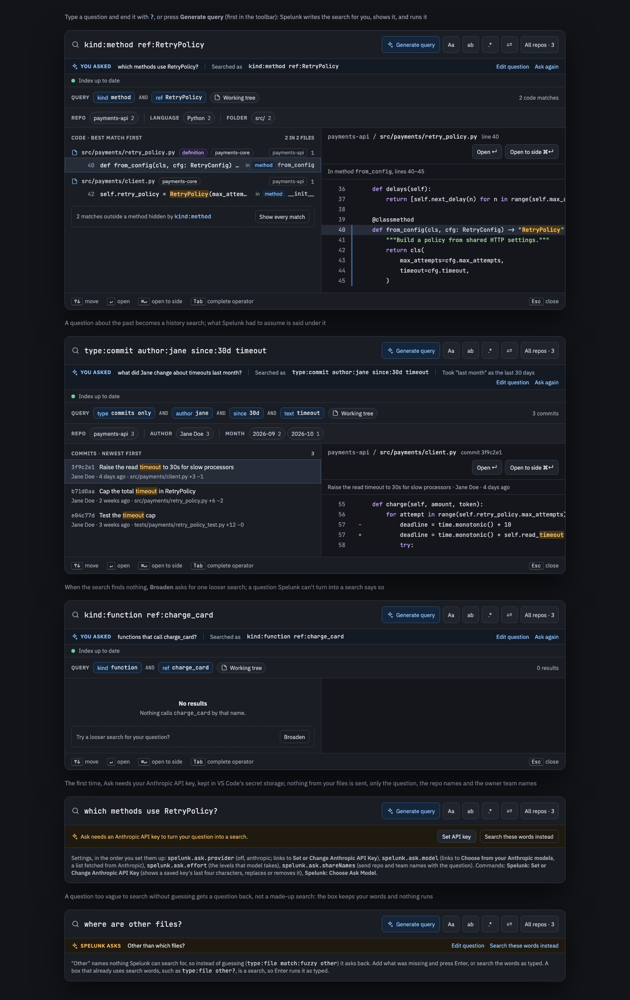
</a>

The built panel

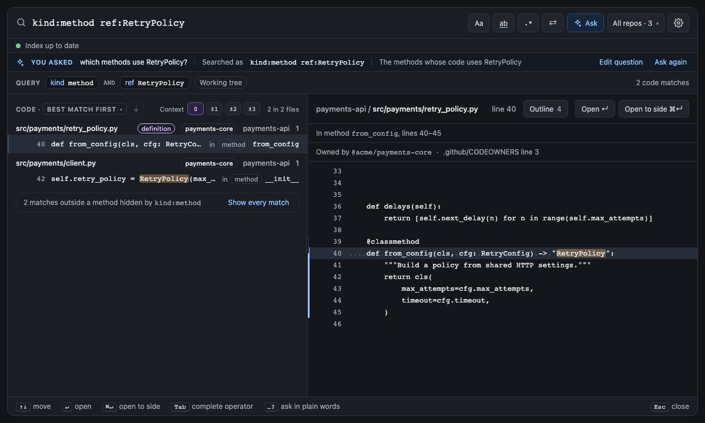

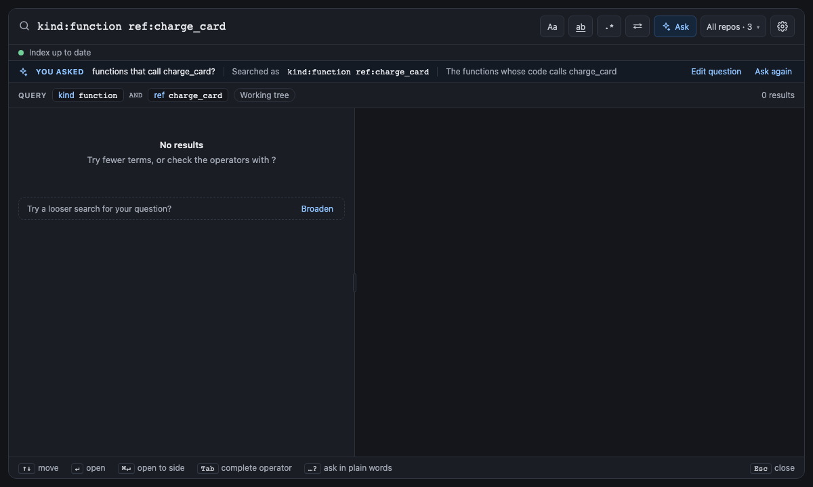

<!-- /screen -->

## Go to Symbol and Go to Definition

Spelunk also answers VS Code's own navigation, outside the panel, from the same index.

<!-- screen:editor-navigation -->
**Screen 55: Jump to a definition by name: ⌘T finds functions and classes in every repo and language; Go to Definition
and Find References can fall back to Spelunk** · Screen id `editor-navigation` · milestone 2.1

Press ⌘T (Ctrl+T), or type `#` in Quick Open, and type part of a name: **Go to Symbol in Workspace** lists the
functions, classes, interfaces and types Spelunk found in every open repo, in every language it reads, even where no
language extension is installed. Pick one and it opens at its name.

- **A few letters are enough**, in order: `retpol` finds `RetryPolicy` and `NewRetryPolicy`, as VS Code matches. Case
  doesn't matter, and spaces are ignored.
- **The best come first**: the exact name, then names that start with what you typed, then names that hold it, then
  the rest, shorter names first. At most 200 are listed; type more to narrow them.
- **Next to a language server.** Where VS Code already has one (TypeScript's, say), its results and Spelunk's are
  listed together, and a definition both find shows once.
- **Generated and vendored files are left out**, as `-is:generated -is:vendored` would (see
  [`is:`](Files-and-Repos#is)), and so is what VS Code's `files.exclude` and `search.exclude` hide.
  `spelunk.editor.includeGeneratedAndVendored` lists them too, marked **generated** or **vendored** and after the
  others; files `spelunk.index.exclude` leaves out (`vendor/` and `node_modules/` by default) aren't indexed at all.
- **The index is as of the last save**: a function you just typed shows once you save the file. While a repo is
  indexed for the first time it adds nothing, and the status bar says **Indexing**.
- `spelunk.editor.workspaceSymbols` turns this off. It needs `spelunk.index.symbols`, which keeps the definitions.

**Go to Definition** (F12) and **Find References** (⇧F12) can use the index too, with
`spelunk.editor.definitions`. It is **off** by default, because Spelunk goes by a name's spelling, not its meaning:
another `RetryPolicy` in another repo counts too, as does the name in a comment.

| `spelunk.editor.definitions` | Go to Definition and Find References |
| --- | --- |
| `off` (default) | VS Code's language servers only, as without Spelunk |
| `fallback` | Spelunk answers only when no language server does, so where one does nothing changes |
| `always` | Spelunk's answers are added to the language servers'; one both find shows once |

- **Go to Definition** finds the definitions named exactly so, case and all, like
  [`symbol:`](Definitions-and-Code-Shape#symbol)
  with the whole name. From a Go file it keeps to Go's when Go has any, so the Python and TypeScript `RetryPolicy`
  don't come too; from a language that has none, every language's are listed.
- **Find References** lists the lines that use the name as a whole word, without the lines defining it, as
  [`ref:`](Definitions-and-Code-Shape#ref) does, in the same language when it has any, at most 200.

<a href="images/mocks/EditorNavigation.png">
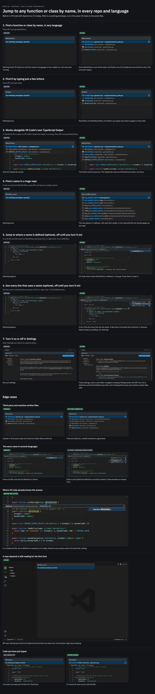
</a>

Built: ⌘T, Go to Definition and Find References

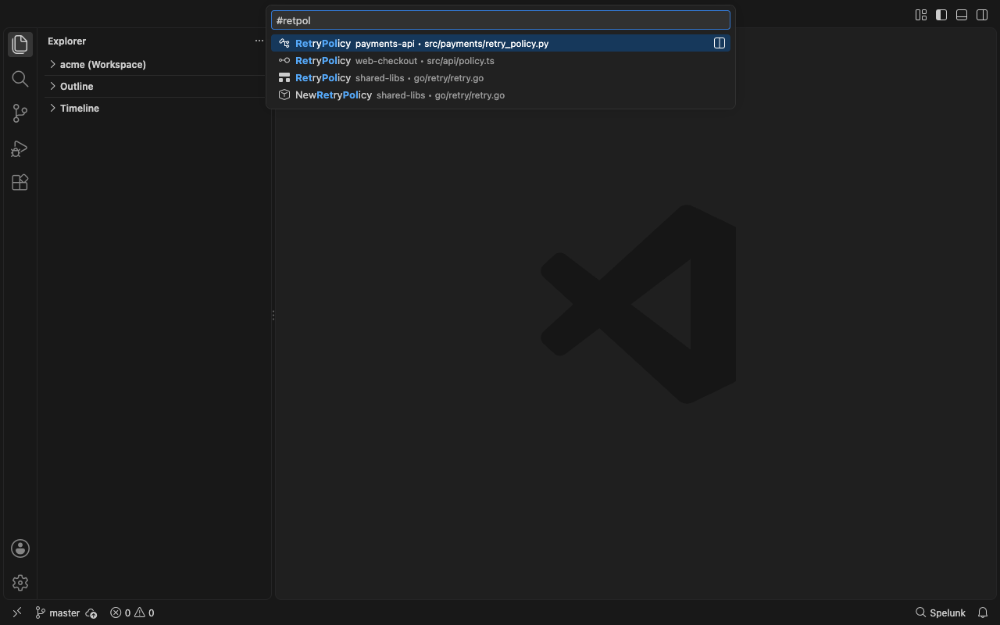

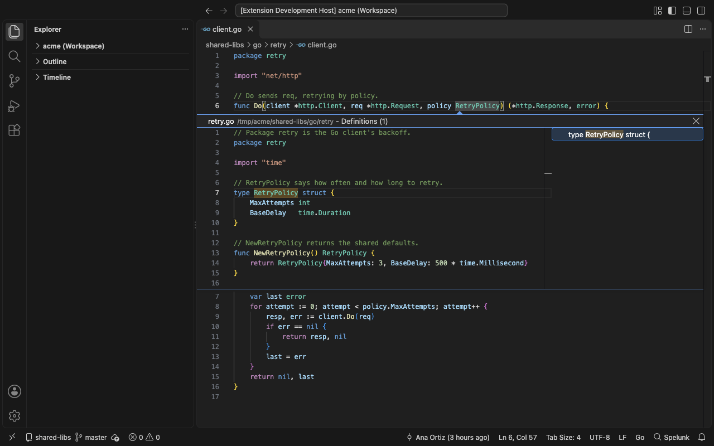

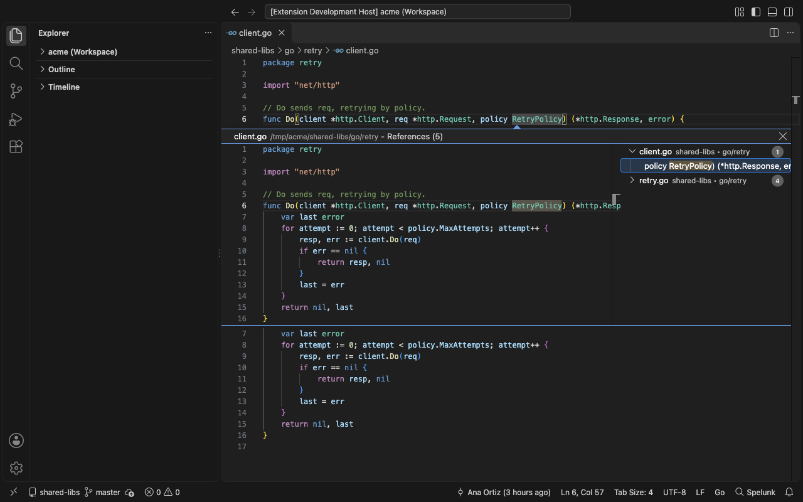

<!-- /screen -->

## The empty box

<!-- screen:empty-box -->
**Screen 4: Empty box: recent queries + operator sheet** · Screen id `empty-box` · milestone M2

<a href="images/mocks/EmptyState.png">
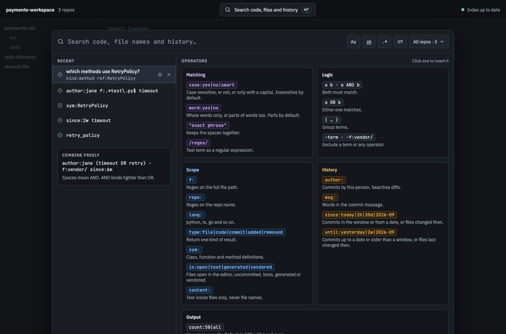
</a>

The built panel

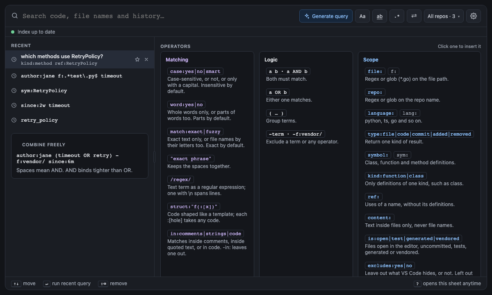

<!-- /screen -->

- **Recent queries** on the left: ↑ ↓ to pick, ↵ to run. Remove one with the **×** at the end of its row, or select it
  and press ⇧⌫. The panel remembers 20 by default (`ui.recentQueries`); lowering it forgets the oldest. A query goes
  under Recent when you open one of its results, press Esc, or run Replace, and the query left in the box when the
  window closes goes in when it opens again. A query [Ask](#asking-in-plain-words) wrote goes in as soon as it runs,
  shown under your question: its row runs the query again without asking the AI, and its ☆ names the pin after the
  question.
- **Pinned queries** above them: the **☆** on a recent query pins it and asks for an optional name (↵ saves it, Esc
  skips it). The pencil renames a pin, and the filled **★** or ⇧⌫ unpins it. Pins live in `ui.pinnedQueries`
  ([below](#pinned-queries)).
- **The bell** on a pin that searches commits watches it: new commits by others that match count on the pin
  (**2 new**) and pop up, and are tagged **New** when the query runs; ⌥W toggles it on the selected pin
  ([below](#query-watches)).
- **The operator sheet** on the right, or below the recent queries in a narrow panel: click an operator to insert it.
  Press `?` in an empty box to scroll it into view.
- **The divider** between them: drag it, or focus it and press ← →. Double-click resets it. The width is remembered.

### Pinned queries

<!-- screen:pinned-queries -->
**Screen 31: Pinned queries: star a recent query, name it, keep it on top** · Screen id `pinned-queries` · milestone 1.1

<a href="images/mocks/PinnedQueries.png">
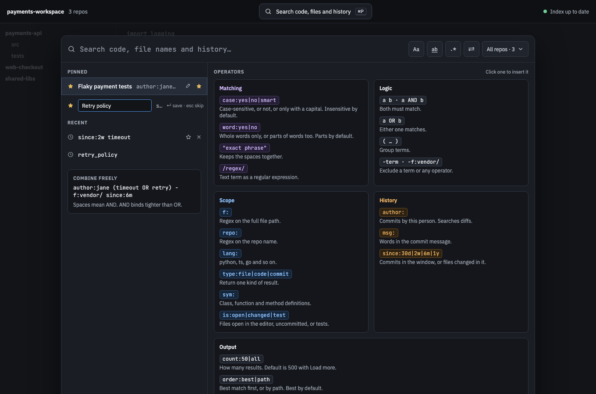
</a>

The star on a recent query pins it under **Pinned**, above the recent queries, and opens a name field: type a name
and press ↵, or press Esc to leave it unnamed. A named pin shows its name, then the query. The pencil renames a pin;
the filled star, or ⇧⌫ on the selected row, unpins it. ↑ ↓ and ↵ go through the pins first, and a pinned query isn't
listed again under **Recent**.

Pins are kept in `spelunk.ui.pinnedQueries`, so they sync with your settings. A workspace that sets it in its own
settings shares those pins with everyone who opens it, and pinning there saves to the workspace.

The built panel

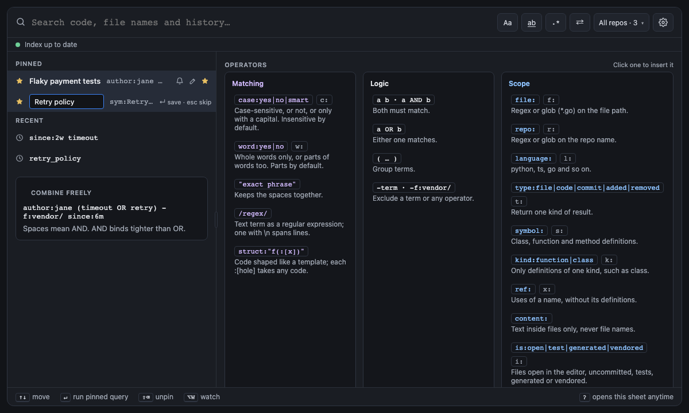

<!-- /screen -->

### Query watches

<!-- screen:query-watches -->
**Screen 38: Query watches: a bell on a pinned history query; new matching commits get a count, a notification and a New
tag** · Screen id `query-watches` · milestone 1.2

<a href="images/mocks/QueryWatches.png">
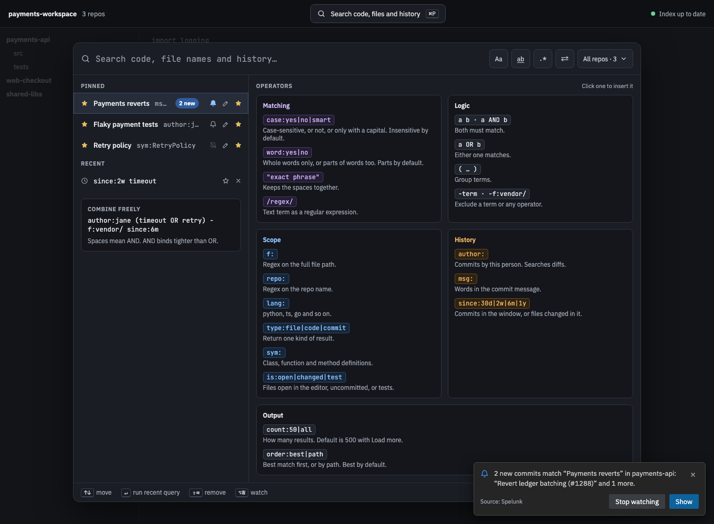
</a>

<a href="images/mocks/QueryWatches-results.png">
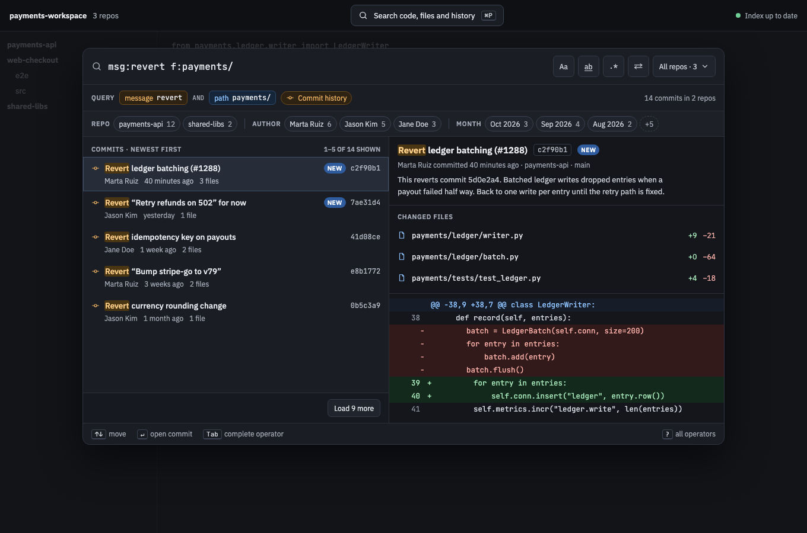
</a>

A pinned query that searches commits (it has `author:`, `msg:` or `type:commit`) gets a bell. Click it, or press ⌥W
on the selected pin, to watch the query: the bell stays lit, and whenever the history index takes in new commits (a
commit, pull or merge, checked every few seconds) the daemon runs the query over just those commits. If any match,
the pin counts them (**2 new**) and VS Code says so, naming the newest: **Show** runs the query, **Stop watching**
turns the bell off. When the query runs, by Show or from the empty box, the commits it found are tagged **New**,
and the count clears.

Only commits you haven't seen count: not your own (by the repo's `user.email`), not a repo's first read, and not the
older commits a branch switch brings back. A pin over current files gets a crossed-out bell that says why it can't be
watched. `spelunk.watch.notify` turns the notification off and keeps the count; the bell is saved as `watch: true` in
`spelunk.ui.pinnedQueries`, and the counts live in the workspace's state.

The built panel

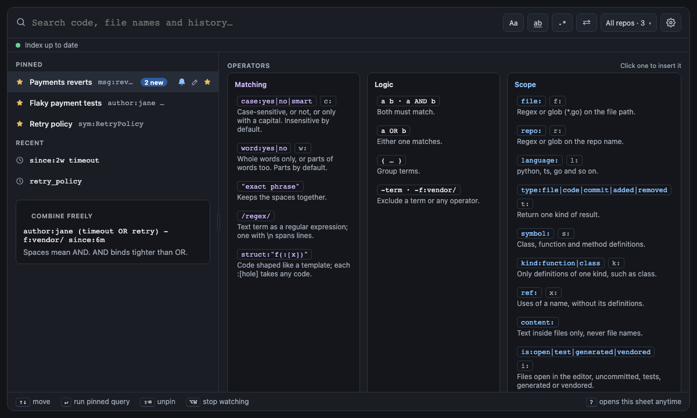

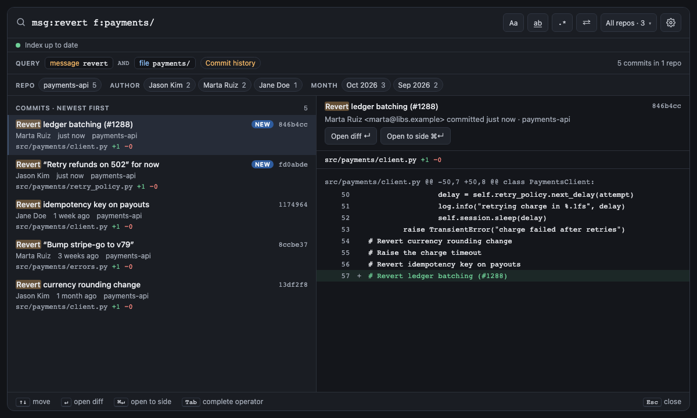

<!-- /screen -->

## While you type

| You see | What it does |
| --- | --- |
| **Suggestions** | From the first letter, matching operators (a short name such as `sym` lists its operator first). After an operator, up to 10 of its values: authors with commit counts and when they last committed, repos with their index state, languages, time windows with how many files changed, file types and folders, symbol names, commit-message words. Tab inserts one; `?` opens Help while operators are suggested (among values it is typed). See [[Autocomplete]] |
| **Chips** under the box | How the query was read, operator by operator, and whether it searches **Working tree**, **Commit history**, or the files at a revision (**At v1.0.0 · 3f9c2e1 · 14 Mar 2026**, once the search has read it) (`ui.showParsedQuery`) |
| **Aa**, **ab** and **.\*** | Toggle `case:yes`, `word:yes` (whole words only) and regex on the text. They edit the query text, so what you see is what runs (`a OR b` becomes `case:yes (a OR b)`). Under smart case (`case:smart`, or the setting) **Aa** carries a dot and is pressed when the query's capital letters made case match; clicking it writes `case:no` or `case:yes` |
| **All repos · N** | The repo menu: each repo with its index state. Pick one to scope the query (adds `repo:`, putting a query with OR at its top level in parentheses so every branch is scoped); All repos removes it |
| **Errors and warnings** | What's wrong, with fixes. ⌘. applies the first one; ⌘Z undoes it |

## Results

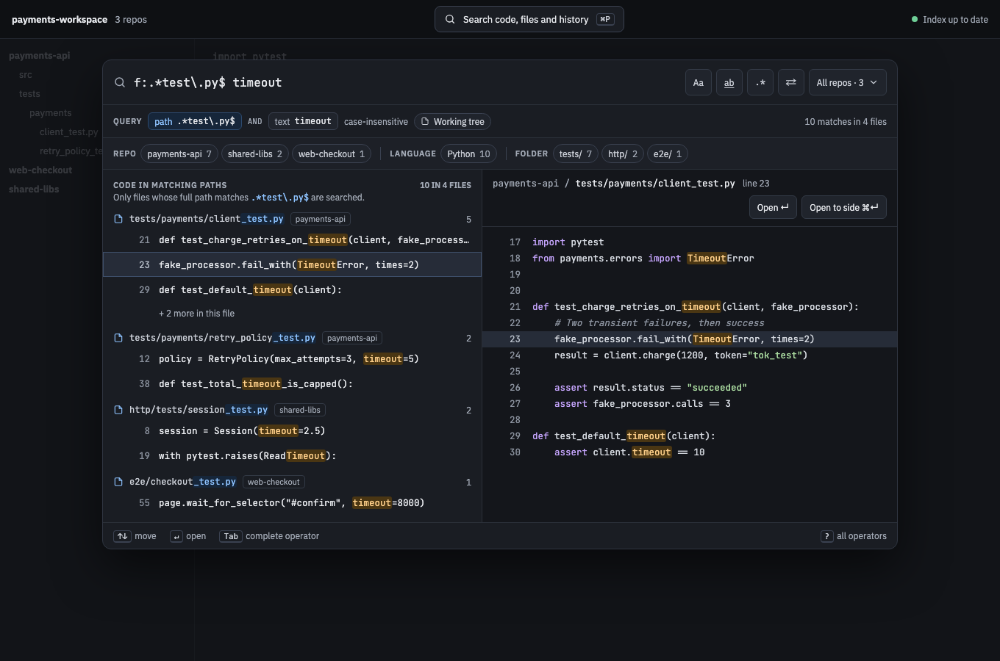

- Results are grouped: **file names**, **code** (grouped by file), **definitions**, or **commits**, each with a count.
- **The preview** sits to the right of the results in a panel wider than 640 px. In a narrower one it hides, and
  isn't read until the panel is wide enough to show it. Drag the line between them, or focus it and press ← →, to
  give either more room; double-click it to reset. The width is remembered.
- **Results stream in** as they're found. The first page holds 500 (`results.count`, or `count:`); **Load more**
  fetches the next.
- **Exact by default, file names by their letters on request.** A word matches its exact text. With `match:fuzzy` it
  also finds file names that have its letters in order, as Quick Open does, with the matched letters highlighted:
  `match:fuzzy usrsvc` finds `UserService.ts`. Without it, a note counts the names it would add, with **Show them**.
  Code lines always match exactly.
- **Best match first.** Files that define what you searched for, are open in the editor, or are named after it come
  first, then recently changed ones; tests, vendored and generated files come last. A badge says why, and
  `-is:generated -is:vendored` leaves the last two out altogether. `order:file` (or the `spelunk.results.order` setting)
  sorts by path
  instead. Commits are always newest first.
- **Context lines.** **Context 0 · ±1 · ±2 · ±3** in the Code heading shows up to three dimmed lines above and
  below each code match (`results.contextLines`, 0 by default). Matches close together share one run of lines, so
  none shows twice, and **⋯** marks the lines skipped between runs. ↑ ↓ still step from match to match. See
  [Context lines](Results-and-Ranking#context-lines).
- **Syntax colors.** Code is colored as your editor colors it, with your theme, and the preview marks whitespace as
  `editor.renderWhitespace` says. See [Syntax colors](Results-and-Ranking#syntax-colors-and-whitespace).
- Files with uncommitted edits carry an **Uncommitted changes** badge, and `is:changed` keeps only them; a result
  whose file is gone shows **No longer exists**.
- **Owners.** In a repo with a CODEOWNERS file, each result's badge names its file's owner (`payments-core +1`), the
  preview says who owns the file and which CODEOWNERS line says so, and `owner:payments-core` keeps one team's files.
  See [`owner:`](Files-and-Repos#owner).
- **Past revisions.** With `at:`, each result whose file was deleted or changed since carries a **deleted since** or
  **changed since** badge, a repo without the revision says why under the results, and the preview reads
  **v1.0.0 · read-only**. See [`at:`](Commits-and-Time#at).
- **Hidden notes** such as "3 commits hidden by `-file:vendor/` · Show them" say what each filter removed; the link
  removes the filter.
- **Facets** above the results count them by repo, language, CODEOWNERS owner and top folder (repo, author and month
  for commits).
  Click a bucket to keep only it, Alt-click to leave it out; click a pressed or struck-through bucket to take its
  filter back out. See [Facets](Results-and-Ranking#facets).

| To | Do |
| --- | --- |
| Preview a result | Click it, or ↑ ↓; after a click the keys still work from the box. When the search runs again (Esc, or a changed setting) the result you were on stays selected if it is still found, keys pressed meanwhile included. Code previews highlight every term. Commit previews show the message and the diff, with files outside `file:` behind **Show all**; a commit that matched only in its message says so |
| Open it at the match | Double-click or ↵ (`open.trigger` can make it a single click). Commits open as a read-only diff, and a result at a revision (`at:`) as the file was then, read-only |
| See what changed since a revision | **Compare with now** in the preview of an `at:` result opens a diff of the file then against the file now. It's off when the file was deleted since, or is the same now |
| Open it beside the editor | ⌘↵. The panel stays open |
| Open the file at a line in the preview | Double-click a word in a code preview: the file opens beside the editor with that word selected, at its line and column; a double-click on a line number opens at the start of that line. The panel stays open, and a single click or a drag still just selects text. Commit diffs don't open this way |
| See the file's definitions | **Outline** in a code preview's header. See [The Outline](#the-outline) |
| Share it | Right-click it: copy it, its path or its link on GitHub, copy or export every result, or copy a link to the search. See [Sharing a result](#sharing-a-result) |
| Step through results later | F4 and ⇧F4, except where VS Code's Search or References lists have the focus. The status bar says "Opened from search · result 2 of 5"; click it to go back |
| Close the panel | Esc. The query and results are kept |

### Opening a result

<!-- screen:opened-file -->
**Screen 16: Double-click opens the file at the match** · Screen id `opened-file` · milestone M5

<a href="images/mocks/OpenedFile.png">
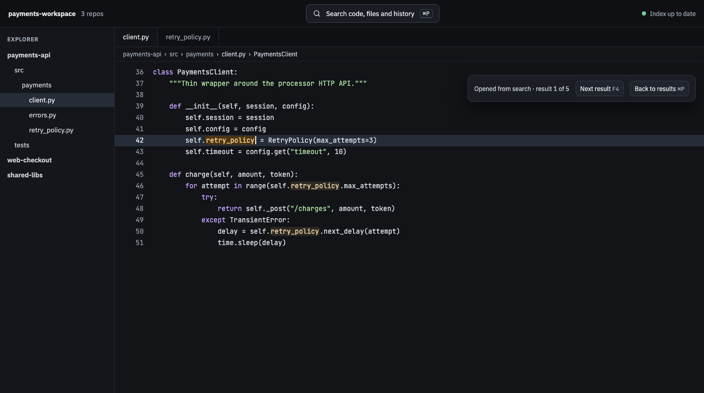
</a>

<!-- /screen -->

After you open a result the panel hides (`open.closeOnOpen`), except when opened to the side.

### Sharing a result

<!-- screen:share-result -->
**Screen 53: Result menu: right-click a result to copy it, its path, its link on GitHub (or GitLab, Bitbucket, Gitea,
Azure DevOps), every result, or a link to the search** · Screen id `share-result` · milestone 2.1

Right-click a result for VS Code's own menu, made for results: VS Code's Cut, Copy and Paste, which act on text, are
left off.

| Item | Copies, or does |
| --- | --- |
| **Open**, **Open to the Side** | Opens the result, as ↵ and ⌘↵ do |
| **Copy** | The path, line and code: `src/payments/client.py:46: for attempt in range(3):`. A file name copies its path |
| **Copy Path**, **Copy Relative Path** | The file's full path, or its path from the workspace folder, then the line: `src/payments/client.py:46`. ⌥⌘C and ⇧⌥⌘C copy the selected result's, as in VS Code's Explorer |
| **Copy SHA**, **Copy SHA and Subject** | On a commit: `4421bd6…`, or `4421bd6 Retry charges with the shared retry_policy` |
| **Copy GitHub Permalink**, **Open on GitHub** | The result's address on its repo's host: the line in the file, a match over lines as a range, a file name as the whole file, a commit as its page. The items name the host: GitHub, GitLab, Bitbucket, Gitea or Azure DevOps |
| **Copy All Results** | The results loaded so far, one per line; it says "the 50 shown of 1,240" when the search found more |
| **Export Results** | Text, Markdown, CSV or JSON, to a file you pick: every result, up to 10,000, the last three linking each to its permalink |
| **Copy Link to This Search** | `vscode://spelunk.spelunk/search?q=retry_policy`. Whoever clicks it gets Spelunk open in VS Code on the same query, over their own repos |

A permalink points at a commit the remote has, so it keeps working when the file changes:

- **Your edits above the line** that aren't pushed yet move it on disk; the link points at the line it is on in the
  newest pushed commit, the same code.
- **The line itself changed** and isn't pushed, or the commit is only on your machine: choosing the item copies
  nothing and says why. It works again once you push.
- **A file renamed** since links to its old path. A workspace folder inside a bigger repo links with the folder's path
  in front.
- **No remote**, or not a Git repository: the link items are greyed out. Paths still copy.
- **Several remotes**, and the branch tracks none: choosing the item asks which.
- **A server Spelunk can't place**, such as `git.acme.corp`: the first time, choosing the item asks which kind of
  server it is (GitHub, GitLab, Bitbucket, Gitea or Azure DevOps), saves the answer in your user settings
  (`spelunk.permalinks.hosts`), and copies the link. It isn't asked again. A URL's user name and token never reach a
  link.

<a href="images/mocks/Permalinks.png">
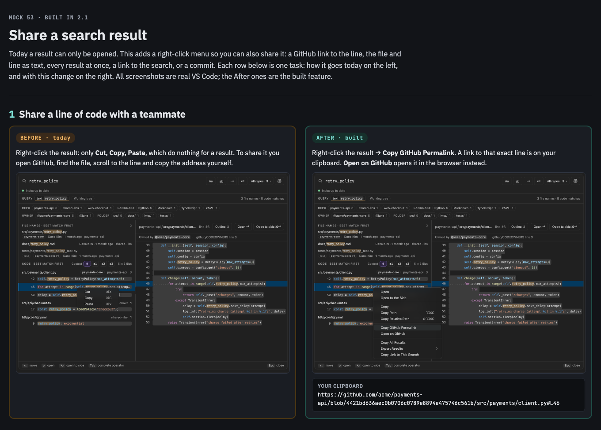
</a>

The built panel

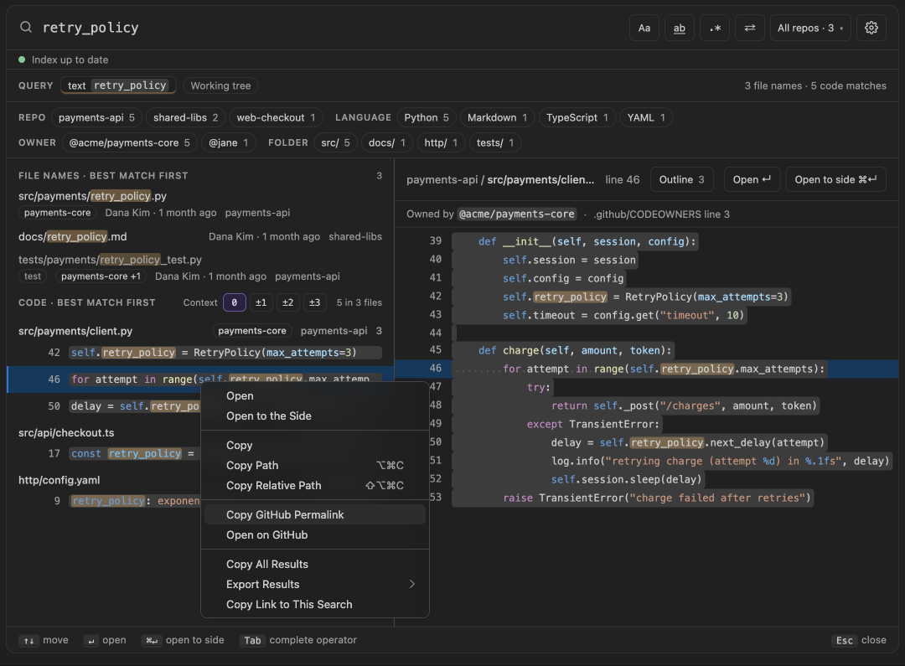

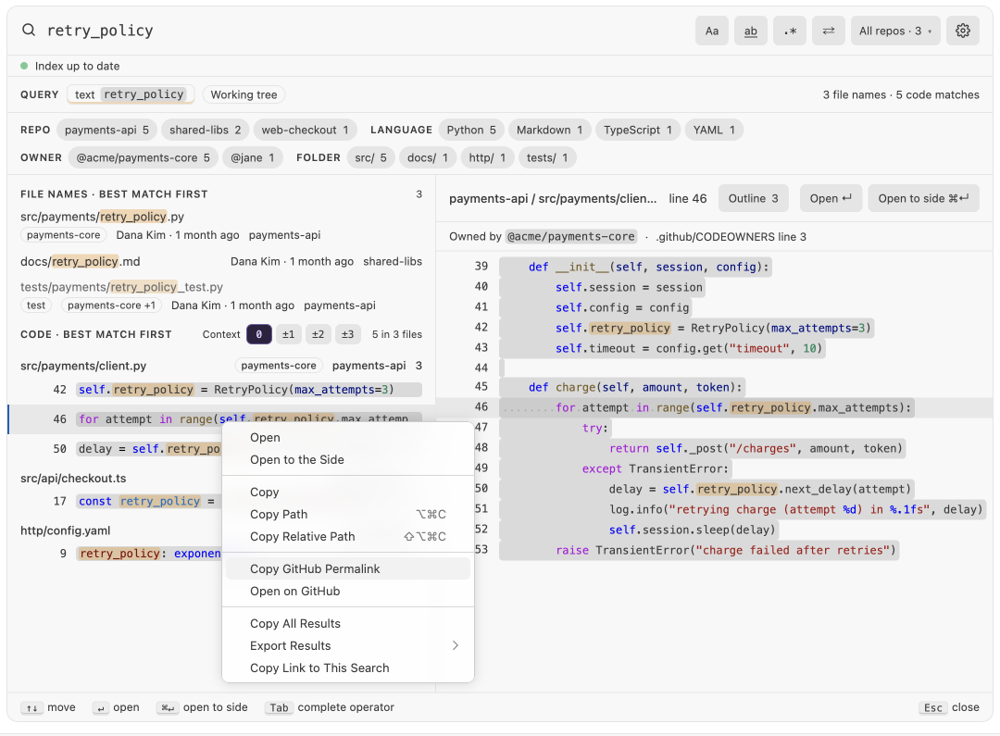

<!-- /screen -->

### The Outline

<!-- screen:file-outline -->
**Screen 44: Outline: the previewed file's definitions, members under their type, closed until opened** ·
Screen id `file-outline` · milestone 2.1

**Outline** in a code preview's header, with how many definitions the file has, opens a column beside the code that
lists them all, as VS Code's Outline does: each class, interface, type or module with its members indented under it,
a letter for its kind (**C** class, **I** interface, **T** type, **ƒ** function, **m** method) and its line. The
definition the match is in is marked. Click one to open the file beside the editor at that line; the panel stays
open. The column scrolls on its own, so a long outline never pushes the code away. Drag its left edge, or focus it
and press ← →, to widen or narrow it; double-click the edge to reset it. The width is remembered.

It's closed until you open it, and stays open or closed as you leave it, from file to file and across reloads. A file
with no definitions Spelunk can find, and a commit diff, has no Outline.

<a href="images/mocks/FileOutline.png">
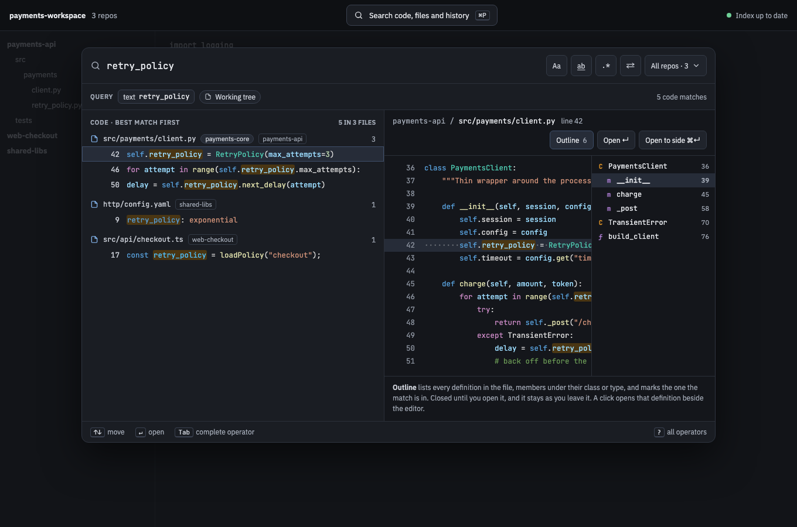
</a>

The built panel

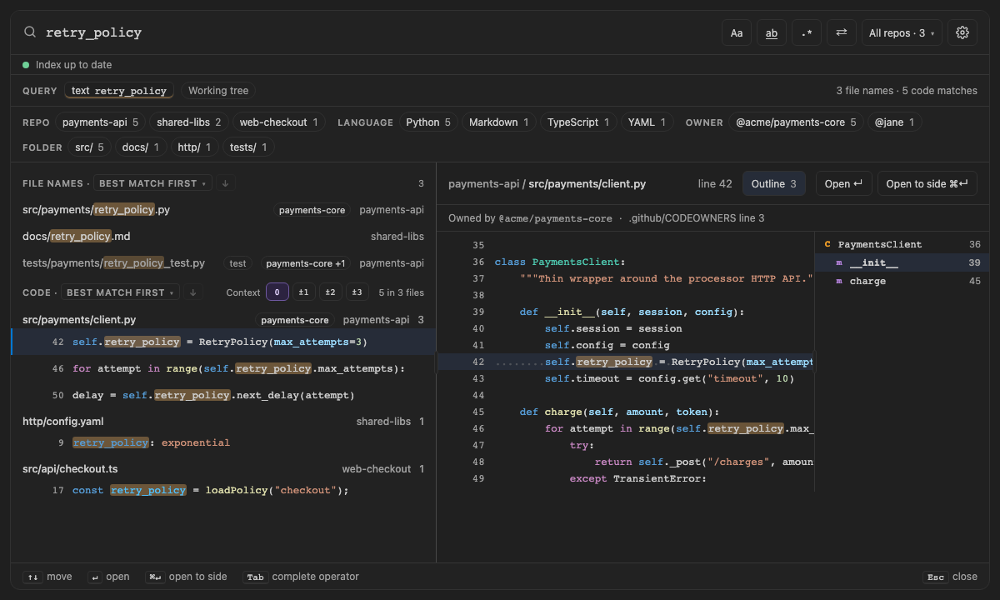

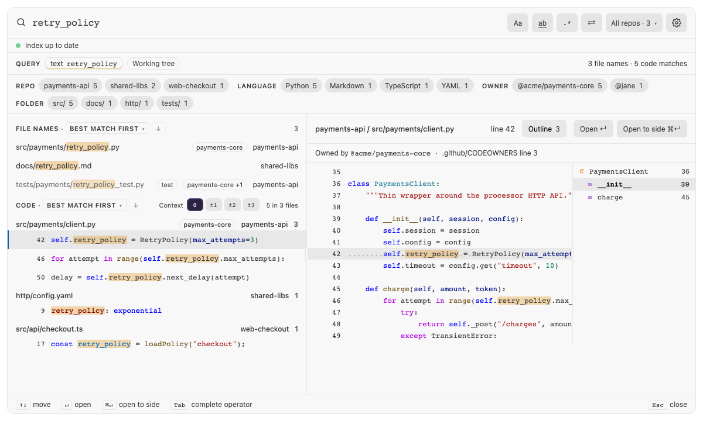

<!-- /screen -->

The definitions come from Spelunk's own index, so the Outline works in every repo and at a past revision (`at:`),
with no language extension installed. Members are found by indentation: a definition indented under a class,
interface or module belongs to it until a line as far left ends it. A Go method goes under the type its receiver
names, and a Rust method under the type its `impl` block names, when the file defines that type. A file with more than
1,000 definitions lists the first 1,000.

### Jupyter notebooks

Spelunk searches a Jupyter notebook (`.ipynb`) by what its cells say, as it searches any other file: their code and
notes, never the JSON the notebook is saved as, and never its plots and other images.

<!-- screen:notebook-cells -->
**Screen 60: Jupyter notebooks: searched by their cells, each result under its cell, opened at that cell** ·
Screen id `notebook-cells` · milestone 2.1

`retry_policy` finds five lines in `churn_model.ipynb`, each under a small **Cell 2 · Python** heading (or **Cell 1 ·
Markdown** for a note), numbered within its cell as Jupyter numbers them. The line that cell 4 printed when it ran isn't
among them: what cells print isn't searched unless `index.notebookOutputs` says so. The preview shows the notebook's
cells one after another, each under its heading and the number Jupyter shows beside a cell that ran (**[2] Cell 3 ·
Python**), and says what a cell's outputs are, such as **Output: text · not searched**. The header says **cell 3, line
1**, and the Outline lists each code cell's definitions by cell and line (**3:1**). **Open** (↵) opens the notebook in
VS Code's notebook editor, scrolled to cell 3 with `retry_policy` selected in it; a note's cell is selected and left
formatted for reading.

<a href="images/mocks/NotebookCells.png">
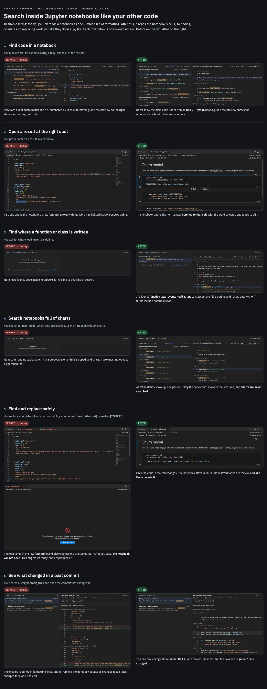
</a>

The built panel

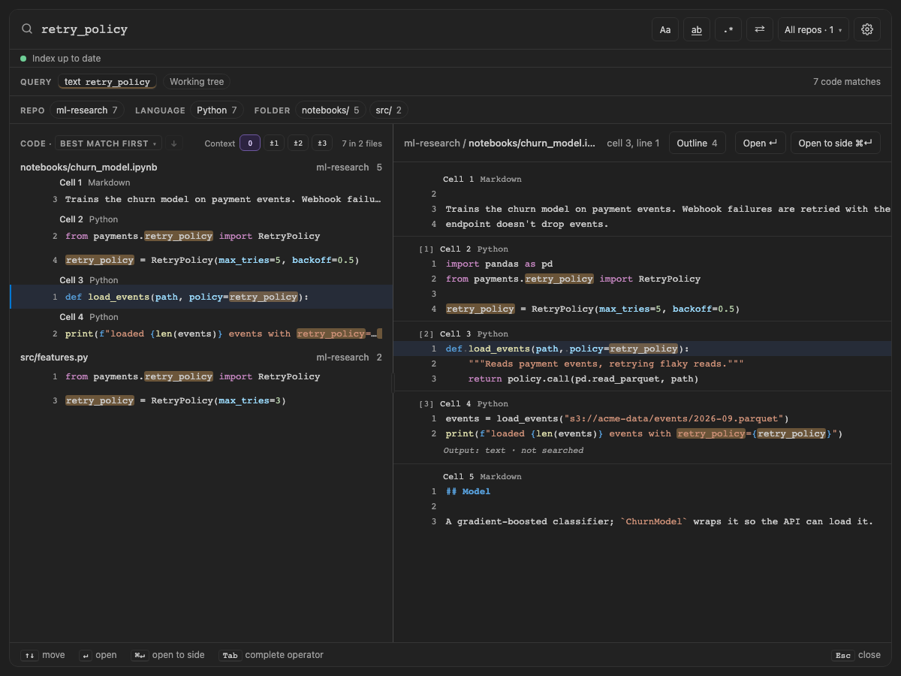

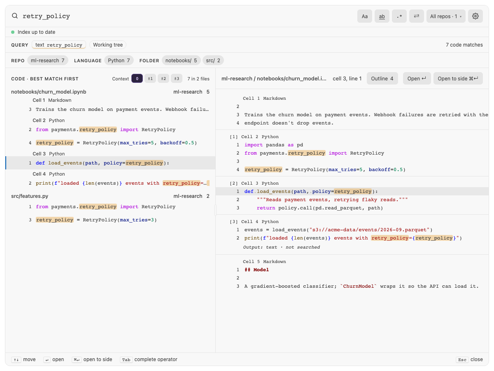

<!-- /screen -->

Everything else works on a notebook's cells as on a file's lines:

- **Definitions.** `symbol:`, `kind:` and `ref:` find the functions and classes a code cell defines, in the cell's
  language, and the Outline lists them.
- **Languages.** A notebook is in its kernel's language, so `language:python` keeps a Python notebook, and the
  Language facet counts it as Python. A cell VS Code switched to another language (`%%sql` or R, say) is colored as
  that language.
- **Size.** `index.maxFileSizeKB` counts only the cells' code and notes, not the outputs saved with them, so a
  notebook full of plots is still searched. A notebook file over 64 MB is never read.
- **Context lines and regexes** stay inside a cell: the lines around a match come from its cell, and a regex across
  lines never runs from one cell into the next.
- **Outputs.** With `index.notebookOutputs` on, the text a code cell printed or returned is searched too: a match in
  it is a result under **Cell 4 · Output**, opens with its cell selected, and Replace never changes it. Plots and
  other images never are.
- **History.** A commit diffs a notebook by its cells' source, so re-running a notebook (new outputs and run numbers)
  changes nothing a history search sees, and a one-line edit is one changed line, shown under its cell. See
  [Commits and Time](Commits-and-Time#files-or-commits).
- **Past revisions.** `at:` reads a notebook by its cells too, and opens it read-only in the notebook editor.
- A file that ends `.ipynb` but isn't a notebook Spelunk can read (one with merge conflict marks, or the old nbformat
  3) is searched as text, as before.

## Replace

<!-- screen:replace-in-files -->
**Screen 32: Replace in current files: preview every edit, then one undoable change** · Screen id `replace-in-files` ·
milestone 1.1

**⇄** (or ⌥⌘F) opens the Replace row under the box. As you type `BackoffPolicy`, every code match of
`RetryPolicy` shows struck out with its replacement after it, in the results and the preview, and the row counts
**5 matches in 3 files**. The file names that match are listed but never renamed. **Replace all** (⌘↵) changes the
code matches in one undoable edit; the files stay unsaved.

<a href="images/mocks/Replace.png">
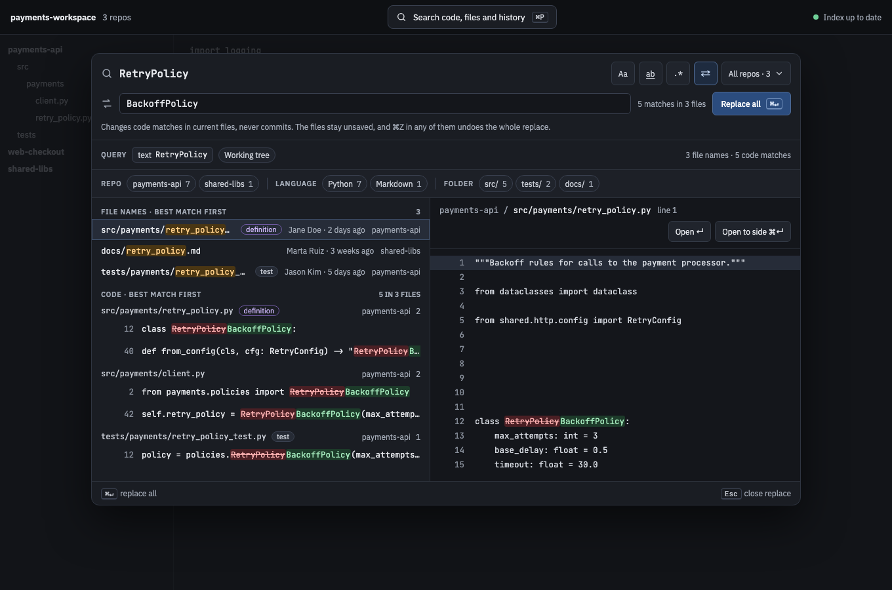
</a>

The built panel

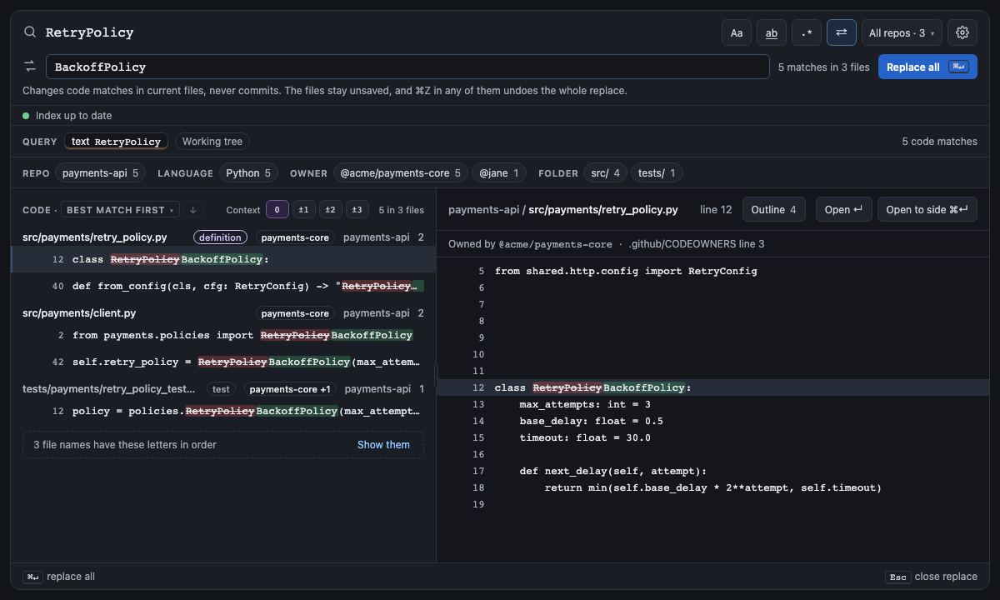

<!-- /screen -->

In a Jupyter notebook, Replace changes the cells' code and notes through VS Code's notebook editor, so the notebook
stays valid whatever the new text holds (quotes and backslashes included), and ⌘Z undoes it there. What cells printed
is never changed: running a cell writes its output.

**⇄** beside **.\*** (or ⌥⌘F, or Ctrl+H) opens the Replace row. Type the replacement, and each code match shows
struck out with its replacement after it, in the results and the preview; the row counts the matches and files.
**Replace all** (⌘↵) then changes every one of them, not just the loaded page, as one edit:

- It changes **code matches in current files** only, never commits, file names, definitions, or files at a revision
  (`at:`).
- The query needs **exactly one search term**; filters such as `file:`, `lang:` or `-word` are fine. `a OR b`
  can't be replaced, since each term would need its own replacement, and nor can a regex with `\n`, whose matches
  span lines: Replace edits one line at a time. A `struct:` template can't be replaced either: nothing yet says what
  its holes become.
- With a `/regex/` term, `$1` or `${name}` in the replacement inserts what a group matched. Otherwise the
  replacement goes in as typed.
  Use `${1}_suffix` when text follows a group number: `$1_suffix` names one capture called `1_suffix`.
  Unknown references are errors, `$0` inserts the whole match, and `$$` inserts a literal dollar sign. A defined
  optional group that did not match still inserts empty text.
- Over 10,000 matches, narrow the search first: a replace is all or nothing.
  A regex whose capture data exceeds the planning budget also asks you to narrow the search and returns no edits.
  The complete plan has a 16 MiB payload budget too: very large source lines or replacement text may require a
  narrower search or shorter replacement, even for fewer matches.
- A file whose complete source changed since it was indexed is **skipped whole**, even when the target line stayed
  the same: changing a comment opener elsewhere can change what qualifies. Notebook source-cell boundaries and
  languages are checked too. If that index included notebook outputs, changed searchable output text also invalidates
  the plan, including a first text output added since indexing; outputs still are not edited. Replace all requires
  the current preview and checks document versions immediately before applying; if the plan changed, nothing is
  replaced and the new preview shows.
- Replacement paths must still name regular files under a selected root. A file or parent directory replaced by a
  link is rejected, even if its text is identical. The path is checked again before applying and before **Save them**.
- The files are left **unsaved**: ⌘Z in any of them undoes the whole replace, and **Save them** saves them.

Esc closes the row, and the results show the search again. Closing it while Replace all runs doesn't stop the
replace; opened again, the row waits for it to finish, then previews afresh.

## Names on hover

<!-- screen:hover-labels -->
**Screen 61: Hover labels: rest the mouse on an icon and its name shows in a third of a second** ·
Screen id `hover-labels` · milestone 2.1

Rest the mouse on any icon or button in the panel and, after a third of a second, a small label says what it does:
**Replace in current files (⌥⌘F)** on ⇄, **Match case** on Aa, **Search settings** on the gear, **1 line above and
below each match** on ±1, **Pin**, **Remove from recent**, **Rename** and the bell's watch on the empty box's
queries, what a click on a facet keeps or leaves out, and so on. Move straight on to the next icon and its label
shows at once. A click, a key or a scroll puts the label away. It uses your theme's hover colors, and near the panel's
edge it moves inward so it's never cut off.

<a href="images/mocks/HoverLabels.png">
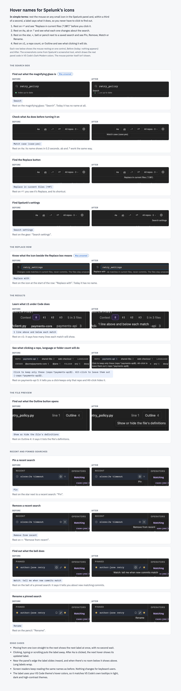
</a>

The built panel

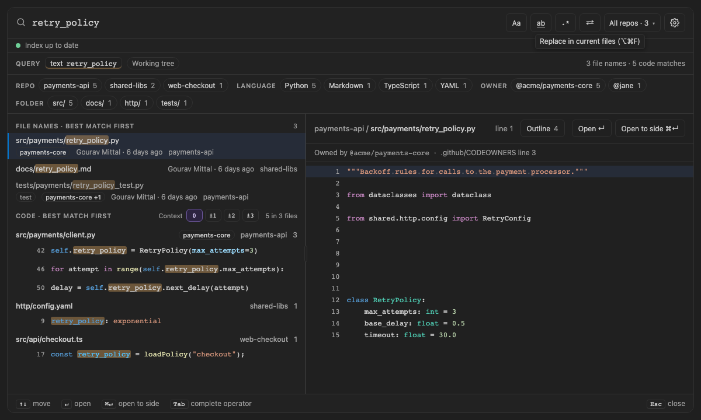

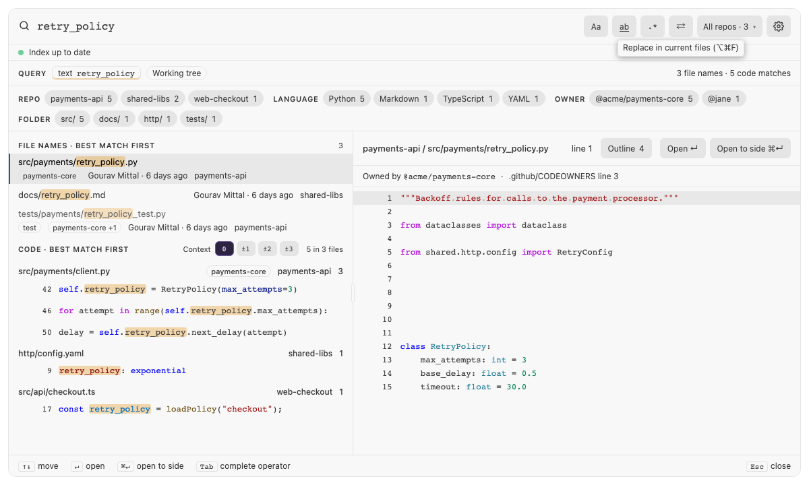

<!-- /screen -->

## Keys

| Key | Does |
| --- | --- |
| ⌘P or your chosen key | Open search |
| ↑ ↓ | Move through suggestions, pinned and recent queries, or results |
| Tab | Insert the selected suggestion |
| ↵ / ⌘↵ | Open the result / open it to the side |
| ⌘. | Apply the first suggested fix |
| ⌥⌘F or Ctrl+H | Open or close the Replace row |
| ⌘↵ (in the Replace row) | Replace all |
| ? | Show the operator sheet (in an empty box), or open Help (while operators are suggested) |
| ⇧⌫ | Remove the selected recent query, or unpin the selected pin (in an empty box) |
| ⌥W | Watch the selected pin for new commits, or stop (in an empty box) |
| F4 / ⇧F4 | Next / previous result, without reopening the panel. The Search view, a search editor, a references peek and the References view keep F4 for their own lists |
| ↑ ↓, Home, End (in the repo menu) | Move through the repos; ↵ picks one, and Tab leaves the menu |
| Esc | Close the repo menu (back to its button) or suggestions, then close the panel |

The hints along the bottom of the panel show only the keys that do something now: in an empty box, ⌥W shows on a
pin that can be watched, and ⇧⌫ says **unpin** on a pin and **remove** on a recent query.

Screen readers hear the suggestion or result ↑↓ is on (a code result with its file's path first), and, in an empty
box, the query ↵ would run.

On Windows and Linux, ⌘ is Ctrl and ⌥ is Alt.

## Help

**Spelunk: Open Help** opens a guide with every operator, worked examples (each with a **Try** button), keys
and settings. In a narrow editor the operator table turns into one card per operator, its **Try** button beside the
name.

<!-- screen:help-page -->
**Screen 17: Help guide** · Screen id `help-page` · milestone M2

<a href="images/mocks/Help.png">
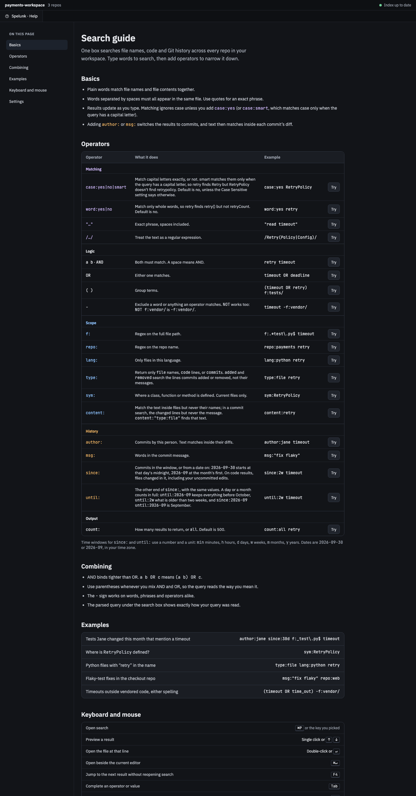
</a>

The built panel

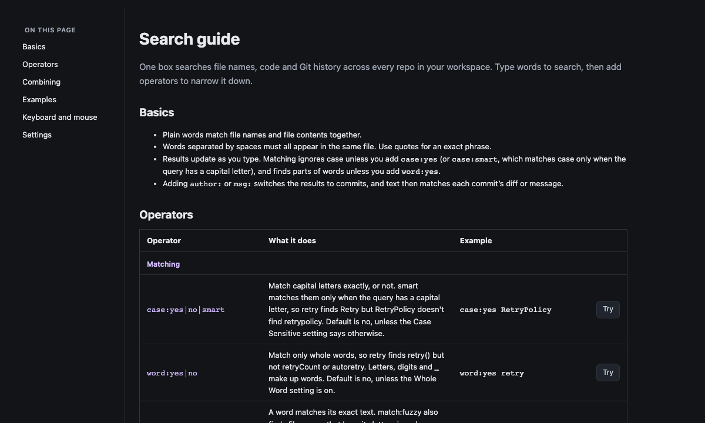

<!-- /screen -->

---

**Next:** [[Autocomplete]]: what the box suggests after each operator.
