# Words Regex and Logic

<!-- Linked screenshots and expandable previews require these HTML elements. -->
<!-- markdownlint-configure-file {"MD033": {"allowed_elements": ["a", "details", "img", "summary"]}} -->

How Spelunk matches the words you type: phrases, regexes, case, whole words, fuzzy file names, and how to combine
terms with AND, OR and NOT. Every operator is on one screen in [[Query Language]].

## Words

| Write | Matches |
| --- | --- |
| `retry policy` | The lines of files whose text has **both** words, and the files whose name has both |
| `match:fuzzy usrsvc` | Also file names that have its letters in order, like `UserService.ts` (see [Fuzzy file names](Words-Regex-and-Logic#fuzzy-file-names)) |
| `"read timeout"` | The exact phrase, spaces included |
| `/Retry(Policy\|Config)/` | A regular expression (RE2: no backreferences or lookaround) |
| `/except TransientError:\n\s*delay/` | A regex with `\n` in it: matches across lines (see [Regexes across lines](Words-Regex-and-Logic#regexes-across-lines)) |
| `struct:"backoff(:[call], tries=:[n])"` | Code shaped like the template, however it is laid out (see [Code by its shape](Definitions-and-Code-Shape#struct)) |

Matching ignores case unless you add `case:yes`, press **Aa**, or turn on the Case Sensitive setting; `case:smart`
matches case only when the query has a capital letter. A word also
matches inside longer words (`retry` finds `retryCount`) unless you add `word:yes`, press **ab**, or turn on the Whole
Word setting.

<!-- screen:plain-text-search -->
**Screen 1: Plain text: names and contents** · Screen id `plain-text-search` · milestone M1

<a href="images/mocks/Main.png">
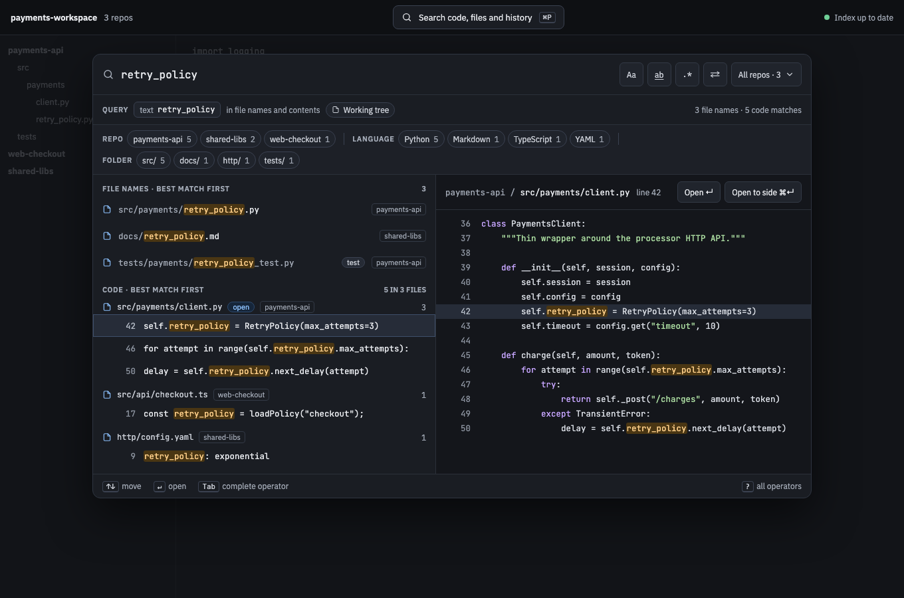
</a>

The built panel

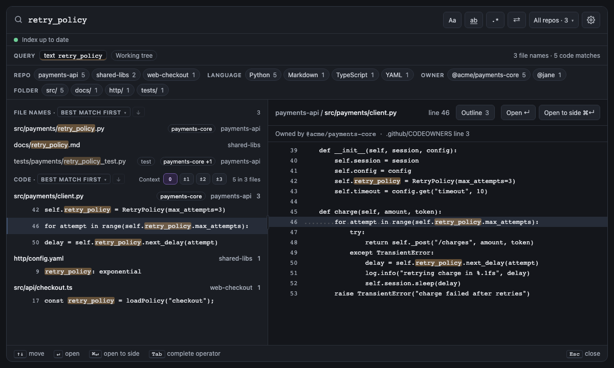

<!-- /screen -->

## Regexes

A `/regex/` is RE2, as in Go: linear time, no backreferences or lookaround, so no query can hang the search.

<!-- screen:case-regex-language -->
**Screen 8: `case:` + `/regex/` + `lang:`** · Screen id `case-regex-language` · milestone M1

<a href="images/mocks/Matching.png">
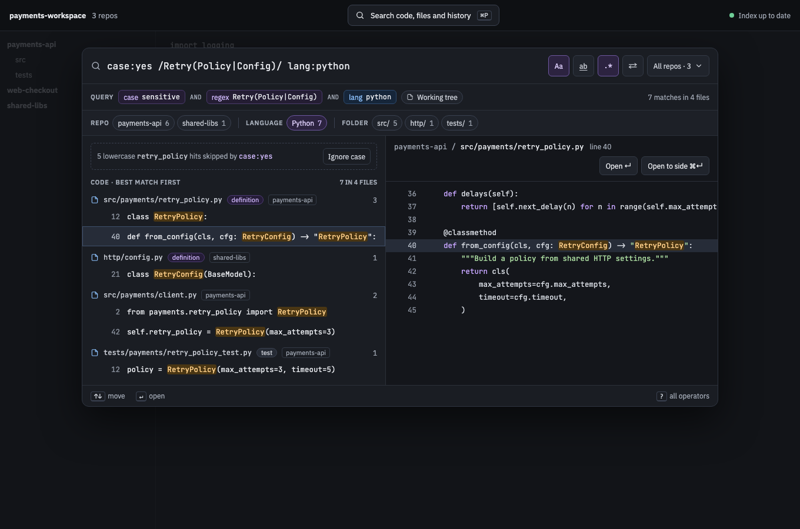
</a>

The built panel

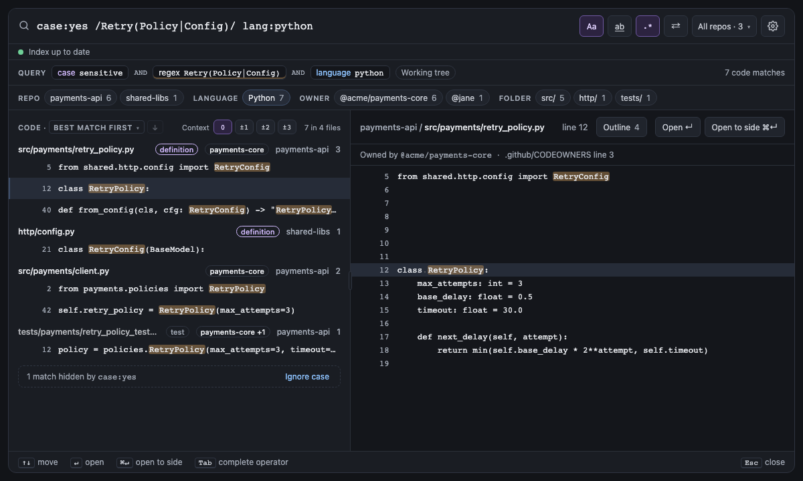

<!-- /screen -->

### Regexes across lines

A regex matches one line at a time, as in ripgrep, so `\s` and `[^x]` never run onto the next line. A regex with
`\n` in it (or `\x0a`) is the exception, as in VS Code's search: it is matched against the whole file, so
`/except TransientError:\n\s*delay/` finds an `except` whose next line sets a delay. `^` and `$` still mean the start
and end of a line, and lines that end in `\r\n` match the same as ones that end in `\n`. Each match is one result on
the line it starts, showing every line it spans (up to ten, then "14 more lines, to line 25"); matches that share a
line, or another term's match on one of its lines, join it. The preview marks the whole match and opening it selects
all of it.

It works in current files only: a commit search matches each changed line on its own, so such a regex warns there,
and Replace can't change a match across lines.

<!-- screen:multiline-regex -->
**Screen 39: Multiline regex: a regex with `\n` matches across lines, one result per match** ·
Screen id `multiline-regex` · milestone 1.2

`/@retry\(.*\)\n\s*async def/` finds the async functions decorated with `@retry`: the decorator on one line, `async
def` on the next. In 1.1 every regex matched one line at a time, so the panel said "No results". Now each match is
one result that shows both lines under their numbers, with a bar beside them, the matched part of each marked but not
its indentation, and **3 in 2 files** counts matches, not lines. The preview's header says **lines 29–30** and marks
both, and opening the result selects the whole match. A longer match shows ten lines after its first and then "⋯ 14
more lines, to line 25"; with context lines, they sit above its first line and below its last.

<a href="images/mocks/MultilineRegex.png">
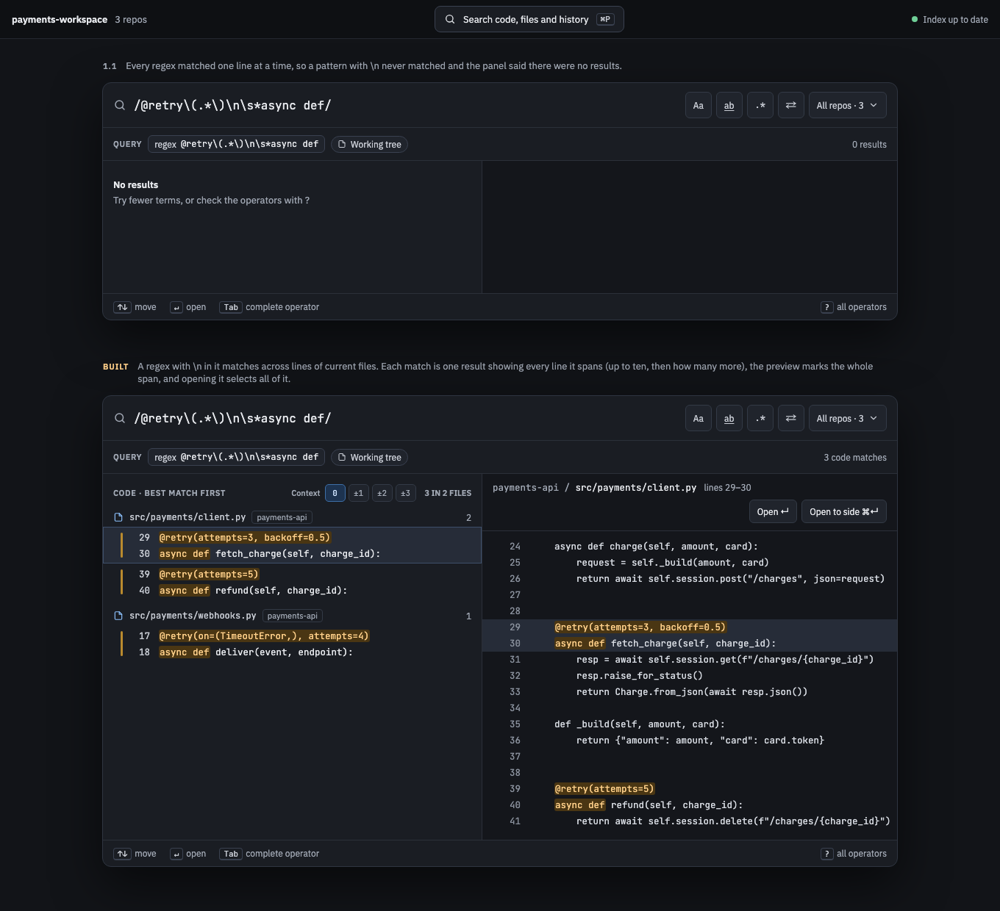
</a>

The built panel

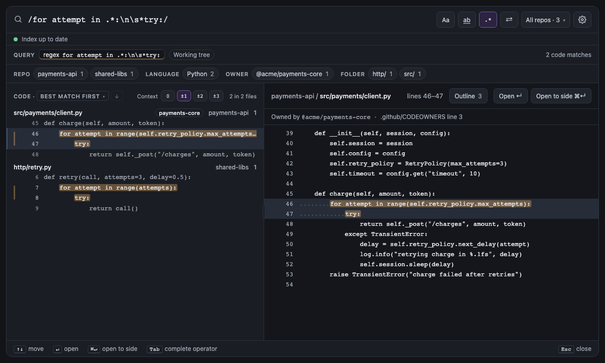

<!-- /screen -->

## `case:`

| Short | Takes | Searches | Example |
| --- | --- | --- | --- |
| none | `yes`, `no`, or `smart` (match case only when the query has a capital letter) | Current files and commits | `case:yes RetryPolicy` |

With `case:smart`, or the Case Sensitive setting on `smart`, case matches only when what you search for has a capital
letter: `retry` finds `retry`, `Retry` and `RETRY`, but `RetryPolicy` finds only `RetryPolicy`. As in ripgrep's
`--smart-case`, only the text terms and the values of `symbol:`, `ref:` and `message:` count, not filters such as
`file:` or
`repo:`. In a regex only literal letters count, so `/\W+retry/`, `/\p{Lu}/`, `/[A-Z]/` and letters after `(?i)` don't
make it match case. When smart case matches case, the panel says what that hid ("18 matches hidden by `case:smart` ·
Ignore case").

<!-- screen:smart-case -->
**Screen 29: `case:smart` matches case when the query has a capital** · Screen id `smart-case` · milestone 1.1

`case:smart Retry` matches case because `Retry` has a capital letter: `RetryPolicy` and `RetryConfig`, but not
`retry_policy` or `retry()`. **Aa** is pressed and carries a dot, which means smart case decided; its tooltip says
which way. A note counts the matches that differed only in case, with **Ignore case**, which writes `case:no`. With
the Case Sensitive setting on `smart`, a plain `Retry` looks the same, without the `case smart` chip.

<a href="images/mocks/SmartCase.png">
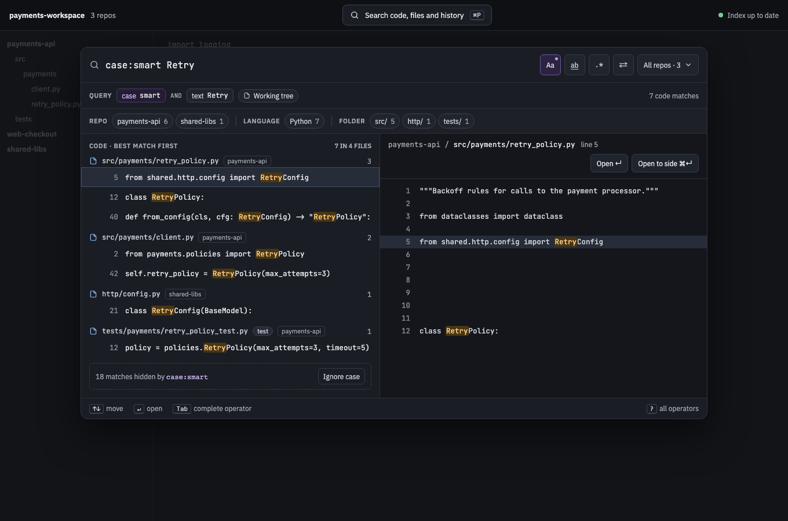
</a>

The built panel

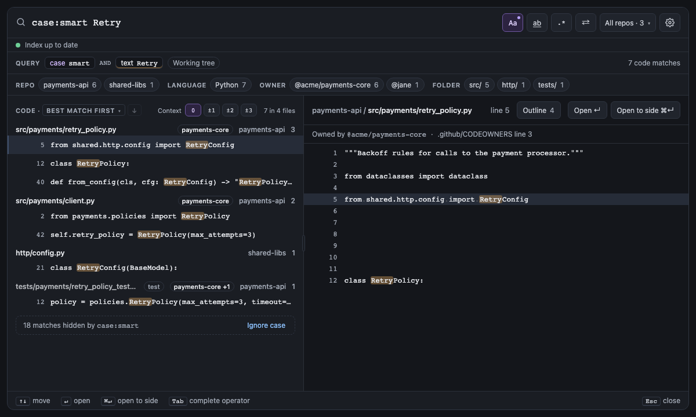

<!-- /screen -->

## `word:`

| Short | Takes | Searches | Example |
| --- | --- | --- | --- |
| none | `yes` (whole words only) or `no` (parts of words too) | Current files and commits | `word:yes retry` |

With `word:yes`, a word, phrase or regex matches only where it is a whole word: `retry` finds `retry()` and
`(retry)` but not `retryCount`, `autoretry` or `retry_policy`. Letters, digits and `_` make up words, in any
language. As in VS Code, an end of the term that is itself punctuation needs no boundary, so `word:yes foo.` finds
`foo.bar` and `word:yes ->` finds `a->b`. It applies to the words of the query wherever they match: code lines, file
names, and a commit's changed lines and message. Operator values such as `file:`, `symbol:` and `message:` are not
affected.

<!-- screen:whole-words -->
**Screen 28: `word:yes` keeps whole words** · Screen id `whole-words` · milestone 1.1

`word:yes` keeps only the matches that are whole words: `retry()` and `import retry`, but not `retry_policy.py`,
`RetryPolicy` or `autoretry`. **ab** is pressed, and a note counts the matches that were only parts of words, with
**Match parts of words** to show them.

<a href="images/mocks/WholeWords.png">
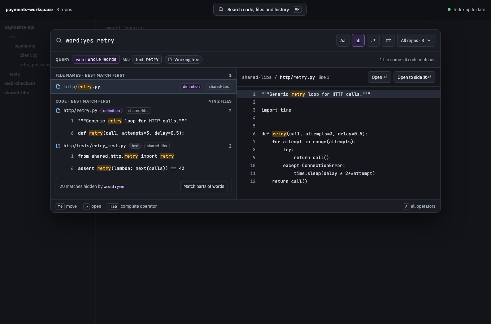
</a>

The built panel

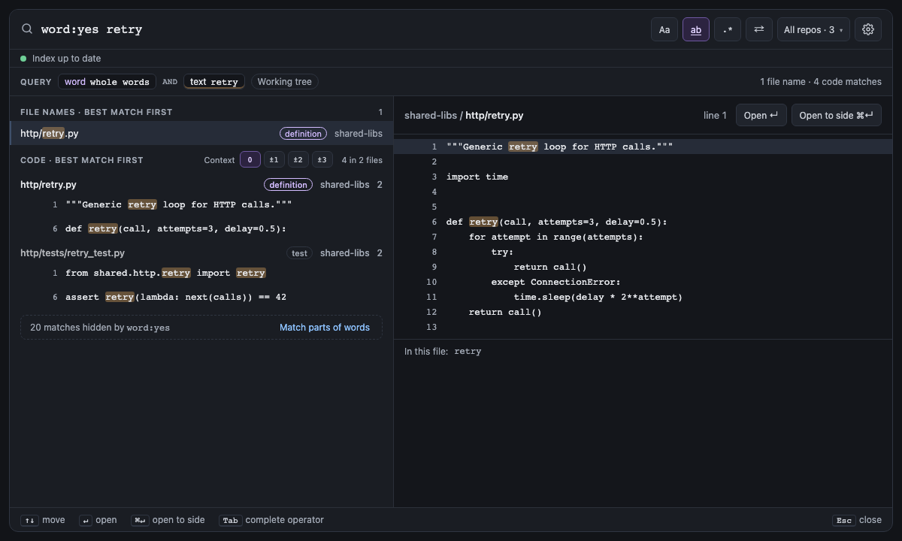

<!-- /screen -->

## Fuzzy file names

A word matches its exact text: `RetryPolicy` finds the files and lines that say `RetryPolicy`, never
`retry_policy.py`. Add `match:fuzzy` and a word also finds file names that have its letters in order, as VS Code's
Quick Open does: `match:fuzzy usrsvc` finds `UserService.ts`, `match:fuzzy rtrypol` finds `retry_policy.py`, and
`match:fuzzy cfg` finds `config.py`. The first letter must start a word
of the name (the name's start, after `_`, `-` or `.`, a capital after a lower-case letter, or a digit after a letter),
so letters scattered through unrelated names don't match. A word without a `/` matches the file's name; one with a
`/` matches the whole path, so `pay/rtry` finds `payments/retry_policy.py`. The matched letters are highlighted, and
in best-match order such a name comes after the names that contain the word, best fuzzy match first.

Only file names match this way: code lines still need the exact text. A `"phrase"`, a `/regex/`, a `-word` and any
word under `word:yes` match exactly, and `case:yes` (or smart case) makes the letters match case.

Ignoring case uses Unicode simple case folding, as text search does. Final sigma and long s share their usual
case partners; dotted capital I is not treated as ordinary `i`. Workspace-symbol search uses the same rule.

Without `match:fuzzy`, when a word would have found more file names this way a note under the results counts them,
**3 file names have these letters in order**, and its **Show them** adds `match:fuzzy` to the query (or turns a
`match:exact` into it). `spelunk.search.match` set to `fuzzy` makes every query fuzzy unless it says `match:exact`.

| Short | Takes | Searches | Example |
| --- | --- | --- | --- |
| | `exact` (a word matches its text only, the default) or `fuzzy` (file names by their letters too) | Current files | `match:fuzzy rtrypol` |

<!-- screen:fuzzy-file-names -->
**Screen 33: `match:fuzzy` finds file names by their letters in order; without it, a note offers them** ·
Screen id `fuzzy-file-names` · milestone 2.1

`match:fuzzy rtrypol` finds `retry_policy.py`, `retry_policy.md` and `retry_policy_test.py`, whose names have those
letters in order from the start of a word, the way Quick Open finds files; each matched letter is highlighted. Code
still needs the exact text. Without `match:fuzzy`, `rtrypol` finds nothing exactly, and the note under the results
says **3 file names have these letters in order** with **Show them**.

<a href="images/mocks/FuzzyNames.png">
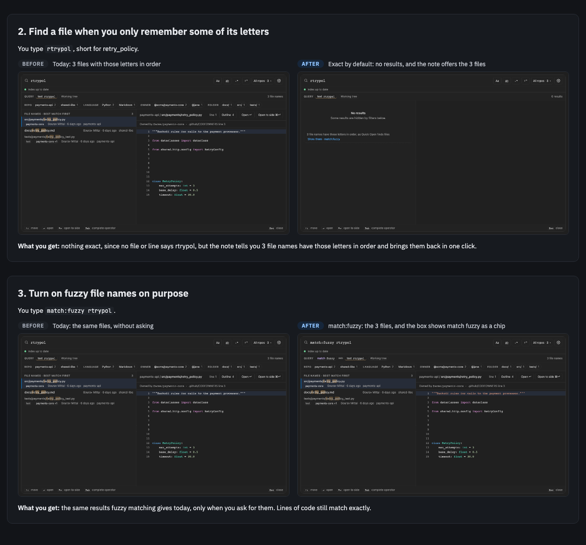
</a>

The built panel

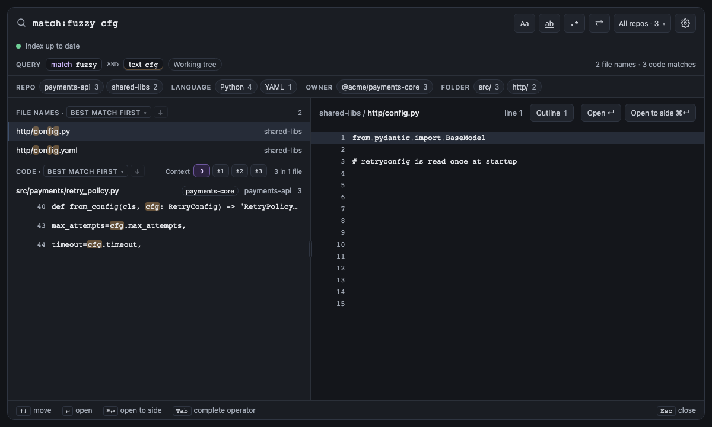

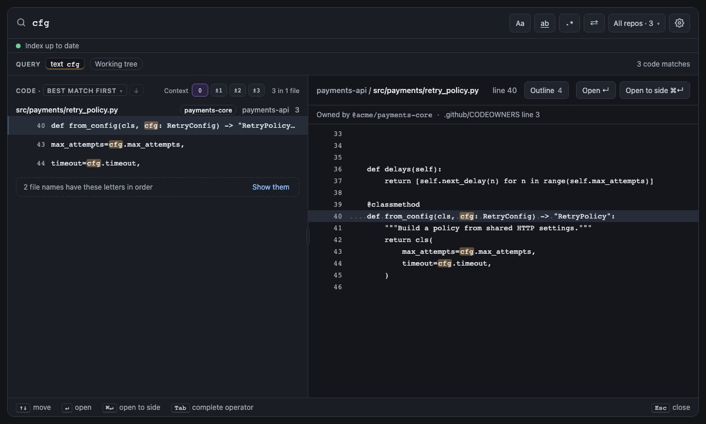

<!-- /screen -->

## `content:`

| Short | Takes | Searches | Example |
| --- | --- | --- | --- |
| none | A word, a `"phrase"` or a `/regex/` matched in file text only, never in file names or commit messages | Current files and commits | `content:retry` |

A word matches file names as well as the text inside files, but a file's name and its text are searched apart:
`main_test inputGrace` finds files whose text has both words, or whose name has both, not a file named `main_test`
that mentions `inputGrace`. Say which word is the name with `file:`: `file:main_test inputGrace`. `content:retry`
matches only the text: it lists the lines
that mention `retry` but not `retry.ts` as a file name, and in a commit search it matches the changed lines but not
the message. It is a word in every other way: it takes a `"phrase"` or a `/regex/`, counts for smart case, gets its
own highlight color, and `word:yes` applies to it. Its value is searched as written, so `content:"type:file"` finds
that text instead of reading it as an operator.

## `in:`

| Short | Takes | Searches | Example |
| --- | --- | --- | --- |
| none | `comments` (inside comments, Python docstrings too), `strings` (inside quoted text) or `code` (outside both); `-in:` leaves that place out | Current files | `in:comments retry` |

`in:` says where a match has to be. `retry in:comments` finds the notes people left about retrying and skips the code;
`"budget spent" in:strings` lands on the error message itself; `retry in:code` skips every comment and docstring that
only talks about retrying; `retry -in:comments` keeps code and quoted text. Each file is read by its language's rules,
the same ones `struct:` uses, and each match counts on its own: on `retryCount++; // retry again`, `in:comments`
marks only the second `retry`, and Replace changes only that one. The facets count only what is kept, and a note says
how many matches `in:` hid ("20 matches hidden by `in:comments` · Show them").

- **Executable interpolation.** JavaScript/TypeScript template expressions such as `${dangerCall()}` and Python
  f-string expressions count as code. Literal segments and quoted strings nested inside an expression count as
  strings, so `in:strings` replacement does not edit the executable call. Rust block comments retain nested comments.
- **C and C++ continuation lines.** Backslash-newline pairs, including CRLF, are removed logically before reading
  comments, strings and identifiers. Split comment closers cannot hide following code. Raw-string bodies retain
  their original bytes, and apostrophes in numeric digit separators remain code. Ranges still refer to the file's
  physical text. This does not expand macros, evaluate conditional compilation or translate legacy three-character
  escape sequences.
- **Repeated queries.** Immutable working-tree snapshots cache lexical regions within an 8 MiB per-shard budget.
  Changed overlays and disk loads start fresh; a full cache computes without retaining more regions.
- **Where it can go.** Like `case:`, it applies to the whole query: once, at the top level, never inside `( )` or an
  `OR` branch. Unlike the others, it can take a minus: `-in:comments`.
- **A match that crosses places**, such as `/retryCount\+\+; \/\/ retry/`, which starts in code and ends in a
  comment, is in neither: `in:comments` and `in:code` skip it, and `-in:comments` keeps it.
- **A regex across lines** counts when the whole match is in the place, such as two lines of one block comment.
- **Plain text and Markdown** are people's writing, with no code to tell apart, so every `in:` keeps their matches.
  A notebook's markdown cells are the same; its code cells are read by their language. A file in a language Spelunk
  has no comment rules for (`.xml`, `.vue`) counts as code.
- **File names and definitions.** A file's name is in no comment, so `in:` searches file text only. Definitions are
  code: `symbol:` and `kind:` work with `in:code`, and with `in:comments` or `in:strings` a warning says they can find
  nothing, as it does for `struct:` and `type:file`. Looking inside definitions works with any of them:
  `kind:function content:TODO in:comments` finds the TODO comments inside functions.
- **Excluded words follow it too.** `retry -budget in:code` leaves out only the files with `budget` in their code.
- **Current files only**, at any revision `at:` names; a commit search says so, with a fix that removes `in:`.

<!-- screen:comments-strings -->
**Screen 57: Comments, quoted text or code: `in:comments`, `in:strings` and `in:code` keep each match by where it is;
`-in:` leaves one place out** · Screen id `comments-strings` · milestone 2.1

`retry` finds file names and 29 matches across code, comments, docstrings and quoted text. `retry in:comments` keeps
the 9 in comments, docstrings and plain-text notes, the facets count only those, and a note offers the other 20. On a
line with `retry` in its code
and in its comment, only the comment's is marked, in the list and the preview, and Replace with `in:comments` changes
5 matches instead of 11.

<a href="images/mocks/CommentsStrings.png">
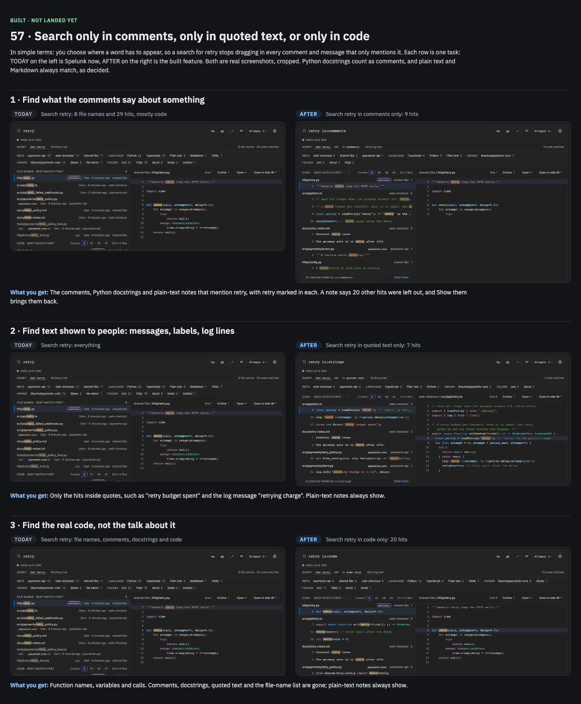
</a>

The built panel

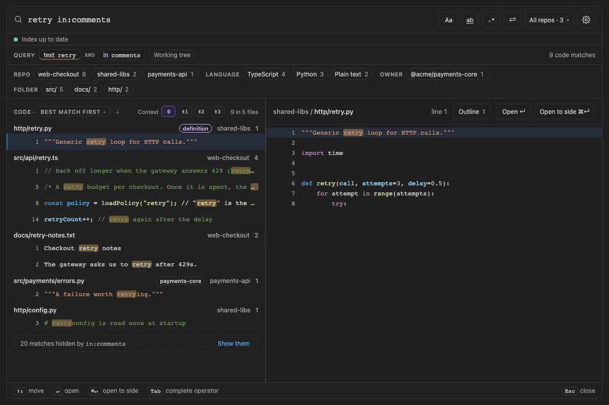

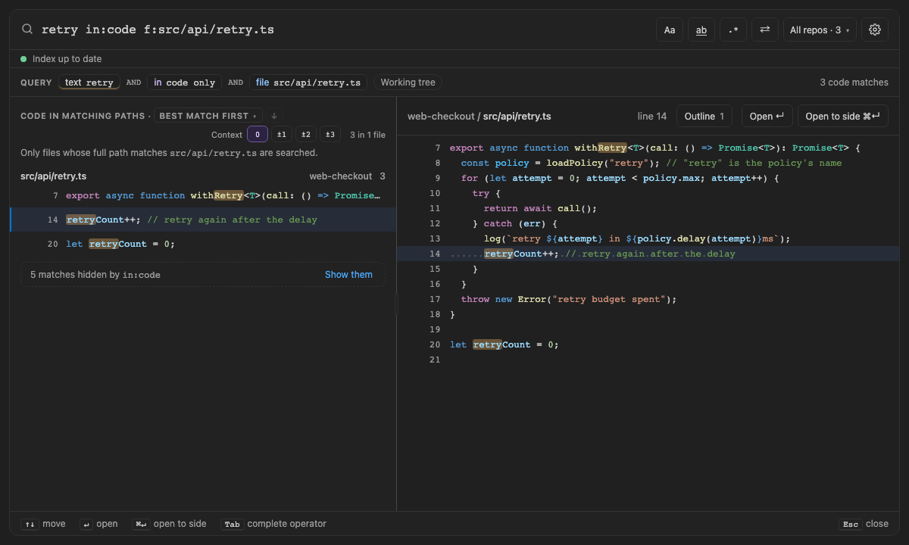

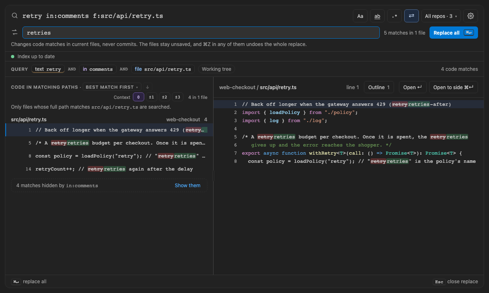

<!-- /screen -->

## Logic

| Write | Means |
| --- | --- |
| `a b` or `a AND b` | Both must match |
| `a OR b` | Either matches |
| `( … )` | Group terms |
| `-word`, `-"phrase"`, `-file:vendor/` | Exclude a word, a phrase, or anything an operator matches |
| `NOT word`, `NOT file:vendor/` | The same as `-`, spelled as GitHub and Sourcegraph do |

**AND binds tighter than OR:** `a b OR c` means `(a b) OR c`. Use parentheses whenever you mix them. A pipe inside a
plain word is just a character, and lowercase `and`, `or` and `not` are words to search for: `daemon|search` matches the
text `daemon|search`, and the panel warns and offers
`daemon OR search` or `/daemon|search/` instead.

A word left out leaves out every file whose name or text has it: `-inputGrace file:daemon/` lists neither the code
lines nor the file names of the files that mention `inputGrace`.

A `-` excludes only what starts like a word, a `"phrase"`, a `/regex/`, an operator or a group. Before punctuation it
is part of the text: `->`, `-=` and `--verbose` search for themselves.

<!-- screen:boolean-history -->
**Screen 7: AND / OR / ( ) / - / `since:` in history** · Screen id `boolean-history` · milestone M3

<a href="images/mocks/BooleanLogic.png">
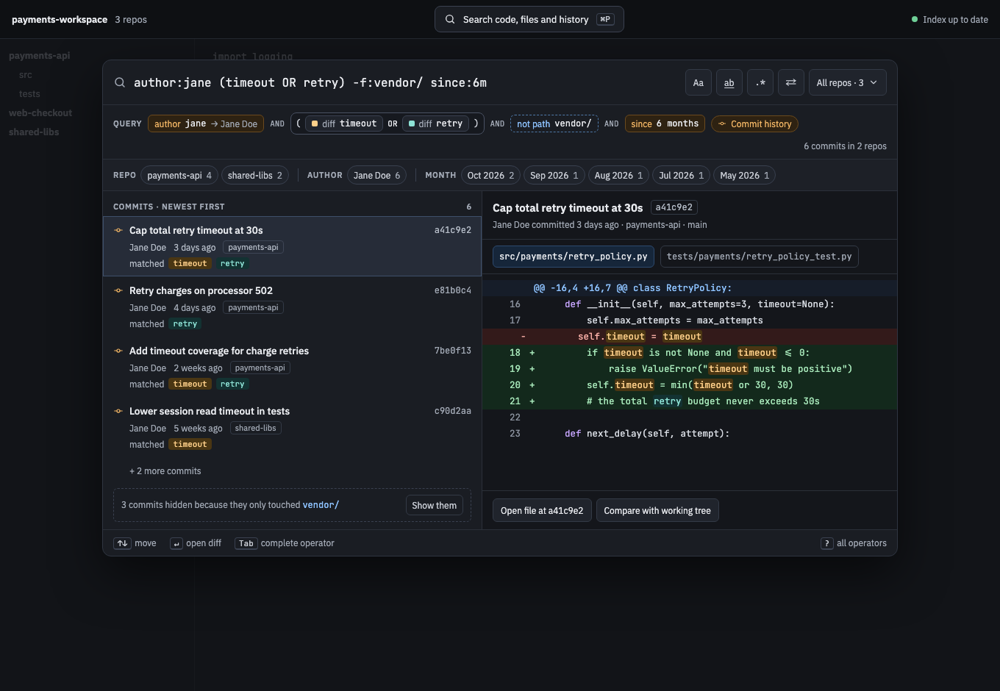
</a>

The built panel

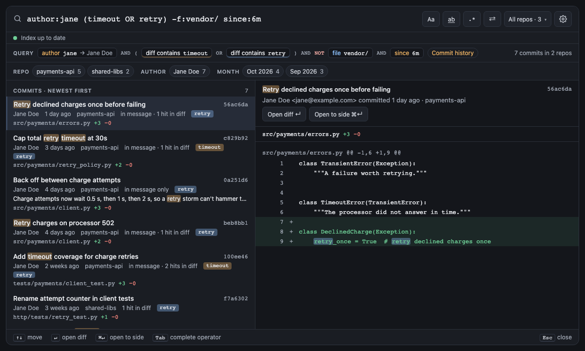

<!-- /screen -->

---

**Next:** [[Files and repos|Files and Repos]]: keep the files, repos and languages you want.
